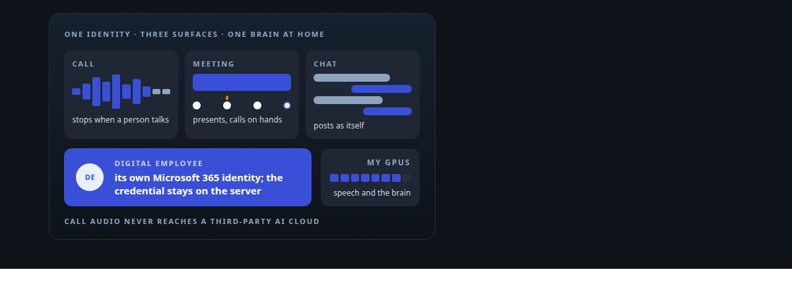
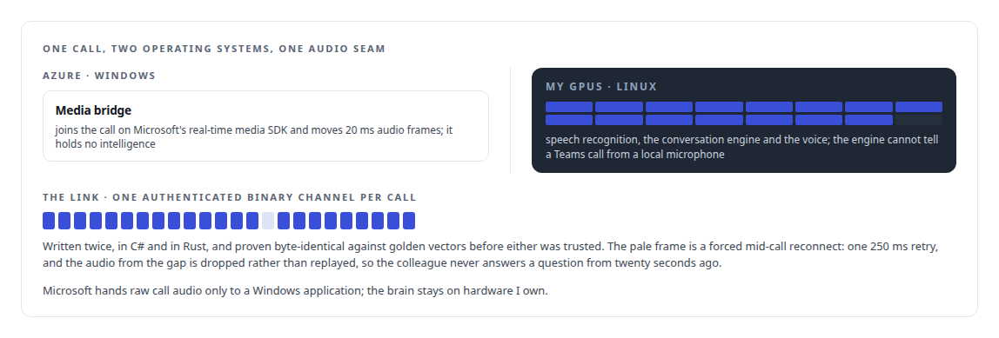
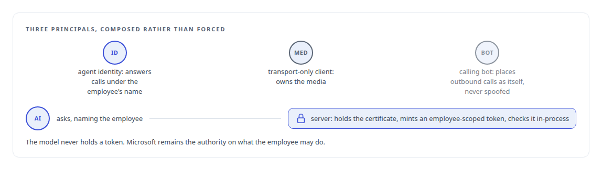
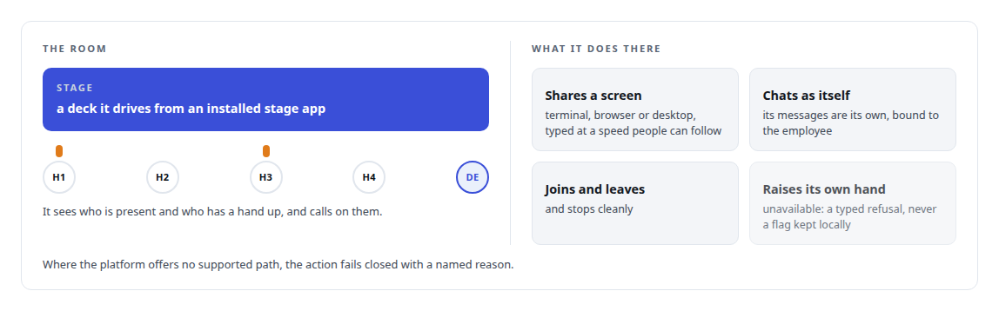

# AI teammates inside Microsoft Teams and team chat

**A colleague people can call, interrupt and invite to meetings, under an identity the organisation governs**

Canonical: https://coreyjames.ai/capabilities/ai-teammates-in-teams-and-chat/  
Author: Corey James · Published: 2026-10-28 · Kind: capability  
Systems: [Helix](https://github.com/coreyjames-ai/helix)  
Skills: [real-time voice AI](https://github.com/coreyjames-ai/portfolio/tree/main/skills/real-time-voice-ai) · [Microsoft Teams real-time media](https://github.com/coreyjames-ai/portfolio/tree/main/skills/microsoft-teams-real-time-media) · [MCP server design](https://github.com/coreyjames-ai/portfolio/tree/main/skills/mcp-server-design) · [Rust systems engineering](https://github.com/coreyjames-ai/portfolio/tree/main/skills/rust-systems-engineering)  



## Result

| Figure | What it measures |
| --- | --- |
| **30 min** | Teams media soak from Azure to my own GPUs, zero receive stalls |
| **67 ms** | round-trip media latency across the bridge at most, 65 ms at best, single probe |
| **13** | meeting actions, each with an exact schema, served under the employee's identity |

## What was built

I built a digital employee in my own Microsoft 365 tenant. It answers calls with speech models on my own GPUs, stops when a person talks over it, joins meetings and posts in chat as itself. Underneath is the real-time media bridge I built between Microsoft's Windows-only media stack and a Linux voice engine. Start with [A self-hosted colleague in a Teams call](https://coreyjames.ai/stories/a-self-hosted-colleague-in-a-teams-call).






In a meeting it is a participant, not a listener. See [Solving the digital-employee identity](https://coreyjames.ai/stories/solving-the-digital-employee-identity) and [A meeting attendee that will not fake it](https://coreyjames.ai/stories/a-meeting-attendee-that-will-not-fake-it).



> I worked out the Microsoft identity layer from real tenant evidence where the documentation ran out.

## What was verified

Each line is a claim the canonical page supports, with the figure as the page states it.

- Microsoft Teams real-time media: a Windows media bridge on Microsoft's real-time media SDK joined to a Linux voice engine on my own GPUs, through a 30-minute soak with zero receive stalls.
- Binary wire protocol design: one authenticated audio channel per call, written in C# and in Rust and proven byte-identical against golden vectors, recovering a forced mid-call reconnect in one 250 ms retry.
- Identity for AI agents in Microsoft 365 and Entra: three Microsoft principals composed into one digital employee, with employee-scoped tokens minted on the server and never held by the model.
- MCP server design: 13 meeting actions with exact schemas served under the employee's identity, failing closed with a named reason where the platform offers no supported path.
- Real-time voice AI: round-trip media latency of 65 to 67 ms across the bridge, with call audio kept off third-party AI clouds.

## Related

- [A self-hosted colleague in a Teams call](https://github.com/coreyjames-ai/helix/tree/main/stories/a-self-hosted-colleague-in-a-teams-call) · https://coreyjames.ai/stories/a-self-hosted-colleague-in-a-teams-call/
- [Solving the digital-employee identity](https://github.com/coreyjames-ai/helix/tree/main/stories/solving-the-digital-employee-identity) · https://coreyjames.ai/stories/solving-the-digital-employee-identity/
- [A meeting attendee that will not fake it](https://github.com/coreyjames-ai/helix/tree/main/stories/a-meeting-attendee-that-will-not-fake-it) · https://coreyjames.ai/stories/a-meeting-attendee-that-will-not-fake-it/
- System: [Helix](https://github.com/coreyjames-ai/helix)

## Citation

Corey James. "AI teammates inside Microsoft Teams and team chat." coreyjames.ai, 2026. https://coreyjames.ai/capabilities/ai-teammates-in-teams-and-chat/

```bibtex
@misc{coreyjames-ai-teammates-in-teams-and-chat,
  author = {Corey James},
  title = {AI teammates inside Microsoft Teams and team chat},
  year = {2026},
  howpublished = {\url{https://coreyjames.ai/capabilities/ai-teammates-in-teams-and-chat/}},
  note = {GitHub copy: https://github.com/coreyjames-ai/portfolio/tree/main/research/capabilities/ai-teammates-in-teams-and-chat}
}
```

Part of [Corey James's portfolio](https://github.com/coreyjames-ai/portfolio) · site: https://coreyjames.ai/ · MCP server: https://coreyjames.ai/mcp · agent card: https://coreyjames.ai/.well-known/agent.json
