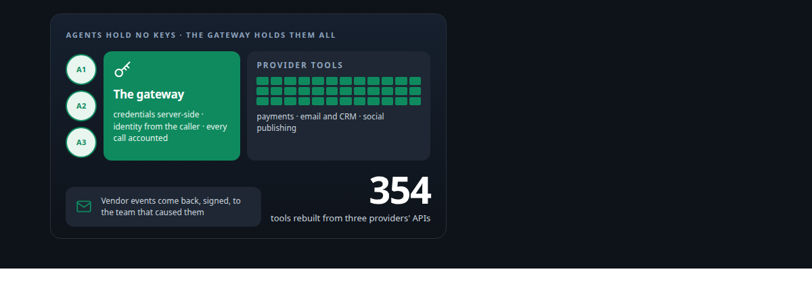
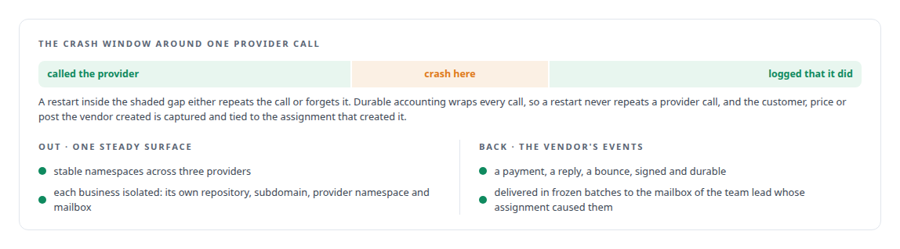
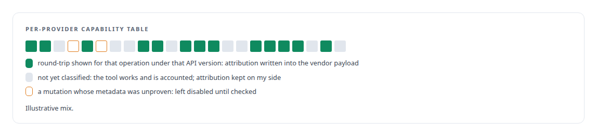
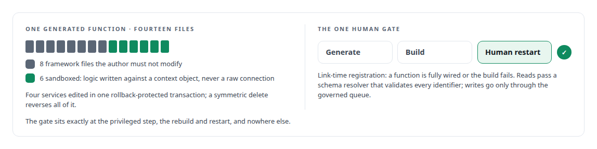

# Business systems as safe agent tools

**Agents acting on payments, email, social platforms and private APIs without holding a key, with every action attributed**

Canonical: https://coreyjames.ai/capabilities/business-systems-as-safe-agent-tools/  
Author: Corey James · Published: 2026-10-28 · Kind: capability  
Systems: [FAFOHive](https://github.com/coreyjames-ai/fafohive) · [FAFO Core and Function Forge](https://github.com/coreyjames-ai/fafo-core) · [Auth and access plane](https://github.com/coreyjames-ai/auth-and-access-plane)  
Skills: [tool synthesis and governed API integration](https://github.com/coreyjames-ai/portfolio/tree/main/skills/tool-synthesis-and-governed-api-integration) · [exactly-once delivery and crash recovery](https://github.com/coreyjames-ai/portfolio/tree/main/skills/exactly-once-delivery-and-crash-recovery) · [OAuth 2.0 and identity architecture](https://github.com/coreyjames-ai/portfolio/tree/main/skills/oauth-2-0-and-identity-architecture) · [distributed systems correctness](https://github.com/coreyjames-ai/portfolio/tree/main/skills/distributed-systems-correctness)  



## Result

| Figure | What it measures |
| --- | --- |
| **0** | provider keys held by any agent; every credential stays server-side |
| **7 of 14** | function crates in the estate carry the tool generator's fingerprints |
| **1 person** | approves every grant an outside assistant receives, on the consent screen |

## What was built

Agents that do real work against real services need credentials, and the moment one holds a credential there is a key in a transcript, actions nobody can attribute, and a crash window where a charge is doubled or lost.

I built a governed gateway that exposes provider tools, each rebuilt from the provider's API, to managed agents, with credentials held server-side and identity derived from the authenticated caller, so no tool argument can claim to be someone else. Start with [Agents with real tools and no keys](https://coreyjames.ai/stories/agents-with-real-tools-and-no-keys).






I built the substrate that turns one function definition into an orchestrated, budgeted, agent-callable tool, and a generator that lets agents write new tools inside a sandbox that becomes callable only after a human restart. See [Tools that build tools, under governance](https://coreyjames.ai/stories/tools-that-build-tools-under-governance).



And I built the access plane that lets commercial assistants connect to a private tool estate on my terms. See [The hardening fix that locked everyone out](https://coreyjames.ai/stories/the-hardening-fix-that-locked-everyone-out).

> Attribution that might be silently dropped is worse than none.

## What was verified

Each line is a claim the canonical page supports, with the figure as the page states it.

- Tool synthesis and governed API integration: payments, email and social-publishing provider APIs rebuilt as agent tools behind one gateway, with 0 provider keys held by any agent.
- Exactly-once delivery and crash recovery: durable accounting around every provider call so a restart never repeats it, and vendor events returned signed to the team that caused them.
- Attribution design for agent actions: a per-provider capability table that writes attribution into a vendor payload only where that operation was shown to round-trip it.
- Sandboxed code generation for agents: a generator emitting 8 framework and 6 sandboxed files per tool, callable only after a human restart, with 7 of 14 function crates carrying its fingerprints.
- OAuth 2.0 and identity architecture: an access plane where 1 person approves every grant an outside assistant receives, on the consent screen.

## Related

- [Agents with real tools and no keys](https://github.com/coreyjames-ai/fafohive/tree/main/stories/agents-with-real-tools-and-no-keys) · https://coreyjames.ai/stories/agents-with-real-tools-and-no-keys/
- [Tools that build tools, under governance](https://github.com/coreyjames-ai/fafo-core/tree/main/stories/tools-that-build-tools-under-governance) · https://coreyjames.ai/stories/tools-that-build-tools-under-governance/
- [The hardening fix that locked everyone out](https://github.com/coreyjames-ai/auth-and-access-plane/tree/main/stories/the-hardening-fix-that-locked-everyone-out) · https://coreyjames.ai/stories/the-hardening-fix-that-locked-everyone-out/
- [Closed by evidence](https://github.com/coreyjames-ai/agentos/tree/main/stories/closed-by-evidence) · https://coreyjames.ai/stories/closed-by-evidence/
- System: [FAFOHive](https://github.com/coreyjames-ai/fafohive)
- System: [FAFO Core and Function Forge](https://github.com/coreyjames-ai/fafo-core)
- System: [Auth and access plane](https://github.com/coreyjames-ai/auth-and-access-plane)

## Citation

Corey James. "Business systems as safe agent tools." coreyjames.ai, 2026. https://coreyjames.ai/capabilities/business-systems-as-safe-agent-tools/

```bibtex
@misc{coreyjames-business-systems-as-safe-agent-tools,
  author = {Corey James},
  title = {Business systems as safe agent tools},
  year = {2026},
  howpublished = {\url{https://coreyjames.ai/capabilities/business-systems-as-safe-agent-tools/}},
  note = {GitHub copy: https://github.com/coreyjames-ai/portfolio/tree/main/research/capabilities/business-systems-as-safe-agent-tools}
}
```

Part of [Corey James's portfolio](https://github.com/coreyjames-ai/portfolio) · site: https://coreyjames.ai/ · MCP server: https://coreyjames.ai/mcp · agent card: https://coreyjames.ai/.well-known/agent.json
