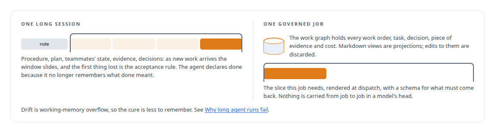
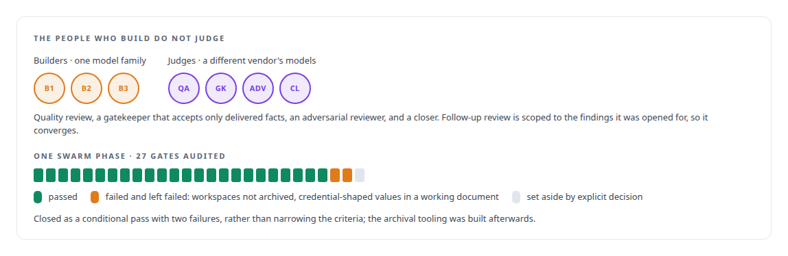
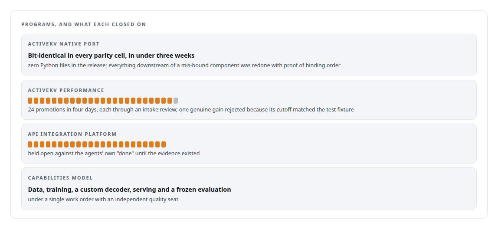

# Governed autonomous engineering

**Programs of AI coding agents that finish, prove it, and can be trusted**

Canonical: https://coreyjames.ai/capabilities/governed-autonomous-engineering/  
Author: Corey James · Published: 2026-10-28 · Kind: capability  
Systems: [AgentOS](https://github.com/coreyjames-ai/agentos) · [Agent Swarm](https://github.com/coreyjames-ai/agent-swarm)  
Skills: [C++ and native ports with parity proof](https://github.com/coreyjames-ai/portfolio/tree/main/skills/c-and-native-ports-with-parity-proof) · [agent orchestration](https://github.com/coreyjames-ai/portfolio/tree/main/skills/agent-orchestration) · [AI-assisted engineering methodology](https://github.com/coreyjames-ai/portfolio/tree/main/skills/ai-assisted-engineering-methodology) · [separation of duties for AI work](https://github.com/coreyjames-ai/portfolio/tree/main/skills/separation-of-duties-for-ai-work)  


## Result

| Figure | What it measures |
| --- | --- |
| **246** | work orders governed, including every program on this page |
| **45,097** | state transitions, each one leaving a receipt |
| **1,000+** | passing trials voided when I found they were testing the wrong thing |

## What was built

AI coding agents can carry substantial engineering only if the output can be trusted. Agents over-claim, drift as their context fills, and optimise for whatever metric is in front of them.


The method is written down and enforced by machinery I built, and work closes only on evidence.





The programs hold up. How I run them is in [Directing AI coding agents at program scale](https://coreyjames.ai/stories/directing-ai-coding-agents-at-program-scale).



> Longer prompts and more human review do not scale.

## What was verified

Each line is a claim the canonical page supports, with the figure as the page states it.

- AI-assisted engineering methodology: programs of AI coding agents under a written method enforced by machinery I built, 246 work orders governed and 45,097 state transitions each leaving a receipt.
- Agent orchestration: each job rendered at dispatch from the slice of the work graph it needs, with a schema for what must come back, so nothing is carried from job to job in a model's head.
- Separation of duties for AI work: builders from one model family judged by a different vendor's models, and a 27-gate swarm phase closed as a conditional pass with two failures rather than narrowed criteria.
- Evidence-gated acceptance: 1,000+ passing trials voided when I found they were testing the wrong thing, and a genuine gain rejected because its cutoff matched the test fixture.
- C++ and native ports with parity proof: the ActiveKV native port, bit-identical in every parity cell in under three weeks, with zero Python files in the release.
- Technical leadership of agent teams: data, training, a custom decoder, serving and a frozen evaluation for a model program under a single work order with an independent quality seat.

## Related

- [Why long agent runs fail](https://github.com/coreyjames-ai/agentos/tree/main/stories/why-long-agent-runs-fail) · https://coreyjames.ai/stories/why-long-agent-runs-fail/
- [Closed by evidence](https://github.com/coreyjames-ai/agentos/tree/main/stories/closed-by-evidence) · https://coreyjames.ai/stories/closed-by-evidence/
- [Separation of duties for AI work](https://github.com/coreyjames-ai/agentos/tree/main/stories/separation-of-duties-for-ai-work) · https://coreyjames.ai/stories/separation-of-duties-for-ai-work/
- [Directing AI coding agents at program scale](https://github.com/coreyjames-ai/agentos/tree/main/stories/directing-ai-coding-agents-at-program-scale) · https://coreyjames.ai/stories/directing-ai-coding-agents-at-program-scale/
- System: [AgentOS](https://github.com/coreyjames-ai/agentos)
- System: [Agent Swarm](https://github.com/coreyjames-ai/agent-swarm)

## Citation

Corey James. "Governed autonomous engineering." coreyjames.ai, 2026. https://coreyjames.ai/capabilities/governed-autonomous-engineering/

```bibtex
@misc{coreyjames-governed-autonomous-engineering,
  author = {Corey James},
  title = {Governed autonomous engineering},
  year = {2026},
  howpublished = {\url{https://coreyjames.ai/capabilities/governed-autonomous-engineering/}},
  note = {GitHub copy: https://github.com/coreyjames-ai/portfolio/tree/main/research/capabilities/governed-autonomous-engineering}
}
```

Part of [Corey James's portfolio](https://github.com/coreyjames-ai/portfolio) · site: https://coreyjames.ai/ · MCP server: https://coreyjames.ai/mcp · agent card: https://coreyjames.ai/.well-known/agent.json
