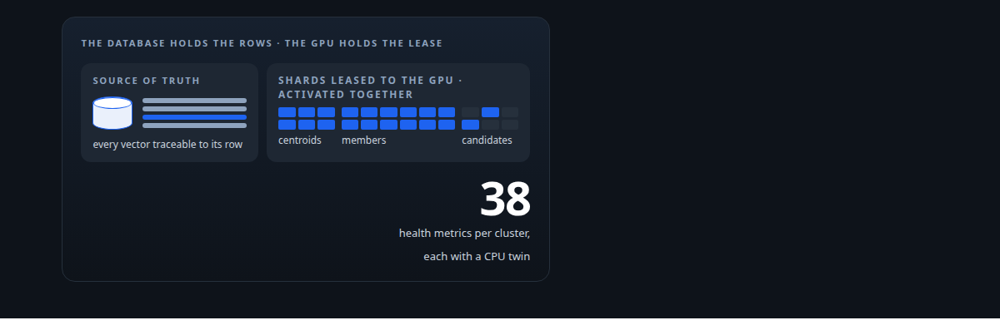
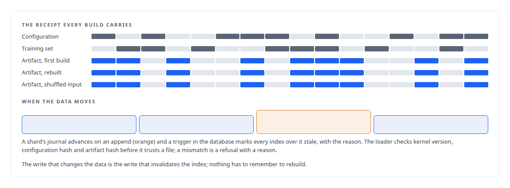
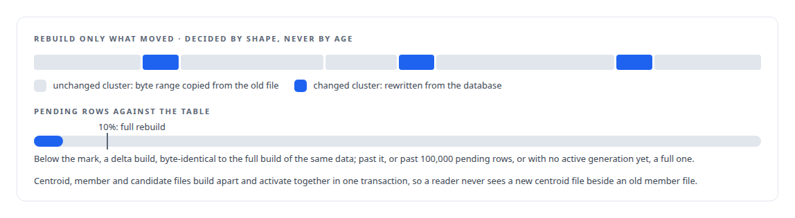
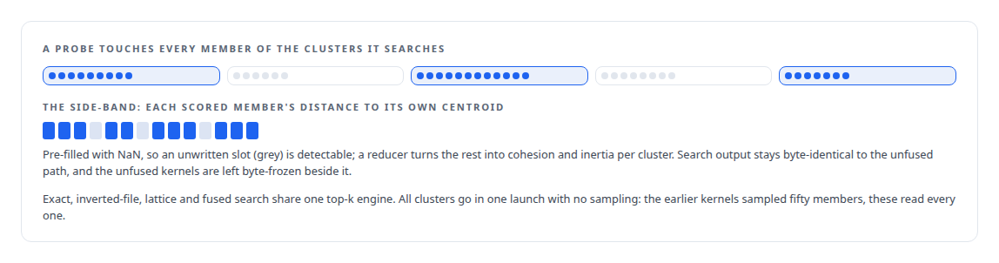

# GPU vector search and corpus analytics

**Vectors that stay out of the database yet verifiably tied to it, searched and scored on the GPU**

Canonical: https://coreyjames.ai/capabilities/gpu-vector-search-and-corpus-analytics/  
Author: Corey James · Published: 2026-10-28 · Kind: capability  
Systems: [Inference Fabric](https://github.com/coreyjames-ai/inference-fabric)  
Skills: [vector search and ANN indexes](https://github.com/coreyjames-ai/portfolio/tree/main/skills/vector-search-and-ann-indexes) · [CUDA kernel development](https://github.com/coreyjames-ai/portfolio/tree/main/skills/cuda-kernel-development) · [embedding analytics and cluster metrics](https://github.com/coreyjames-ai/portfolio/tree/main/skills/embedding-analytics-and-cluster-metrics) · [AI-assisted engineering methodology](https://github.com/coreyjames-ai/portfolio/tree/main/skills/ai-assisted-engineering-methodology)  



## Result

| Figure | What it measures |
| --- | --- |
| **0.85** | recall at ten against exact search, the inverted-file floor asserted in continuous integration |
| **10⁻⁴** | relative tolerance between every kernel and its CPU reference |
| **~100 s** | to rebuild the GPU files from four million rows, the cost a delta build avoids |

## What was built

Embeddings are often too large and too hot for the relational database, and the moment they leave it there is no way to say which row a vector belongs to, or whether the index being searched is any good.

I built vector storage leased to the GPU that stays verifiably tied to its relational source, with index-quality reporting so retrieval health is visible. See [An index you can rebuild from its receipt](https://coreyjames.ai/stories/an-index-you-can-rebuild-from-its-receipt) and [The database decides when an index goes stale](https://coreyjames.ai/stories/the-database-decides-when-an-index-goes-stale).






Under it is a CUDA engine written from Rust against the driver API for the newest NVIDIA architecture, with a CPU reference and equivalence tests for every kernel, and exact, inverted-file and lattice search. The design is one of my filed inventions, [Family Four](https://coreyjames.ai/research/family-four-self-verifying-vector-substrate/).



> A GPU kernel that computes a statistic is a poor definition of that statistic.

## What was verified

Each line is a claim the canonical page supports, with the figure as the page states it.

- Vector search and ANN indexes: exact, inverted-file and lattice search on the GPU, with a recall-at-ten floor of 0.85 against exact search asserted in continuous integration.
- Data provenance for retrieval: every index build carries configuration, training-set and artifact hashes, and a rebuild from shuffled input gives byte-identical artifacts.
- Database-driven index invalidation: a trigger marks every index over a shard stale the moment its journal advances, and the loader refuses a mismatched file with a reason.
- Incremental rebuild design: delta builds byte-identical to the full build, chosen by shape with a full rebuild past 10% of the table or 100,000 pending rows, sparing a ~100 s full rebuild.
- CUDA kernel development: kernels written from Rust against the driver API, each held to a CPU reference at a relative tolerance of 10⁻⁴.
- Embedding analytics and cluster metrics: search and cluster health from the same read, through a NaN-filled side-band reduced to cohesion and inertia per cluster.

## Related

- [From 44K to 163K tokens per second](https://github.com/coreyjames-ai/inference-fabric/tree/main/stories/from-44k-to-163k-tokens-per-second) · https://coreyjames.ai/stories/from-44k-to-163k-tokens-per-second/
- [Thirty-eight metrics in a dozen passes](https://github.com/coreyjames-ai/inference-fabric/tree/main/stories/thirty-eight-metrics-in-a-dozen-passes) · https://coreyjames.ai/stories/thirty-eight-metrics-in-a-dozen-passes/
- [Every metric gets a CPU twin](https://github.com/coreyjames-ai/inference-fabric/tree/main/stories/every-metric-gets-a-cpu-twin) · https://coreyjames.ai/stories/every-metric-gets-a-cpu-twin/
- [An index you can rebuild from its receipt](https://github.com/coreyjames-ai/inference-fabric/tree/main/stories/an-index-you-can-rebuild-from-its-receipt) · https://coreyjames.ai/stories/an-index-you-can-rebuild-from-its-receipt/
- [The database decides when an index goes stale](https://github.com/coreyjames-ai/inference-fabric/tree/main/stories/the-database-decides-when-an-index-goes-stale) · https://coreyjames.ai/stories/the-database-decides-when-an-index-goes-stale/
- [Rebuild only what moved](https://github.com/coreyjames-ai/inference-fabric/tree/main/stories/rebuild-only-what-moved) · https://coreyjames.ai/stories/rebuild-only-what-moved/
- [Three shards that move together](https://github.com/coreyjames-ai/inference-fabric/tree/main/stories/three-shards-that-move-together) · https://coreyjames.ai/stories/three-shards-that-move-together/
- [Family Four: Self-verifying vector and GPU retrieval substrate](https://github.com/coreyjames-ai/portfolio/tree/main/research/patent-families/family-four-self-verifying-vector-substrate) · https://coreyjames.ai/research/family-four-self-verifying-vector-substrate/
- System: [Inference Fabric](https://github.com/coreyjames-ai/inference-fabric)

## Citation

Corey James. "GPU vector search and corpus analytics." coreyjames.ai, 2026. https://coreyjames.ai/capabilities/gpu-vector-search-and-corpus-analytics/

```bibtex
@misc{coreyjames-gpu-vector-search-and-corpus-analytics,
  author = {Corey James},
  title = {GPU vector search and corpus analytics},
  year = {2026},
  howpublished = {\url{https://coreyjames.ai/capabilities/gpu-vector-search-and-corpus-analytics/}},
  note = {GitHub copy: https://github.com/coreyjames-ai/portfolio/tree/main/research/capabilities/gpu-vector-search-and-corpus-analytics}
}
```

Part of [Corey James's portfolio](https://github.com/coreyjames-ai/portfolio) · site: https://coreyjames.ai/ · MCP server: https://coreyjames.ai/mcp · agent card: https://coreyjames.ai/.well-known/agent.json
