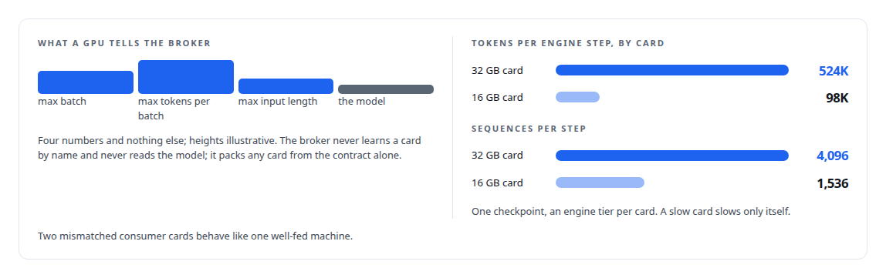
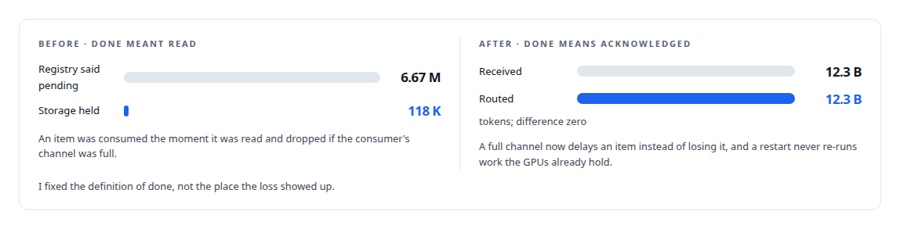

# High-throughput batch inference and embeddings

**Millions of items through GPUs I own, with the hardware kept busy and the accounting balanced**

Canonical: https://coreyjames.ai/capabilities/high-throughput-batch-inference/  
Author: Corey James · Published: 2026-10-28 · Kind: capability  
Systems: [Inference Fabric](https://github.com/coreyjames-ai/inference-fabric) · [FAFO Core and Function Forge](https://github.com/coreyjames-ai/fafo-core)  
Skills: [high-throughput batch inference](https://github.com/coreyjames-ai/portfolio/tree/main/skills/high-throughput-batch-inference) · [GPU inference optimisation](https://github.com/coreyjames-ai/portfolio/tree/main/skills/gpu-inference-optimisation) · [token-aware scheduling](https://github.com/coreyjames-ai/portfolio/tree/main/skills/token-aware-scheduling) · [inference serving architecture](https://github.com/coreyjames-ai/portfolio/tree/main/skills/inference-serving-architecture)  


## Result

| Figure | What it measures |
| --- | --- |
| **0.42%** | padding waste across the two cards, with zero shape switches |
| **99.9%** | engine cache hit rate, from shape-pure batches |
| **4.95 M** | tasks on one GPU over a ten-hour run, zero retries |

## What was built

Offline workloads, synthetic data, extraction, bulk embeddings, are throughput problems, and a serving stack built for chat treats them like chat: padding, idle gaps, producers tied to GPUs for hours, results persisted by whoever is still waiting.

I took one model from about 44,000 tokens per second on one NVIDIA Blackwell GPU to a five-minute mean of 163,000 on two NVIDIA Blackwell GPUs without touching a kernel, by building the layers around the engine. Start with [From 44K to 163K tokens per second](https://coreyjames.ai/stories/from-44k-to-163k-tokens-per-second).


The first layer is a broker whose unit of scheduling is the token, feeding pull-based workers that stay saturated on mixed hardware. See [A message broker that understands tokens](https://coreyjames.ai/stories/a-message-broker-that-understands-tokens).



Results land when they finish, through a completion service that closes the loop for producers that submit and exit, and the accounting balances to zero. The pipeline populated tens of millions of work items on two consumer GPUs. See [Millions of queued items that were not there](https://coreyjames.ai/stories/millions-of-queued-items-that-were-not-there) and [The workload that shaped the platform](https://coreyjames.ai/stories/the-workload-that-shaped-the-platform).



> I did not replace NVIDIA's inference; I fed it.

## What was verified

Each line is a claim the canonical page supports, with the figure as the page states it.

- High-throughput batch inference: one 7B dense model in FP8 taken from about 44,000 to a five-minute mean of 163,000 tokens per second on two NVIDIA Blackwell GPUs without touching a kernel.
- Token-aware scheduling: shape-pure batches packed to each card's four-number contract, with 0.42% padding waste and a 99.9% engine cache hit rate across two mismatched cards.
- Distributed systems correctness: done redefined as acknowledged after 6.67 M pending items proved to be 118 K in storage, leaving 12.3 B tokens received and 12.3 B routed.
- Inference serving architecture: per-card engine tiers of 524K and 98K tokens per step from one checkpoint, so a slow card slows only itself.
- GPU inference optimisation: 4.95 M tasks on one GPU over a ten-hour run with zero retries.

## Related

- [From 44K to 163K tokens per second](https://github.com/coreyjames-ai/inference-fabric/tree/main/stories/from-44k-to-163k-tokens-per-second) · https://coreyjames.ai/stories/from-44k-to-163k-tokens-per-second/
- [A message broker that understands tokens](https://github.com/coreyjames-ai/inference-fabric/tree/main/stories/a-message-broker-that-understands-tokens) · https://coreyjames.ai/stories/a-message-broker-that-understands-tokens/
- [Millions of queued items that were not there](https://github.com/coreyjames-ai/inference-fabric/tree/main/stories/millions-of-queued-items-that-were-not-there) · https://coreyjames.ai/stories/millions-of-queued-items-that-were-not-there/
- [The workload that shaped the platform](https://github.com/coreyjames-ai/fafo-core/tree/main/stories/the-workload-that-shaped-the-platform) · https://coreyjames.ai/stories/the-workload-that-shaped-the-platform/
- System: [Inference Fabric](https://github.com/coreyjames-ai/inference-fabric)
- System: [FAFO Core and Function Forge](https://github.com/coreyjames-ai/fafo-core)

## Citation

Corey James. "High-throughput batch inference and embeddings." coreyjames.ai, 2026. https://coreyjames.ai/capabilities/high-throughput-batch-inference/

```bibtex
@misc{coreyjames-high-throughput-batch-inference,
  author = {Corey James},
  title = {High-throughput batch inference and embeddings},
  year = {2026},
  howpublished = {\url{https://coreyjames.ai/capabilities/high-throughput-batch-inference/}},
  note = {GitHub copy: https://github.com/coreyjames-ai/portfolio/tree/main/research/capabilities/high-throughput-batch-inference}
}
```

Part of [Corey James's portfolio](https://github.com/coreyjames-ai/portfolio) · site: https://coreyjames.ai/ · MCP server: https://coreyjames.ai/mcp · agent card: https://coreyjames.ai/.well-known/agent.json
