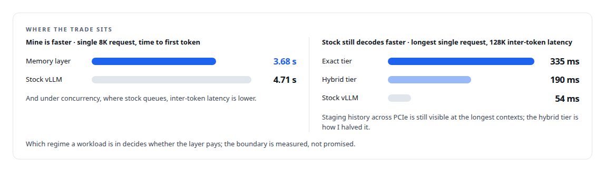
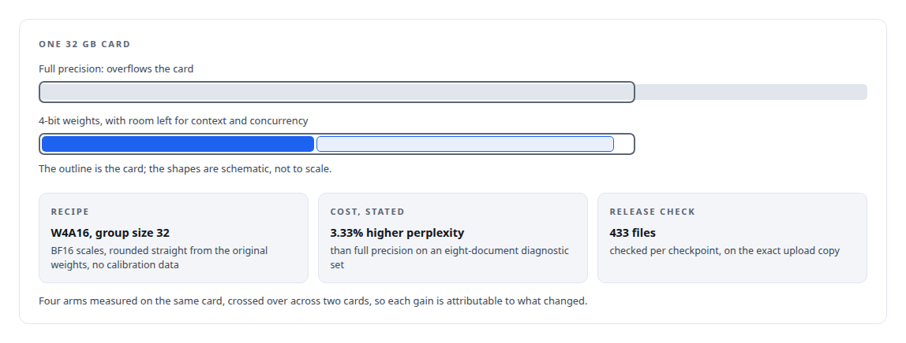
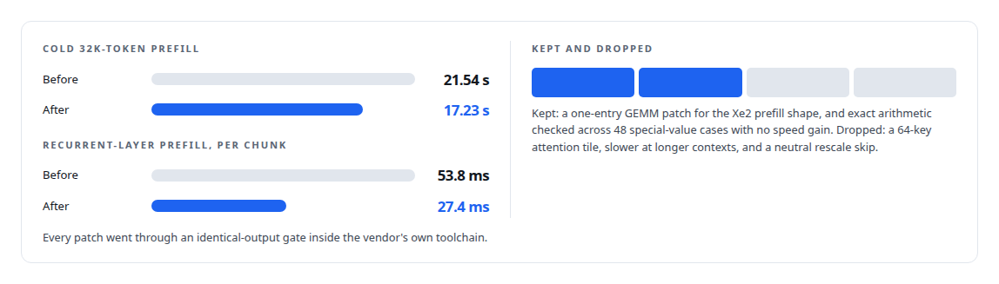

# Bigger models and longer context on fixed GPU memory

**When GPU memory, not the workload, is the limit**

Canonical: https://coreyjames.ai/capabilities/longer-context-on-the-gpus-you-own/  
Author: Corey James · Published: 2026-10-28 · Kind: capability  
Systems: [ActiveKV](https://github.com/coreyjames-ai/activekv) · [Capabilities model](https://github.com/coreyjames-ai/capabilities-model)  
Skills: [KV-cache offload for LLM inference](https://github.com/coreyjames-ai/portfolio/tree/main/skills/kv-cache-offload-for-llm-inference) · [C++ and native ports with parity proof](https://github.com/coreyjames-ai/portfolio/tree/main/skills/c-and-native-ports-with-parity-proof) · [GPU inference optimisation](https://github.com/coreyjames-ai/portfolio/tree/main/skills/gpu-inference-optimisation) · [Intel GPU and SYCL/oneAPI engineering](https://github.com/coreyjames-ai/portfolio/tree/main/skills/intel-gpu-and-sycl-oneapi-engineering)  


## Result

| Figure | What it measures |
| --- | --- |
| **13 of 13** | exact cells bit-identical to fully resident attention at the native port, 12 of 12 hybrid |
| **0** | Python files in the release payload of the memory layer |
| **+36%** | sustained output throughput of the 4-bit build over the mixed 4- and 8-bit control, 64 clients |

## What was built

A model's context, or the number of long sessions that can stay alive, is capped by the memory on the cards at hand. The usual answers are bigger cards, more cards or less context.

I built an inference-memory layer for vLLM that moves a context's history into host RAM and treats the GPU as a bounded working set, with an exact tier that is bit-identical to fully resident attention. I ported it entirely to native C++ under parity gates, as a patch that applies to an unmodified vLLM. Start with [Context beyond VRAM](https://coreyjames.ai/stories/context-beyond-vram).



I fit a 27-billion-parameter model on a single 32 GB Intel card through a published, measured quantization. See [A 27B model on one 32 GB Intel card](https://coreyjames.ai/stories/a-27b-model-on-one-32gb-intel-card).



I also patched a vendor's kernel stack on brand-new silicon with outputs unchanged. See [Bringing a serving stack up on new silicon](https://coreyjames.ai/stories/bringing-a-serving-stack-up-on-new-silicon).




> Exactness is a property I want in the system.

## What was verified

Each line is a claim the canonical page supports, with the figure as the page states it.

- KV-cache offload for LLM inference: a context's history in host RAM and the GPU as a bounded working set inside vLLM, with an exact tier bit-identical to fully resident attention in 13 of 13 cells.
- C++ and native ports with parity proof: the memory layer ported entirely to native C++ under parity gates, 12 of 12 hybrid cells matching and 0 Python files in the release payload.
- LLM quantization (4-bit): a 27B model fitted on one 32 GB Intel card as a W4A16 build, +36% sustained output throughput over the mixed control at a stated 3.33% perplexity cost.
- Intel GPU and SYCL/oneAPI engineering: vendor kernel patches on new silicon with identical outputs, cutting a cold 32K-token prefill from 21.54 s to 17.23 s.
- Performance benchmarking methodology: time to first token of 3.68 s against stock vLLM's 4.71 s on a single 8K request, with the 128K regime where stock still decodes faster stated beside it.

## Related

- [Context beyond VRAM](https://github.com/coreyjames-ai/activekv/tree/main/stories/context-beyond-vram) · https://coreyjames.ai/stories/context-beyond-vram/
- [Rewriting an engine extension without changing a token](https://github.com/coreyjames-ai/activekv/tree/main/stories/rewriting-an-engine-extension-without-changing-a-token) · https://coreyjames.ai/stories/rewriting-an-engine-extension-without-changing-a-token/
- [A 27B model on one 32 GB Intel card](https://github.com/coreyjames-ai/capabilities-model/tree/main/stories/a-27b-model-on-one-32gb-intel-card) · https://coreyjames.ai/stories/a-27b-model-on-one-32gb-intel-card/
- [Bringing a serving stack up on new silicon](https://github.com/coreyjames-ai/activekv/tree/main/stories/bringing-a-serving-stack-up-on-new-silicon) · https://coreyjames.ai/stories/bringing-a-serving-stack-up-on-new-silicon/
- System: [ActiveKV](https://github.com/coreyjames-ai/activekv)
- System: [Capabilities model](https://github.com/coreyjames-ai/capabilities-model)

## Citation

Corey James. "Bigger models and longer context on fixed GPU memory." coreyjames.ai, 2026. https://coreyjames.ai/capabilities/longer-context-on-the-gpus-you-own/

```bibtex
@misc{coreyjames-longer-context-on-the-gpus-you-own,
  author = {Corey James},
  title = {Bigger models and longer context on fixed GPU memory},
  year = {2026},
  howpublished = {\url{https://coreyjames.ai/capabilities/longer-context-on-the-gpus-you-own/}},
  note = {GitHub copy: https://github.com/coreyjames-ai/portfolio/tree/main/research/capabilities/longer-context-on-the-gpus-you-own}
}
```

Part of [Corey James's portfolio](https://github.com/coreyjames-ai/portfolio) · site: https://coreyjames.ai/ · MCP server: https://coreyjames.ai/mcp · agent card: https://coreyjames.ai/.well-known/agent.json
