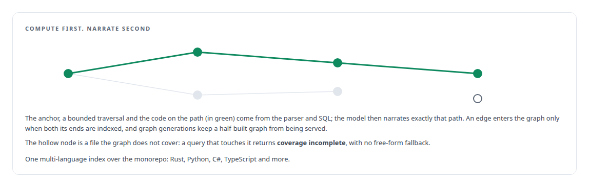
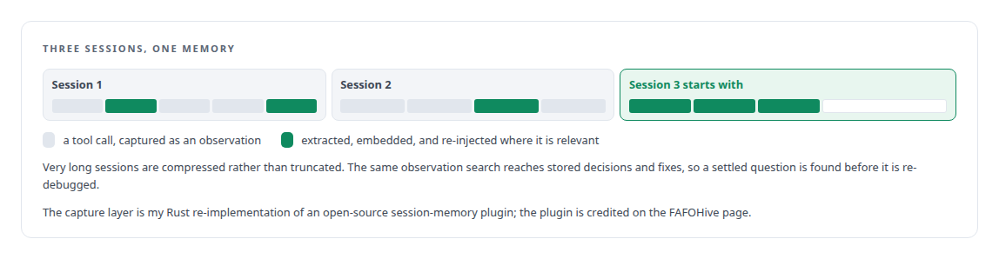

# Memory and code intelligence for agents

**Agents that remember across sessions and explain code without inventing it**

Canonical: https://coreyjames.ai/capabilities/memory-and-code-intelligence-for-agents/  
Author: Corey James · Published: 2026-10-28 · Kind: capability  
Systems: [FAFOHive](https://github.com/coreyjames-ai/fafohive)  
Skills: [AI-assisted engineering methodology](https://github.com/coreyjames-ai/portfolio/tree/main/skills/ai-assisted-engineering-methodology) · [evidence-gated acceptance](https://github.com/coreyjames-ai/portfolio/tree/main/skills/evidence-gated-acceptance)  


## Result

| Figure | What it measures |
| --- | --- |
| **294,033** | of 294,362 code chunks covered by the computed graph |
| **0** | models involved in a dependency trace; it is a bounded database traversal |
| **3** | indexes, code, past decisions and reference documents, behind one retrieval surface |

## What was built

Coding agents forget everything between sessions, rediscover the same facts about a codebase daily, and explain call paths that do not exist with complete confidence.

I built the memory and code-intelligence service every agent in my estate connects to. Dependency tracing is a graph query, and the code explainer narrates only edges the graph has proven and refuses when coverage is incomplete. Start with [A code explainer that is not allowed to invent](https://coreyjames.ai/stories/a-code-explainer-that-is-not-allowed-to-invent).




Session memory captures every tool call, extracts what matters, and re-injects it later.



> A refusal beats a plausible guess, because the caveat is the first thing a reader stops seeing.

## What was verified

Each line is a claim the canonical page supports, with the figure as the page states it.

- Code intelligence for AI agents: a tree-sitter code graph covering 294,033 of 294,362 code chunks, with dependency tracing as a bounded database traversal and 0 models involved.
- Evidence-grounded LLM output: a code explainer that narrates only edges the graph has proven and returns coverage incomplete, with no free-form fallback.
- Persistent agent memory: session memory that captures every tool call as an observation, extracts and embeds it, and re-injects it into later sessions.
- Retrieval system design: code, past decisions and reference documents as 3 indexes behind one retrieval surface.

## Related

- [A code explainer that is not allowed to invent](https://github.com/coreyjames-ai/fafohive/tree/main/stories/a-code-explainer-that-is-not-allowed-to-invent) · https://coreyjames.ai/stories/a-code-explainer-that-is-not-allowed-to-invent/
- [Why long agent runs fail](https://github.com/coreyjames-ai/agentos/tree/main/stories/why-long-agent-runs-fail) · https://coreyjames.ai/stories/why-long-agent-runs-fail/
- System: [FAFOHive](https://github.com/coreyjames-ai/fafohive)

## Citation

Corey James. "Memory and code intelligence for agents." coreyjames.ai, 2026. https://coreyjames.ai/capabilities/memory-and-code-intelligence-for-agents/

```bibtex
@misc{coreyjames-memory-and-code-intelligence-for-agents,
  author = {Corey James},
  title = {Memory and code intelligence for agents},
  year = {2026},
  howpublished = {\url{https://coreyjames.ai/capabilities/memory-and-code-intelligence-for-agents/}},
  note = {GitHub copy: https://github.com/coreyjames-ai/portfolio/tree/main/research/capabilities/memory-and-code-intelligence-for-agents}
}
```

Part of [Corey James's portfolio](https://github.com/coreyjames-ai/portfolio) · site: https://coreyjames.ai/ · MCP server: https://coreyjames.ai/mcp · agent card: https://coreyjames.ai/.well-known/agent.json
