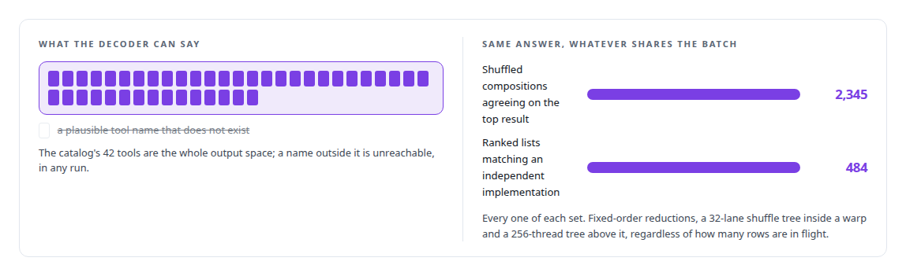
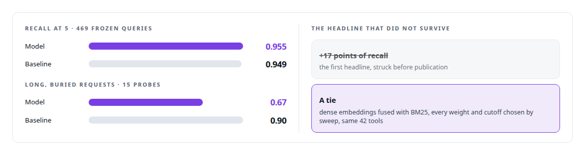
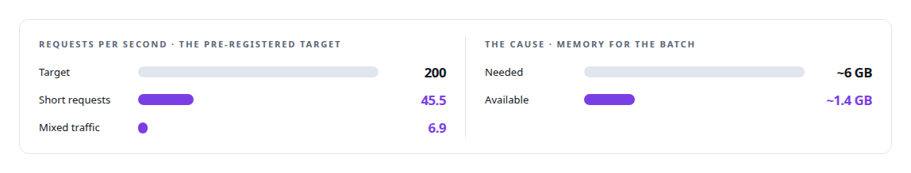

# Custom small models for tool calling and routing

**When a 0.6B model that cannot be wrong in the dangerous way beats a large model reading a catalog**

Canonical: https://coreyjames.ai/capabilities/small-models-for-tool-calling-and-routing/  
Author: Corey James · Published: 2026-10-28 · Kind: capability  
Systems: [Capabilities model](https://github.com/coreyjames-ai/capabilities-model)  
Skills: [inference serving architecture](https://github.com/coreyjames-ai/portfolio/tree/main/skills/inference-serving-architecture) · [GPU inference optimisation](https://github.com/coreyjames-ai/portfolio/tree/main/skills/gpu-inference-optimisation) · [AI-assisted engineering methodology](https://github.com/coreyjames-ai/portfolio/tree/main/skills/ai-assisted-engineering-methodology) · [high-throughput batch inference](https://github.com/coreyjames-ai/portfolio/tree/main/skills/high-throughput-batch-inference)  


## Result

| Figure | What it measures |
| --- | --- |
| **2,048** | simultaneous clients in one burst, none failed or rejected |
| **2,740** | MiB, the engine's whole footprint, on the card the larger serving model already uses |
| **12 of 12** | bit-identity gates passed across batch compositions |

## What was built

Every tool an agent can reach is described to it on every turn, and the bill and the latency grow with the estate. Meanwhile an agent that cannot see the right tool improvises.

I compiled a tool catalog into a fine-tuned 0.6-billion-parameter model that cannot name a tool outside the catalog, with a decoder whose output bits are identical across batch compositions. Start with [A hundred tokens instead of forty-two thousand](https://coreyjames.ai/stories/a-hundred-tokens-instead-of-forty-two-thousand) and [Bit-identical across batch compositions](https://coreyjames.ai/stories/bit-identical-across-batch-compositions).




I measured it against the strongest retrieval baseline I could build, which tied it, and I published the tie. See [The baseline that tied us](https://coreyjames.ai/stories/the-baseline-that-tied-us).



It serves its clients from the memory left beside a larger serving model on one GPU, and it admits work against measured memory, refusing with a number when a request will not fit. See [A router beside a production model](https://coreyjames.ai/stories/a-router-beside-a-production-model).



> A wrong real tool name is a recoverable error; a plausible fake one is a silent failure.

## What was verified

Each line is a claim the canonical page supports, with the figure as the page states it.

- Small language models for tool routing: a 0.6B model fine-tuned on a tool catalog with a decoder that cannot name a tool outside it, serving 2,048 simultaneous clients with none failed.
- Deterministic GPU computation: a CUDA decoder bit-identical across batch compositions, 12 of 12 gates passed and all 2,345 shuffled compositions agreeing on the top result.
- ML evaluation methodology: 469 frozen queries over 42 tools against the strongest classical baseline, published as a tie at 0.955 against 0.949 and a loss of 0.67 against 0.90 on buried requests.
- Inference serving on a shared GPU: a 2,740 MiB engine beside a 30B model that admits work against measured memory, with a missed throughput target reported with its cause.

## Related

- [A hundred tokens instead of forty-two thousand](https://github.com/coreyjames-ai/capabilities-model/tree/main/stories/a-hundred-tokens-instead-of-forty-two-thousand) · https://coreyjames.ai/stories/a-hundred-tokens-instead-of-forty-two-thousand/
- [The baseline that tied us](https://github.com/coreyjames-ai/capabilities-model/tree/main/stories/the-baseline-that-tied-us) · https://coreyjames.ai/stories/the-baseline-that-tied-us/
- [A router beside a production model](https://github.com/coreyjames-ai/capabilities-model/tree/main/stories/a-router-beside-a-production-model) · https://coreyjames.ai/stories/a-router-beside-a-production-model/
- [Bit-identical across batch compositions](https://github.com/coreyjames-ai/capabilities-model/tree/main/stories/bit-identical-across-batch-compositions) · https://coreyjames.ai/stories/bit-identical-across-batch-compositions/
- System: [Capabilities model](https://github.com/coreyjames-ai/capabilities-model)

## Citation

Corey James. "Custom small models for tool calling and routing." coreyjames.ai, 2026. https://coreyjames.ai/capabilities/small-models-for-tool-calling-and-routing/

```bibtex
@misc{coreyjames-small-models-for-tool-calling-and-routing,
  author = {Corey James},
  title = {Custom small models for tool calling and routing},
  year = {2026},
  howpublished = {\url{https://coreyjames.ai/capabilities/small-models-for-tool-calling-and-routing/}},
  note = {GitHub copy: https://github.com/coreyjames-ai/portfolio/tree/main/research/capabilities/small-models-for-tool-calling-and-routing}
}
```

Part of [Corey James's portfolio](https://github.com/coreyjames-ai/portfolio) · site: https://coreyjames.ai/ · MCP server: https://coreyjames.ai/mcp · agent card: https://coreyjames.ai/.well-known/agent.json
