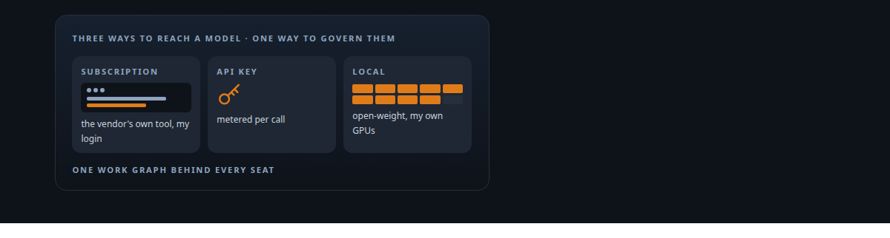
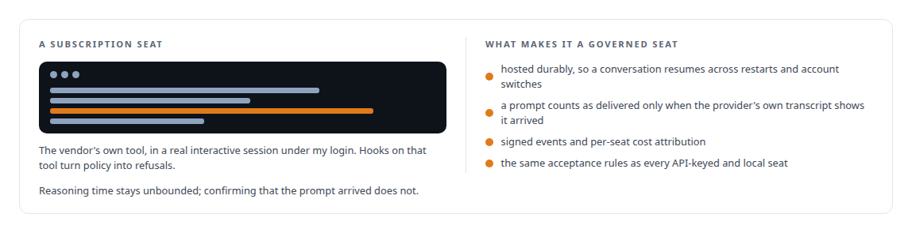
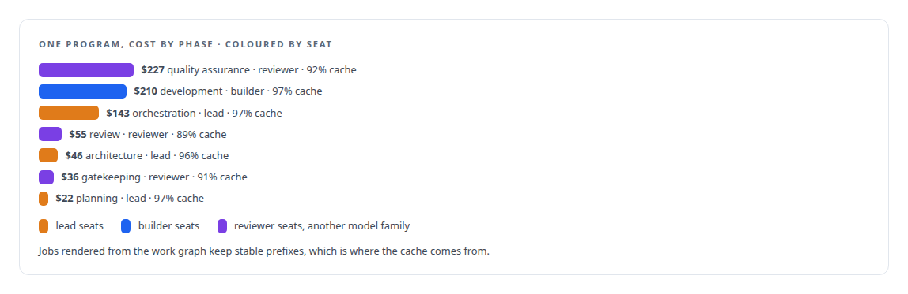

# AI subscriptions as governed workers

**Running vendors' authenticated command-line tools as governed workers, alongside API-keyed and local models**

Canonical: https://coreyjames.ai/capabilities/use-the-ai-subscriptions-you-already-have/  
Author: Corey James · Published: 2026-10-28 · Kind: capability  
Systems: [AgentOS](https://github.com/coreyjames-ai/agentos) · [Helix](https://github.com/coreyjames-ai/helix) · [Agent Swarm](https://github.com/coreyjames-ai/agent-swarm)  
Skills: [cost attribution for AI work](https://github.com/coreyjames-ai/portfolio/tree/main/skills/cost-attribution-for-ai-work) · [separation of duties for AI work](https://github.com/coreyjames-ai/portfolio/tree/main/skills/separation-of-duties-for-ai-work) · [agent orchestration](https://github.com/coreyjames-ai/portfolio/tree/main/skills/agent-orchestration) · [multi-agent governance](https://github.com/coreyjames-ai/portfolio/tree/main/skills/multi-agent-governance)  



## Result

| Figure | What it measures |
| --- | --- |
| **31,811** | metered usage entries, each tied to the work that spent it |
| **94.5%** | overall cache hit rate across one priced engineering program |
| **30 s** | deadline for a vendor session to confirm a prompt arrived, by its own transcript event |

## What was built

My governance platform runs real interactive sessions of vendors' authenticated command-line tools, under my own logins, as durable governed seats, alongside API-keyed seats and local open-source models served on my own GPUs.



Every seat is metered against the work that used it, and cheap is the default: a role contract names its model and reasoning effort as data, so the lead, planning and architecture seats use a heavier model than the development seats on purpose. Start with [Directing AI coding agents at program scale](https://coreyjames.ai/stories/directing-ai-coding-agents-at-program-scale) and [What the work cost, to the penny](https://coreyjames.ai/stories/what-the-work-cost).




> Builders and reviewers come from different model families so their blind spots do not overlap.

## What was verified

Each line is a claim the canonical page supports, with the figure as the page states it.

- Agent orchestration across vendors: vendors' authenticated command-line tools run as durable governed seats beside API-keyed and local open-weight seats, under the same acceptance rules.
- Cost attribution for AI work: 31,811 metered usage records tied to the work that spent them, and one program costed by phase with a 94.5% overall cache hit rate.
- Separation of duties for AI work: builders and reviewers drawn from different model families so their blind spots do not overlap.
- Prompt delivery assurance: a prompt counts as delivered only when the provider's own transcript shows it, within a 30 s acceptance deadline.

## Related

- [Directing AI coding agents at program scale](https://github.com/coreyjames-ai/agentos/tree/main/stories/directing-ai-coding-agents-at-program-scale) · https://coreyjames.ai/stories/directing-ai-coding-agents-at-program-scale/
- [Why long agent runs fail](https://github.com/coreyjames-ai/agentos/tree/main/stories/why-long-agent-runs-fail) · https://coreyjames.ai/stories/why-long-agent-runs-fail/
- [What the work cost, to the penny](https://github.com/coreyjames-ai/agentos/tree/main/stories/what-the-work-cost) · https://coreyjames.ai/stories/what-the-work-cost/
- System: [AgentOS](https://github.com/coreyjames-ai/agentos)
- System: [Helix](https://github.com/coreyjames-ai/helix)
- System: [Agent Swarm](https://github.com/coreyjames-ai/agent-swarm)

## Citation

Corey James. "AI subscriptions as governed workers." coreyjames.ai, 2026. https://coreyjames.ai/capabilities/use-the-ai-subscriptions-you-already-have/

```bibtex
@misc{coreyjames-use-the-ai-subscriptions-you-already-have,
  author = {Corey James},
  title = {AI subscriptions as governed workers},
  year = {2026},
  howpublished = {\url{https://coreyjames.ai/capabilities/use-the-ai-subscriptions-you-already-have/}},
  note = {GitHub copy: https://github.com/coreyjames-ai/portfolio/tree/main/research/capabilities/use-the-ai-subscriptions-you-already-have}
}
```

Part of [Corey James's portfolio](https://github.com/coreyjames-ai/portfolio) · site: https://coreyjames.ai/ · MCP server: https://coreyjames.ai/mcp · agent card: https://coreyjames.ai/.well-known/agent.json
