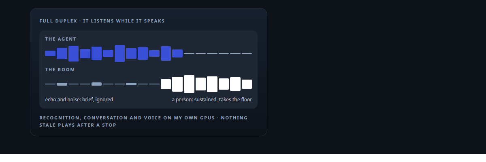
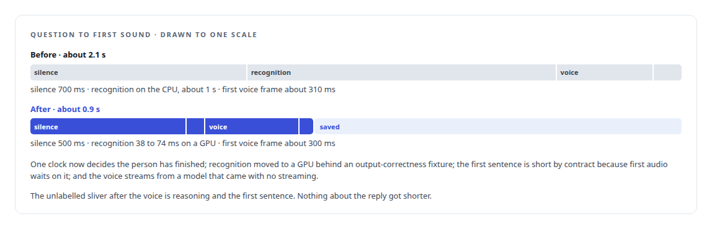
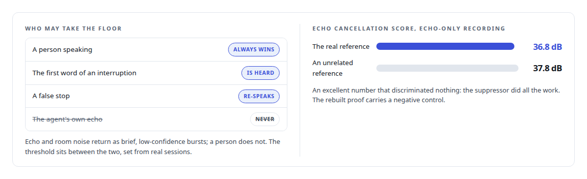
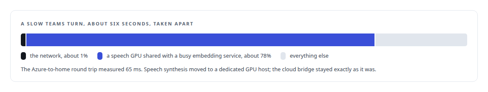

# Voice agents in calls and meetings

**Speech recognition, synthesis and turn-taking on my own hardware, joined to the platforms people already use**

Canonical: https://coreyjames.ai/capabilities/voice-agents-in-meetings/  
Author: Corey James · Published: 2026-10-28 · Kind: capability  
Systems: [Helix](https://github.com/coreyjames-ai/helix)  
Skills: [speech recognition and synthesis pipelines](https://github.com/coreyjames-ai/portfolio/tree/main/skills/speech-recognition-and-synthesis-pipelines) · [real-time voice AI](https://github.com/coreyjames-ai/portfolio/tree/main/skills/real-time-voice-ai) · [GPU inference optimisation](https://github.com/coreyjames-ai/portfolio/tree/main/skills/gpu-inference-optimisation) · [Rust systems engineering](https://github.com/coreyjames-ai/portfolio/tree/main/skills/rust-systems-engineering)  



## Result

| Figure | What it measures |
| --- | --- |
| **25×** | faster speech recognition on the GPU than on the CPU path, 18× at the least, in real turns |
| **< 1 ms** | to play the lines an assistant says most, pre-rendered per voice |
| **5,668** | turns in a ten-minute loopback soak, every one processed |

## What was built

An AI that people can talk to in a real call has to answer in conversational time, stop when it is interrupted, and keep the audio away from third-party AI services.

I built a conversational voice engine in Rust with speech recognition, neural speech synthesis, floor control so several AI voices share one conversation without talking over each other, interruption handling so a person speaking stops the agent, and tool calls made mid-conversation. The gap between the end of a question and the first sound of the reply was taken apart stage by stage. See [From two seconds to under one](https://coreyjames.ai/stories/from-two-seconds-to-under-one).



What counts as an interruption was measured rather than guessed: the engine listens while it speaks, a person can talk over it and it stops at once, and its own echo cannot stop it. See [Interruptions that only people can make](https://coreyjames.ai/stories/interruptions-that-only-people-can-make) and [A proof that proved nothing](https://coreyjames.ai/stories/a-proof-that-proved-nothing).




I joined the engine to Microsoft Teams through a purpose-built real-time media bridge with byte-identical implementations on both sides, soak-tested for thirty minutes and through a forced mid-call reconnect. When a Teams turn ran slow, the cloud hop was the obvious suspect and measurement cleared it. Start with [A self-hosted colleague in a Teams call](https://coreyjames.ai/stories/a-self-hosted-colleague-in-a-teams-call) and [One percent network, seventy-eight percent GPU](https://coreyjames.ai/stories/one-percent-network-seventy-eight-percent-gpu).



On a desk microphone an optional voiceprint, enrolled from eight guided samples without keeping a recording, lets the engine listen only to its operator; it is deliberately not used on Teams, where the platform already isolates voices. A deterministic layer turns written answers into speakable ones while the screen keeps the written form, and no real human voice is cloned without documented consent. See [Listen only to me](https://coreyjames.ai/stories/listen-only-to-me) and [Saying numbers out loud](https://coreyjames.ai/stories/saying-numbers-out-loud).

> A proof that passes with the wrong input is a proof of the test harness.

## What was verified

Each line is a claim the canonical page supports, with the figure as the page states it.

- Real-time voice AI: a Rust conversational engine on my own GPUs with question-to-first-sound cut from about 2.1 s to about 0.9 s, stage by stage.
- Speech recognition and synthesis pipelines: recognition on a GPU at 38 to 74 ms per turn, 18 to 25 times faster than the CPU path, and streaming built for a voice model that had none.
- Full-duplex barge-in design: interruptions that only a person can make, with the agent's own echo below a measured threshold and a false stop re-spoken.
- Test methodology with negative controls: an echo-cancellation score of 36.8 dB exposed when an unrelated reference scored 37.8 dB, and the proof rebuilt with a control.
- Latency diagnosis: a slow Teams turn traced to a shared speech GPU, about 78% of the turn against about 1% for the network, so compute moved and the cloud bridge stayed.

## Related

- [A self-hosted colleague in a Teams call](https://github.com/coreyjames-ai/helix/tree/main/stories/a-self-hosted-colleague-in-a-teams-call) · https://coreyjames.ai/stories/a-self-hosted-colleague-in-a-teams-call/
- [A meeting attendee that will not fake it](https://github.com/coreyjames-ai/helix/tree/main/stories/a-meeting-attendee-that-will-not-fake-it) · https://coreyjames.ai/stories/a-meeting-attendee-that-will-not-fake-it/
- [Interruptions that only people can make](https://github.com/coreyjames-ai/helix/tree/main/stories/interruptions-that-only-people-can-make) · https://coreyjames.ai/stories/interruptions-that-only-people-can-make/
- [Listen only to me](https://github.com/coreyjames-ai/helix/tree/main/stories/listen-only-to-me) · https://coreyjames.ai/stories/listen-only-to-me/
- [From two seconds to under one](https://github.com/coreyjames-ai/helix/tree/main/stories/from-two-seconds-to-under-one) · https://coreyjames.ai/stories/from-two-seconds-to-under-one/
- [Building the streaming my speech model did not ship](https://github.com/coreyjames-ai/helix/tree/main/stories/building-the-streaming-my-speech-model-did-not-ship) · https://coreyjames.ai/stories/building-the-streaming-my-speech-model-did-not-ship/
- [Three hundred milliseconds of hello](https://github.com/coreyjames-ai/helix/tree/main/stories/three-hundred-milliseconds-of-hello) · https://coreyjames.ai/stories/three-hundred-milliseconds-of-hello/
- [Saying numbers out loud](https://github.com/coreyjames-ai/helix/tree/main/stories/saying-numbers-out-loud) · https://coreyjames.ai/stories/saying-numbers-out-loud/
- [Fast transcripts that were wrong](https://github.com/coreyjames-ai/helix/tree/main/stories/fast-transcripts-that-were-wrong) · https://coreyjames.ai/stories/fast-transcripts-that-were-wrong/
- [One percent network, seventy-eight percent GPU](https://github.com/coreyjames-ai/helix/tree/main/stories/one-percent-network-seventy-eight-percent-gpu) · https://coreyjames.ai/stories/one-percent-network-seventy-eight-percent-gpu/
- [A proof that proved nothing](https://github.com/coreyjames-ai/helix/tree/main/stories/a-proof-that-proved-nothing) · https://coreyjames.ai/stories/a-proof-that-proved-nothing/
- System: [Helix](https://github.com/coreyjames-ai/helix)

## Citation

Corey James. "Voice agents in calls and meetings." coreyjames.ai, 2026. https://coreyjames.ai/capabilities/voice-agents-in-meetings/

```bibtex
@misc{coreyjames-voice-agents-in-meetings,
  author = {Corey James},
  title = {Voice agents in calls and meetings},
  year = {2026},
  howpublished = {\url{https://coreyjames.ai/capabilities/voice-agents-in-meetings/}},
  note = {GitHub copy: https://github.com/coreyjames-ai/portfolio/tree/main/research/capabilities/voice-agents-in-meetings}
}
```

Part of [Corey James's portfolio](https://github.com/coreyjames-ai/portfolio) · site: https://coreyjames.ai/ · MCP server: https://coreyjames.ai/mcp · agent card: https://coreyjames.ai/.well-known/agent.json
