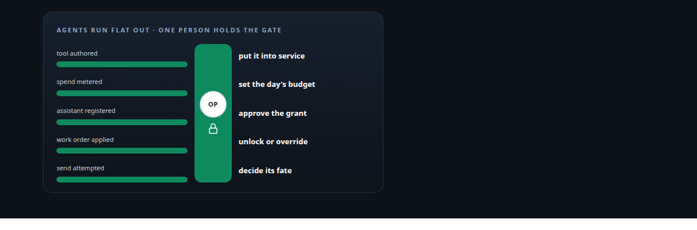
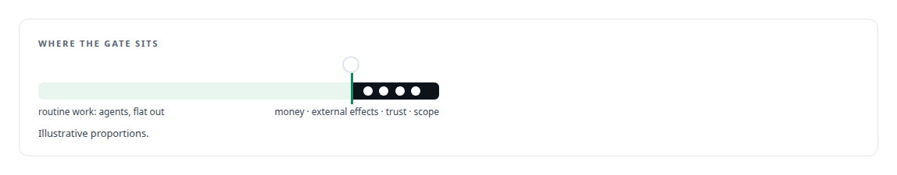
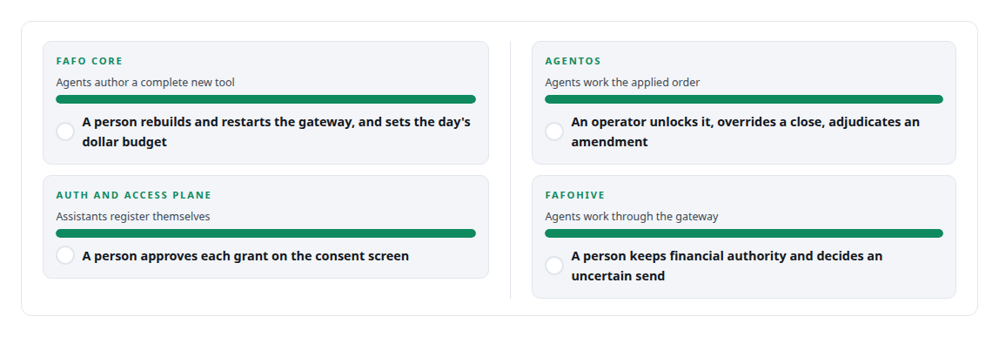

# A human at the privileged step

**Automate everything up to the one action that carries real authority, and put a person exactly there**

Canonical: https://coreyjames.ai/ideas/a-human-at-the-privileged-step/  
Author: Corey James · Published: 2026-10-28 · Kind: idea  
Systems: [FAFO Core and Function Forge](https://github.com/coreyjames-ai/fafo-core) · [AgentOS](https://github.com/coreyjames-ai/agentos) · [Auth and access plane](https://github.com/coreyjames-ai/auth-and-access-plane) · [FAFOHive](https://github.com/coreyjames-ai/fafohive)  
Skills: [separation of duties for AI work](https://github.com/coreyjames-ai/portfolio/tree/main/skills/separation-of-duties-for-ai-work) · [OAuth 2.0 and identity architecture](https://github.com/coreyjames-ai/portfolio/tree/main/skills/oauth-2-0-and-identity-architecture) · [tool synthesis and governed API integration](https://github.com/coreyjames-ai/portfolio/tree/main/skills/tool-synthesis-and-governed-api-integration) · [AI-assisted engineering methodology](https://github.com/coreyjames-ai/portfolio/tree/main/skills/ai-assisted-engineering-methodology)  



## What was built

Full autonomy is a slogan and so is a human in every loop. I put the human at the one step that carries real authority, putting a generated tool into service, setting a day's spend, approving a client's grant, unlocking a work order, deciding the fate of an uncertain send, and nowhere else. The gate sits at the narrowest point, so agents keep their speed everywhere else and the human's attention is spent where it changes something.

## The shape

Identify the action whose consequence cannot be undone or whose authority cannot be delegated. Build the automation to run flat out up to that action and to stop there with everything prepared. Make the human step small and explicit. Keep the gates few, because a human is a throughput limit.



## Where it appears

In [FAFO Core and Function Forge](https://coreyjames.ai/systems/fafo-core), the rebuild script deliberately never restarts anything itself, and the budget path is not on any agent's tool surface: [Tools that build tools, under governance](https://coreyjames.ai/stories/tools-that-build-tools-under-governance).

In the [Auth and access plane](https://coreyjames.ai/systems/auth-and-access-plane), the consent screen turned out to be the only control that mattered: [The hardening fix that locked everyone out](https://coreyjames.ai/stories/the-hardening-fix-that-locked-everyone-out).

In [AgentOS](https://coreyjames.ai/systems/agentos), a work order is immutable once applied, and the logins behind every vendor model session are operator-held: [Closed by evidence](https://coreyjames.ai/stories/closed-by-evidence).

In [FAFOHive](https://coreyjames.ai/systems/fafohive), the agents run real businesses through the gateway and still hold no keys: [Agents with real tools and no keys](https://coreyjames.ai/stories/agents-with-real-tools-and-no-keys).



## What it buys and what it costs

It buys autonomy that an organisation can accept, because the irreversible step has a name on it. It buys agents that are fast, because they are not asking permission for routine work.

It costs latency at the gate and it costs the discipline to keep the gate list short. Every time I have been tempted to add a gate for comfort, I have asked whether the step carries authority or merely risk, and risk is what the rest of the machinery is for.

## The judgment in it


A generated function is reviewed by machines and gated by a restart. A payment is gated by a person. Both are the right amount of human.

> The gate is placed by consequence, not by fear.

## What was verified

Each line is a claim the canonical page supports, with the figure as the page states it.

- Human-in-the-loop design for AI agents: a person placed only at the step that carries authority, such as deploying a generated tool, setting a day's spend or approving a grant, with agents working flat out up to it.
- Governed tool synthesis: agent-authored tools take effect only when a human rebuilds and restarts the gateway, and the budget path sits on no agent's tool surface.
- OAuth consent as a control point: assistants register themselves and a person approves each grant on the consent screen.

## Related

- [Tools that build tools, under governance](https://github.com/coreyjames-ai/fafo-core/tree/main/stories/tools-that-build-tools-under-governance) · https://coreyjames.ai/stories/tools-that-build-tools-under-governance/
- [The hardening fix that locked everyone out](https://github.com/coreyjames-ai/auth-and-access-plane/tree/main/stories/the-hardening-fix-that-locked-everyone-out) · https://coreyjames.ai/stories/the-hardening-fix-that-locked-everyone-out/
- [Closed by evidence](https://github.com/coreyjames-ai/agentos/tree/main/stories/closed-by-evidence) · https://coreyjames.ai/stories/closed-by-evidence/
- [Agents with real tools and no keys](https://github.com/coreyjames-ai/fafohive/tree/main/stories/agents-with-real-tools-and-no-keys) · https://coreyjames.ai/stories/agents-with-real-tools-and-no-keys/
- System: [FAFO Core and Function Forge](https://github.com/coreyjames-ai/fafo-core)
- System: [AgentOS](https://github.com/coreyjames-ai/agentos)
- System: [Auth and access plane](https://github.com/coreyjames-ai/auth-and-access-plane)
- System: [FAFOHive](https://github.com/coreyjames-ai/fafohive)

## Citation

Corey James. "A human at the privileged step." coreyjames.ai, 2026. https://coreyjames.ai/ideas/a-human-at-the-privileged-step/

```bibtex
@misc{coreyjames-a-human-at-the-privileged-step,
  author = {Corey James},
  title = {A human at the privileged step},
  year = {2026},
  howpublished = {\url{https://coreyjames.ai/ideas/a-human-at-the-privileged-step/}},
  note = {GitHub copy: https://github.com/coreyjames-ai/portfolio/tree/main/research/ideas/a-human-at-the-privileged-step}
}
```

Part of [Corey James's portfolio](https://github.com/coreyjames-ai/portfolio) · site: https://coreyjames.ai/ · MCP server: https://coreyjames.ai/mcp · agent card: https://coreyjames.ai/.well-known/agent.json
