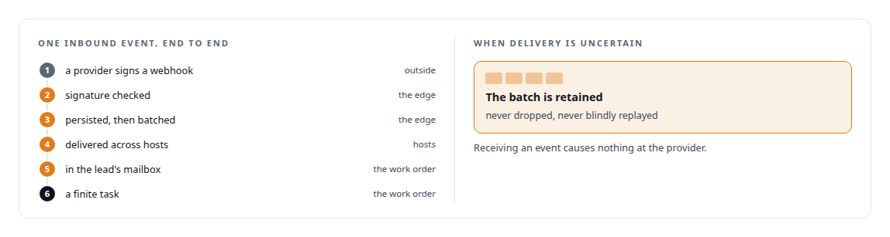
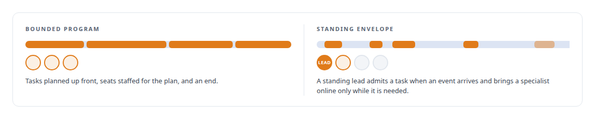

# Agents that react to the world

**Mailboxes, inbound event sources and standing work orders, so an agent team runs on what happens and never only on prompts**

Canonical: https://coreyjames.ai/ideas/agents-that-react-to-the-world/  
Author: Corey James · Published: 2026-10-28 · Kind: idea  
Systems: [AgentOS](https://github.com/coreyjames-ai/agentos) · [Agent Swarm](https://github.com/coreyjames-ai/agent-swarm) · [FAFOHive](https://github.com/coreyjames-ai/fafohive)  
Skills: [exactly-once delivery and crash recovery](https://github.com/coreyjames-ai/portfolio/tree/main/skills/exactly-once-delivery-and-crash-recovery) · [agent orchestration](https://github.com/coreyjames-ai/portfolio/tree/main/skills/agent-orchestration) · [distributed systems correctness](https://github.com/coreyjames-ai/portfolio/tree/main/skills/distributed-systems-correctness) · [message broker and queue design](https://github.com/coreyjames-ai/portfolio/tree/main/skills/message-broker-and-queue-design)  


## What was built

An agent that only answers prompts is a tool. An agent team that runs a business has to react to things that happen while nobody is typing: a payment lands, a customer replies, a post gets a comment, a document arrives, a job finishes somewhere else. I built the agent platform so that every seat has a mailbox, every external system can become a governed event source, and a work order can stay open indefinitely as a standing lead that turns events into finite tasks and brings specialists online when they are needed.

## The shape

Every team lead and every seat has a mailbox. Seats can message only their own team, and the identity on every message is derived on the server from the authenticated participant, so a message cannot claim to come from someone else. The terminal result of an asynchronous tool call is delivered to the caller's mailbox, so messaging is part of governance rather than a side channel beside it.

External systems register as event sources against a work order. The lead turns each event into a finite task under the same rules as any other work.



A work order can have an open-ended envelope, so continuous operation is composed from the same machinery that governs a bounded engineering program, with no new primitives.



## Where it appears

In [AgentOS](https://coreyjames.ai/systems/agentos), mailboxes, inbound event sources, standing-envelope work orders and event-driven tasks are part of the control plane, with the same work graph, hooks and review behind them: [Why long agent runs fail](https://coreyjames.ai/stories/why-long-agent-runs-fail).

In [FAFOHive](https://coreyjames.ai/systems/fafohive), the governed gateway's signed, durable return path carries a payments, email or social-publishing provider's events to the mailbox of the team lead whose assignment caused them, and three binding tools let a team bind the websites and mailboxes it owns and nothing else: [Agents with real tools and no keys](https://coreyjames.ai/stories/agents-with-real-tools-and-no-keys).

In [Agent Swarm](https://coreyjames.ai/systems/agent-swarm), agents message one another over durable streams with signed envelopes, so an agent that is busy or restarting loses nothing addressed to it, and in-flight work from an agent that stops heartbeating is reclaimed.

## What it buys and what it costs

It buys agents that can run a process rather than answer a question: a business, an operations desk, a long-running integration. It buys attribution for every reaction, because the event, the task and the result are all nodes in the same graph. It buys resilience, because a delivery that is uncertain waits rather than disappears.

It costs an edge that must check and persist before it delivers, and a standing lead that must be governed as carefully as a bounded one. Both are in the platform.

## The judgment in it

The decision was to make events first-class work. The alternative, a side channel that pokes an agent, would have given me reactive agents without governed ones.


> An event that becomes a task inherits budgets, evidence and review for free.

## What was verified

Each line is a claim the canonical page supports, with the figure as the page states it.

- Event-driven agent systems: signed provider webhooks checked at an edge, persisted, batched and delivered across hosts into a work order's team-lead mailbox as finite governed tasks.
- Exactly-once delivery and crash recovery: uncertain event batches retained, never dropped and never blindly replayed, with receipt causing no provider-side effect.
- Agent orchestration for continuous operations: standing work orders with an open-ended envelope that admit tasks as events arrive and bring specialist seats online on demand.

## Related

- [Agents with real tools and no keys](https://github.com/coreyjames-ai/fafohive/tree/main/stories/agents-with-real-tools-and-no-keys) · https://coreyjames.ai/stories/agents-with-real-tools-and-no-keys/
- [Why long agent runs fail](https://github.com/coreyjames-ai/agentos/tree/main/stories/why-long-agent-runs-fail) · https://coreyjames.ai/stories/why-long-agent-runs-fail/
- [Closed by evidence](https://github.com/coreyjames-ai/agentos/tree/main/stories/closed-by-evidence) · https://coreyjames.ai/stories/closed-by-evidence/
- System: [AgentOS](https://github.com/coreyjames-ai/agentos)
- System: [Agent Swarm](https://github.com/coreyjames-ai/agent-swarm)
- System: [FAFOHive](https://github.com/coreyjames-ai/fafohive)

## Citation

Corey James. "Agents that react to the world." coreyjames.ai, 2026. https://coreyjames.ai/ideas/agents-that-react-to-the-world/

```bibtex
@misc{coreyjames-agents-that-react-to-the-world,
  author = {Corey James},
  title = {Agents that react to the world},
  year = {2026},
  howpublished = {\url{https://coreyjames.ai/ideas/agents-that-react-to-the-world/}},
  note = {GitHub copy: https://github.com/coreyjames-ai/portfolio/tree/main/research/ideas/agents-that-react-to-the-world}
}
```

Part of [Corey James's portfolio](https://github.com/coreyjames-ai/portfolio) · site: https://coreyjames.ai/ · MCP server: https://coreyjames.ai/mcp · agent card: https://coreyjames.ai/.well-known/agent.json
