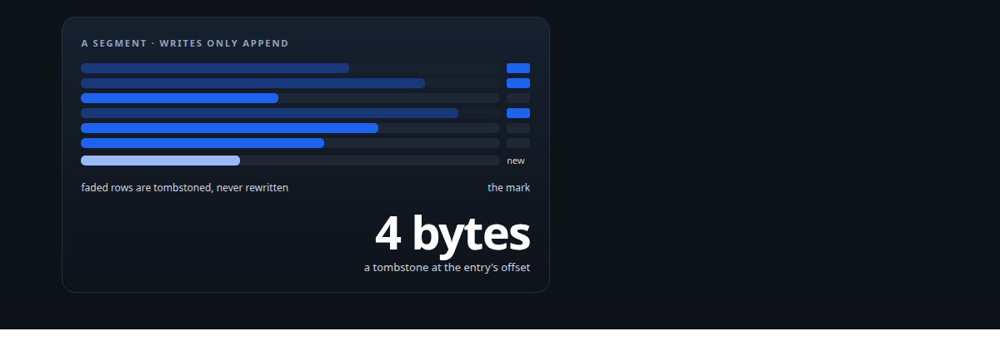
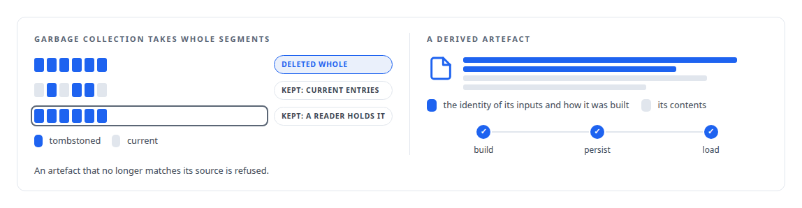
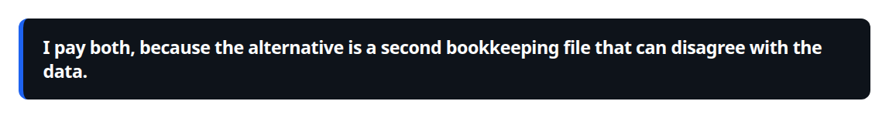
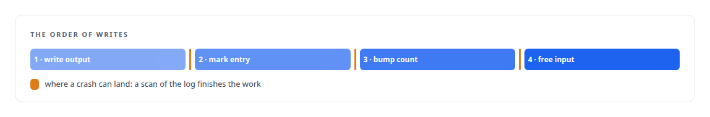

# Append-only, with tombstones and lineage

**Durable logs are only ever appended, deletion is a mark, and every derived artefact can prove where it came from**

Canonical: https://coreyjames.ai/ideas/append-only-with-lineage/  
Author: Corey James · Published: 2026-10-28 · Kind: idea  
Systems: [Inference Fabric](https://github.com/coreyjames-ai/inference-fabric) · [AgentOS](https://github.com/coreyjames-ai/agentos) · [FAFOHive](https://github.com/coreyjames-ai/fafohive) · [ActiveKV](https://github.com/coreyjames-ai/activekv)  
Skills: [append-only log design](https://github.com/coreyjames-ai/portfolio/tree/main/skills/append-only-log-design) · [exactly-once delivery and crash recovery](https://github.com/coreyjames-ai/portfolio/tree/main/skills/exactly-once-delivery-and-crash-recovery) · [distributed systems correctness](https://github.com/coreyjames-ai/portfolio/tree/main/skills/distributed-systems-correctness)  



## What was built

When the history of what happened can be rewritten, recovery becomes archaeology. I build the durable state in my systems as append-only logs. Completion or deletion is a tombstone written in place, in a fixed order relative to the data it refers to, so that a crash between two writes is repaired by a scan rather than a guess. Every derived artefact, an index, an extraction, a projection, carries a hash or a reference back to its source, so lineage is a property of the data and not a convention.

## The shape

Writes append. A segment or a table is never rewritten in place except for the tombstone mark. Derived artefacts carry the identity of their inputs and the parameters of their construction. Recovery is replay: read the log, honour the tombstones, rebuild the rest.



## Where it appears

In the [Inference Fabric](https://coreyjames.ai/systems/inference-fabric), the broker's segments are append-only on memory-mapped files, recovery reads only tombstones, and a hidden-state extraction leaves as a self-describing payload with a hash under a canonically encoded specification: [Spend structure before spending waste](https://coreyjames.ai/stories/spend-structure-before-spending-waste) and [A detector for a silent corruption](https://coreyjames.ai/stories/a-detector-for-a-silent-corruption). The vector store's indexes are bound to their source data and build conditions and refused on mismatch.

In [AgentOS](https://coreyjames.ai/systems/agentos), the work graph is written through transitions that each leave a receipt, Markdown views are regenerated projections of it, and a resumed work order is rebuilt deterministically from the stored state.

In [FAFOHive](https://coreyjames.ai/systems/fafohive), the memory capability's observations are an append-only log of what agents did and decided, and the code graph has generations so an index can be rebuilt without serving a half-built graph.

In [ActiveKV](https://coreyjames.ai/systems/activekv), host pages carry generations and leases, so a page cannot recycle its generation while a copy still reads it, and conversion of a page to the compressed tier writes a checksum before the page is published.

## What it buys and what it costs

It buys recovery you can trust and history you can reconstruct. It buys cheap deletion, one small write per item instead of a compaction. It buys the ability to check an artefact against its source years later.

It costs space until garbage collection runs, and it costs the discipline of never taking the shortcut of an in-place edit.



## The judgment in it

The order is the whole design, and once it is fixed every recovery path becomes a scan.



> I pay both, because the alternative is a second bookkeeping file that can disagree with the data.

## What was verified

Each line is a claim the canonical page supports, with the figure as the page states it.

- Append-only log design: memory-mapped append-only segments where completion is a tombstone written at the entry's offset and recovery reads only tombstones.
- Exactly-once delivery and crash recovery: a fixed write order, output persisted before the tombstone and the input retired last, so every recovery path is a scan.
- Data provenance and lineage: derived indexes, extractions and projections carry the identity of their inputs, checked at build, persist and load and refused on mismatch.

## Related

- [Millions of queued items that were not there](https://github.com/coreyjames-ai/inference-fabric/tree/main/stories/millions-of-queued-items-that-were-not-there) · https://coreyjames.ai/stories/millions-of-queued-items-that-were-not-there/
- [Spend structure before spending waste](https://github.com/coreyjames-ai/inference-fabric/tree/main/stories/spend-structure-before-spending-waste) · https://coreyjames.ai/stories/spend-structure-before-spending-waste/
- [A detector for a silent corruption](https://github.com/coreyjames-ai/inference-fabric/tree/main/stories/a-detector-for-a-silent-corruption) · https://coreyjames.ai/stories/a-detector-for-a-silent-corruption/
- System: [Inference Fabric](https://github.com/coreyjames-ai/inference-fabric)
- System: [AgentOS](https://github.com/coreyjames-ai/agentos)
- System: [FAFOHive](https://github.com/coreyjames-ai/fafohive)
- System: [ActiveKV](https://github.com/coreyjames-ai/activekv)

## Citation

Corey James. "Append-only, with tombstones and lineage." coreyjames.ai, 2026. https://coreyjames.ai/ideas/append-only-with-lineage/

```bibtex
@misc{coreyjames-append-only-with-lineage,
  author = {Corey James},
  title = {Append-only, with tombstones and lineage},
  year = {2026},
  howpublished = {\url{https://coreyjames.ai/ideas/append-only-with-lineage/}},
  note = {GitHub copy: https://github.com/coreyjames-ai/portfolio/tree/main/research/ideas/append-only-with-lineage}
}
```

Part of [Corey James's portfolio](https://github.com/coreyjames-ai/portfolio) · site: https://coreyjames.ai/ · MCP server: https://coreyjames.ai/mcp · agent card: https://coreyjames.ai/.well-known/agent.json
