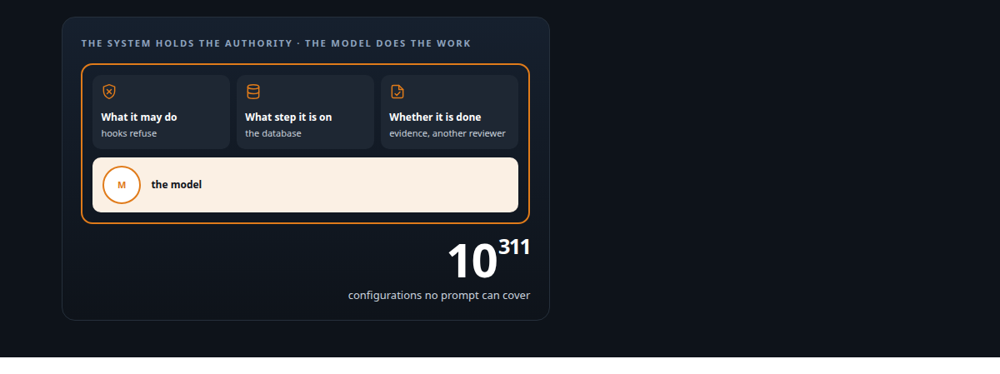
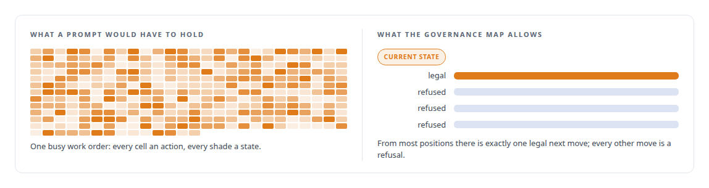
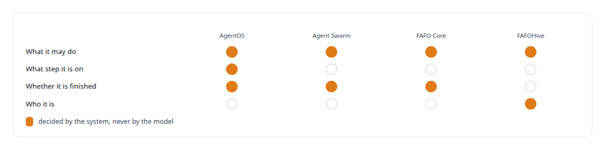

# Authority outside the model

**The model is a nondeterministic worker inside a deterministic system that decides what it may do, what step it is on, and whether it is finished**

Canonical: https://coreyjames.ai/ideas/authority-outside-the-model/  
Author: Corey James · Published: 2026-10-28 · Kind: idea  
Systems: [AgentOS](https://github.com/coreyjames-ai/agentos) · [Agent Swarm](https://github.com/coreyjames-ai/agent-swarm) · [FAFOHive](https://github.com/coreyjames-ai/fafohive) · [FAFO Core and Function Forge](https://github.com/coreyjames-ai/fafo-core)  
Skills: [multi-agent governance](https://github.com/coreyjames-ai/portfolio/tree/main/skills/multi-agent-governance) · [evidence-gated acceptance](https://github.com/coreyjames-ai/portfolio/tree/main/skills/evidence-gated-acceptance) · [agent orchestration](https://github.com/coreyjames-ai/portfolio/tree/main/skills/agent-orchestration)  



## Result

| Figure | What it measures |
| --- | --- |
| **326** | active actions in one busy work order |
| **9** | states each of those actions can be in |
| **52** | legal transitions in the whole governance map, across all states |

## What was built

A language model is a superb worker and a terrible authority. It will do the task in front of it with skill, and it will also decide it has permission it was never given, declare a step complete because the transcript reads that way, and talk itself out of a rule that is inconvenient. Every failure I had with autonomous agents came back to the same cause: the model was being asked to hold the authority as well as do the work. I now build systems where the model never decides what it is allowed to do, what step it is on, or whether it is finished. External rules, data and machinery decide all of that.

## The shape

State lives in a database, never in a prompt. A job is rendered from that state at dispatch time, small and contract-bound, and nothing is carried from job to job inside the model's context. Policy is enforced by hooks that refuse forbidden actions; a rule is a refusal, so no prompt has to remember it. Completion is judged by evidence that exists in the system, examined by a reviewer that did not do the work, and a work order closes as one act over all of its acceptance evidence. Where the model wants a capability, the capability is granted by the system, not claimed by the model.

The arithmetic is the reason this has to be structural: no prompt and no test suite can cover the configurations of one busy work order in my governance platform, and a governance map of legal transitions can.



## Where it appears

In [AgentOS](https://coreyjames.ai/systems/agentos) it is the whole design: a PostgreSQL work graph as the only source of truth, hooks that turn policy into refusals, independent reviewers from a different model family, and evidence-gated close. The diagnosis behind it is in [Why long agent runs fail](https://coreyjames.ai/stories/why-long-agent-runs-fail); the review structure in [Separation of duties for AI work](https://coreyjames.ai/stories/separation-of-duties-for-ai-work); the close rule, held for two weeks against the agents' own "done", in [Closed by evidence](https://coreyjames.ai/stories/closed-by-evidence).

In [Agent Swarm](https://coreyjames.ai/systems/agent-swarm), an agent cannot call a tool it was not granted, every call passes a frozen pipeline the agent cannot bypass, and the gatekeeper that opens merge requests is a different agent from the one that writes code: [Tools are the platform](https://coreyjames.ai/stories/tools-are-the-platform) and [A coding agent that never holds the keys](https://coreyjames.ai/stories/a-coding-agent-that-never-holds-the-keys).

In [FAFO Core and Function Forge](https://coreyjames.ai/systems/fafo-core), an agent can write a new tool, and the tool takes effect only when a human rebuilds and restarts the gateway; the generated code sees a context object rather than resources: [Tools that build tools, under governance](https://coreyjames.ai/stories/tools-that-build-tools-under-governance).

In [FAFOHive](https://coreyjames.ai/systems/fafohive), the gateway derives an agent's identity from how it authenticated, never from what it claims in a tool call, and a budget that an agent cannot raise sits in every provisioning path.



## What it buys and what it costs

It buys trust: a program run this way can be audited, because the history of what happened was produced by the system rather than narrated by the worker. It buys swappable models, because a job that carries its own contract does not care which model fills it. It buys recovery, because the state survives any session.

It costs speed on the happy path. A lead agent that cannot edit an artifact feels slower than one that can. A close that waits for independent evidence takes days longer than one that trusts the builder. I pay that every time, because the alternative looks fine for a day and cannot be trusted for a week.

## The judgment in it

The hard part is resisting the obvious shortcut: the model is right there, it can see the state, why not let it decide? Because it will be right most of the time, and the times it is wrong will be confident and invisible. 


That is also where the model is at its best.

> Anything the system can decide deterministically, the system decides, and the model is left with the work that requires judgment.

## What was verified

Each line is a claim the canonical page supports, with the figure as the page states it.

- Multi-agent governance: agent state held in a database and policy enforced by hooks that refuse forbidden actions; one busy work order holds 326 active actions in 9 states, governed by a map of 52 legal transitions.
- Identity and least privilege for AI agents: identity derived from how an agent authenticated, never its claims in a tool call, a budget it cannot raise, and agent-written tools that take effect only after a human rebuilds the gateway.
- Evidence-gated acceptance: completion judged by evidence in the system and examined by a reviewer that did not do the work, with a work order closing as one act over all of its acceptance evidence.

## Related

- [Why long agent runs fail](https://github.com/coreyjames-ai/agentos/tree/main/stories/why-long-agent-runs-fail) · https://coreyjames.ai/stories/why-long-agent-runs-fail/
- [Separation of duties for AI work](https://github.com/coreyjames-ai/agentos/tree/main/stories/separation-of-duties-for-ai-work) · https://coreyjames.ai/stories/separation-of-duties-for-ai-work/
- [Closed by evidence](https://github.com/coreyjames-ai/agentos/tree/main/stories/closed-by-evidence) · https://coreyjames.ai/stories/closed-by-evidence/
- [Tools are the platform](https://github.com/coreyjames-ai/agent-swarm/tree/main/stories/tools-are-the-platform) · https://coreyjames.ai/stories/tools-are-the-platform/
- [A coding agent that never holds the keys](https://github.com/coreyjames-ai/agent-swarm/tree/main/stories/a-coding-agent-that-never-holds-the-keys) · https://coreyjames.ai/stories/a-coding-agent-that-never-holds-the-keys/
- [Tools that build tools, under governance](https://github.com/coreyjames-ai/fafo-core/tree/main/stories/tools-that-build-tools-under-governance) · https://coreyjames.ai/stories/tools-that-build-tools-under-governance/
- System: [AgentOS](https://github.com/coreyjames-ai/agentos)
- System: [Agent Swarm](https://github.com/coreyjames-ai/agent-swarm)
- System: [FAFOHive](https://github.com/coreyjames-ai/fafohive)
- System: [FAFO Core and Function Forge](https://github.com/coreyjames-ai/fafo-core)

## Citation

Corey James. "Authority outside the model." coreyjames.ai, 2026. https://coreyjames.ai/ideas/authority-outside-the-model/

```bibtex
@misc{coreyjames-authority-outside-the-model,
  author = {Corey James},
  title = {Authority outside the model},
  year = {2026},
  howpublished = {\url{https://coreyjames.ai/ideas/authority-outside-the-model/}},
  note = {GitHub copy: https://github.com/coreyjames-ai/portfolio/tree/main/research/ideas/authority-outside-the-model}
}
```

Part of [Corey James's portfolio](https://github.com/coreyjames-ai/portfolio) · site: https://coreyjames.ai/ · MCP server: https://coreyjames.ai/mcp · agent card: https://coreyjames.ai/.well-known/agent.json
