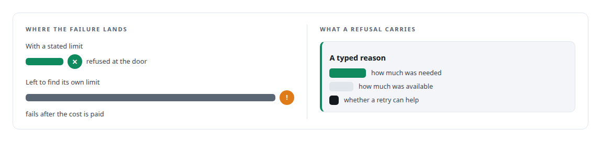
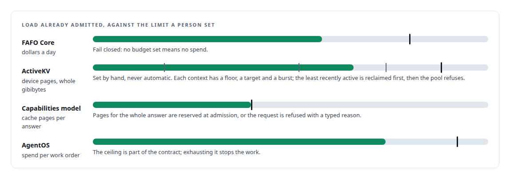

# Budgets and refusals

**Spend, memory and admission are first-class controls, and the system says no with a number instead of degrading**

Canonical: https://coreyjames.ai/ideas/budgets-and-refusals/  
Author: Corey James · Published: 2026-10-28 · Kind: idea  
Systems: [FAFO Core and Function Forge](https://github.com/coreyjames-ai/fafo-core) · [ActiveKV](https://github.com/coreyjames-ai/activekv) · [Capabilities model](https://github.com/coreyjames-ai/capabilities-model) · [AgentOS](https://github.com/coreyjames-ai/agentos)  
Skills: [distributed systems correctness](https://github.com/coreyjames-ai/portfolio/tree/main/skills/distributed-systems-correctness) · [inference serving architecture](https://github.com/coreyjames-ai/portfolio/tree/main/skills/inference-serving-architecture) · [vLLM internals](https://github.com/coreyjames-ai/portfolio/tree/main/skills/vllm-internals) · [AI-assisted engineering methodology](https://github.com/coreyjames-ai/portfolio/tree/main/skills/ai-assisted-engineering-methodology)  


## What was built

Every resource an agent or a kernel can consume has a stated limit in my systems, and crossing it produces a typed refusal with a reason attached. Dollars per day, device pages per context, key-value memory per request, concurrent sequences per engine, tokens per step. The alternative, letting the system find its own limit by thrashing, stalling or running out of memory mid-step, hides the failure where it is most expensive to find.

## The shape

The limit is explicit and set by a human: a whole number of gibibytes, a dollar figure, a count. Admission checks the limit before load is taken on. Budgets sit in paths an agent cannot reach from inside the work; an agent that wants more asks a human. Reclamation, when it happens, is ordered and counted so a wait can be explained afterwards.



## Where it appears

In [FAFO Core and Function Forge](https://coreyjames.ai/systems/fafo-core), the daily budget gates GPU provisioning on local, LAN and cloud hardware, with per-second spend accounting, and it is set by a human on a path agents do not have.

In [ActiveKV](https://coreyjames.ai/systems/activekv), a host-pool geometry that does not fit stops at startup and names the setting to change: [Staging without a stall](https://coreyjames.ai/stories/staging-without-a-stall).

In the [Capabilities model](https://coreyjames.ai/systems/capabilities-model), a sequence never runs out of cache mid-answer, even in a burst of clients: [A router beside a production model](https://coreyjames.ai/stories/a-router-beside-a-production-model).

In [AgentOS](https://coreyjames.ai/systems/agentos), cost is a field on every task: [What the work cost, to the penny](https://coreyjames.ai/stories/what-the-work-cost).



## What it buys and what it costs

It buys predictability: a system that refuses at the door never surprises you at the bottom of a run. It buys explainable waits and auditable spend. It buys the confidence to let agents provision real hardware.

It costs capacity left on the table at the margin, because a budget set by a human is conservative, and it costs the occasional refusal of work that would have fit. I take that trade every time the silent alternative is spend, data loss or a corrupted answer.

## The judgment in it


A reranker that saturates under load is fine. A GPU that runs out of memory halfway through a token is not.

> Fail closed where the silent alternative is money, loss or a false result; degrade gracefully where the alternative is merely lower quality.

## What was verified

Each line is a claim the canonical page supports, with the figure as the page states it.

- Admission control and rate limiting: typed refusals at the door carrying how much was needed, how much was available and whether a retry can help, instead of failing mid-step.
- Cloud GPU provisioning with cost controls: a fail-closed daily dollar budget, set by a person on a path agents cannot reach, gating GPU provisioning on local, LAN and cloud hardware.
- GPU memory management: an explicit device page pool with per-context floors, targets and bursts, and cache pages reserved for a whole answer at admission.

## Related

- [A router beside a production model](https://github.com/coreyjames-ai/capabilities-model/tree/main/stories/a-router-beside-a-production-model) · https://coreyjames.ai/stories/a-router-beside-a-production-model/
- [Staging without a stall](https://github.com/coreyjames-ai/activekv/tree/main/stories/staging-without-a-stall) · https://coreyjames.ai/stories/staging-without-a-stall/
- [What the work cost, to the penny](https://github.com/coreyjames-ai/agentos/tree/main/stories/what-the-work-cost) · https://coreyjames.ai/stories/what-the-work-cost/
- [Tools that build tools, under governance](https://github.com/coreyjames-ai/fafo-core/tree/main/stories/tools-that-build-tools-under-governance) · https://coreyjames.ai/stories/tools-that-build-tools-under-governance/
- System: [FAFO Core and Function Forge](https://github.com/coreyjames-ai/fafo-core)
- System: [ActiveKV](https://github.com/coreyjames-ai/activekv)
- System: [Capabilities model](https://github.com/coreyjames-ai/capabilities-model)
- System: [AgentOS](https://github.com/coreyjames-ai/agentos)

## Citation

Corey James. "Budgets and refusals." coreyjames.ai, 2026. https://coreyjames.ai/ideas/budgets-and-refusals/

```bibtex
@misc{coreyjames-budgets-and-refusals,
  author = {Corey James},
  title = {Budgets and refusals},
  year = {2026},
  howpublished = {\url{https://coreyjames.ai/ideas/budgets-and-refusals/}},
  note = {GitHub copy: https://github.com/coreyjames-ai/portfolio/tree/main/research/ideas/budgets-and-refusals}
}
```

Part of [Corey James's portfolio](https://github.com/coreyjames-ai/portfolio) · site: https://coreyjames.ai/ · MCP server: https://coreyjames.ai/mcp · agent card: https://coreyjames.ai/.well-known/agent.json
