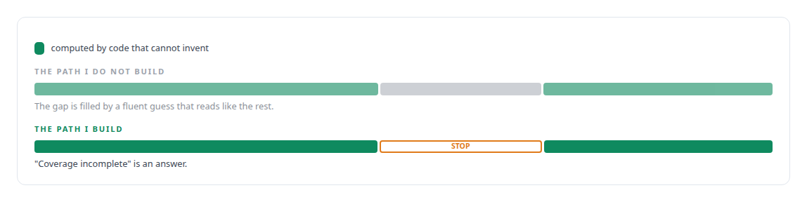
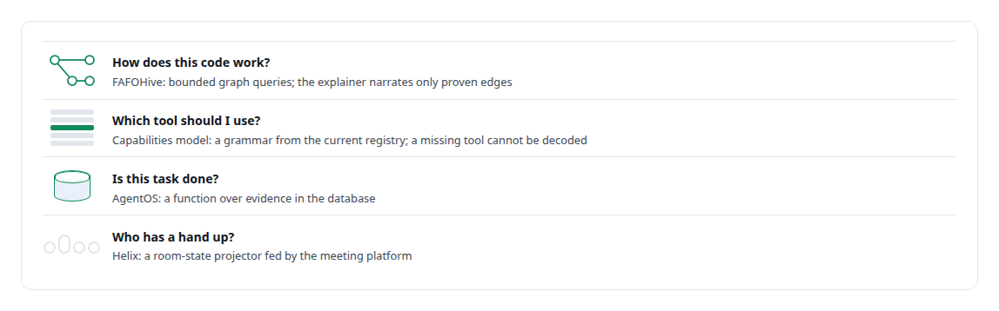

# Compute first, narrate second

**Put deterministic evidence in front of the model instead of asking the model for evidence**

Canonical: https://coreyjames.ai/ideas/compute-first-narrate-second/  
Author: Corey James · Published: 2026-10-28 · Kind: idea  
Systems: [FAFOHive](https://github.com/coreyjames-ai/fafohive) · [AgentOS](https://github.com/coreyjames-ai/agentos) · [Capabilities model](https://github.com/coreyjames-ai/capabilities-model) · [Helix](https://github.com/coreyjames-ai/helix)  
Skills: [agent orchestration](https://github.com/coreyjames-ai/portfolio/tree/main/skills/agent-orchestration) · [AI-assisted engineering methodology](https://github.com/coreyjames-ai/portfolio/tree/main/skills/ai-assisted-engineering-methodology) · [inference serving architecture](https://github.com/coreyjames-ai/portfolio/tree/main/skills/inference-serving-architecture) · [evidence-gated acceptance](https://github.com/coreyjames-ai/portfolio/tree/main/skills/evidence-gated-acceptance)  


## What was built

A model asked "how does this code work" will answer fluently and will invent call paths. A model asked "is this task done" will say yes. A model asked "which tool should I use" will name one that does not exist. In each case the failure is the same: the model was asked to produce evidence. I build the other way round. Whatever can be computed is computed first, by code that cannot hallucinate, and the model's job is reduced to narrating or acting on what it was handed.

## The shape

A deterministic layer produces the facts: a code graph, a work-order state, a tool registry, a room-state projection from a meeting. The model receives those facts in its context and is permitted only to describe, select among, or act on them.



## Where it appears

In [FAFOHive](https://coreyjames.ai/systems/fafohive), the memory capability's code explainer stops at the edge of the graph's coverage: [A code explainer that is not allowed to invent](https://coreyjames.ai/stories/a-code-explainer-that-is-not-allowed-to-invent).

In the [Capabilities model](https://coreyjames.ai/systems/capabilities-model), the registry also supplies the schemas: [A hundred tokens instead of forty-two thousand](https://coreyjames.ai/stories/a-hundred-tokens-instead-of-forty-two-thousand).

In [AgentOS](https://coreyjames.ai/systems/agentos), an agent's job is rendered from the work graph at dispatch time, so what it knows about the plan and the evidence is computed, not remembered: [Why long agent runs fail](https://coreyjames.ai/stories/why-long-agent-runs-fail).

In [Helix](https://coreyjames.ai/systems/helix), the meeting agent never reports a hand it raised from local state: [A meeting attendee that will not fake it](https://coreyjames.ai/stories/a-meeting-attendee-that-will-not-fake-it).



## What it buys and what it costs

It buys answers that can be acted on. An engineer who reads a proven call path can change the code; one who reads a plausible one cannot tell the difference until real use does. It buys smaller models, because a model that only narrates needs less capacity than one that must also know.

It costs the deterministic layer: a parser, a graph, a registry, a projector, each of which is real engineering. And it costs refusals where a looser system would have produced something. I prefer the refusal.

## The judgment in it

The line to hold is at the fallback. Every product instinct says to let the model answer when the graph cannot, with a caveat. 


> The caveat is the first thing a reader stops seeing, so I do not build that path.

## What was verified

Each line is a claim the canonical page supports, with the figure as the page states it.

- Evidence-grounded LLM output: a code explainer that narrates only edges a bounded graph query has proven and reports incomplete coverage instead of guessing.
- Grammar-constrained decoding: a grammar compiled from the tool registry, so a model cannot name a tool that does not exist.
- Agent orchestration: jobs rendered from the work graph at dispatch, and completion decided by a function over evidence in the database.

## Related

- [A code explainer that is not allowed to invent](https://github.com/coreyjames-ai/fafohive/tree/main/stories/a-code-explainer-that-is-not-allowed-to-invent) · https://coreyjames.ai/stories/a-code-explainer-that-is-not-allowed-to-invent/
- [Why long agent runs fail](https://github.com/coreyjames-ai/agentos/tree/main/stories/why-long-agent-runs-fail) · https://coreyjames.ai/stories/why-long-agent-runs-fail/
- [A hundred tokens instead of forty-two thousand](https://github.com/coreyjames-ai/capabilities-model/tree/main/stories/a-hundred-tokens-instead-of-forty-two-thousand) · https://coreyjames.ai/stories/a-hundred-tokens-instead-of-forty-two-thousand/
- [A meeting attendee that will not fake it](https://github.com/coreyjames-ai/helix/tree/main/stories/a-meeting-attendee-that-will-not-fake-it) · https://coreyjames.ai/stories/a-meeting-attendee-that-will-not-fake-it/
- System: [FAFOHive](https://github.com/coreyjames-ai/fafohive)
- System: [AgentOS](https://github.com/coreyjames-ai/agentos)
- System: [Capabilities model](https://github.com/coreyjames-ai/capabilities-model)
- System: [Helix](https://github.com/coreyjames-ai/helix)

## Citation

Corey James. "Compute first, narrate second." coreyjames.ai, 2026. https://coreyjames.ai/ideas/compute-first-narrate-second/

```bibtex
@misc{coreyjames-compute-first-narrate-second,
  author = {Corey James},
  title = {Compute first, narrate second},
  year = {2026},
  howpublished = {\url{https://coreyjames.ai/ideas/compute-first-narrate-second/}},
  note = {GitHub copy: https://github.com/coreyjames-ai/portfolio/tree/main/research/ideas/compute-first-narrate-second}
}
```

Part of [Corey James's portfolio](https://github.com/coreyjames-ai/portfolio) · site: https://coreyjames.ai/ · MCP server: https://coreyjames.ai/mcp · agent card: https://coreyjames.ai/.well-known/agent.json
