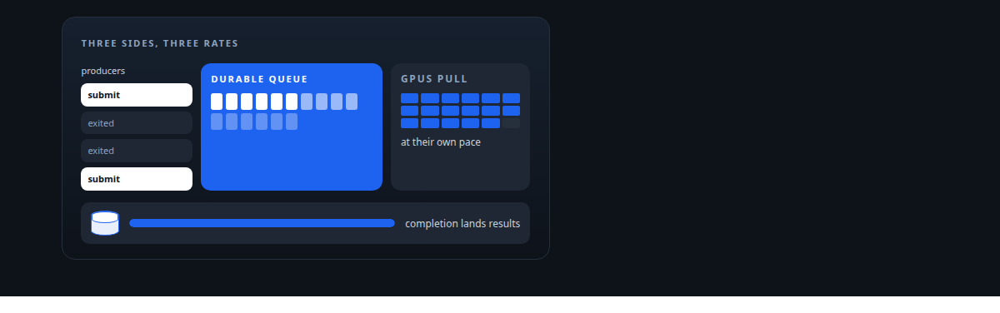
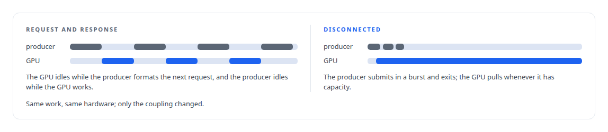
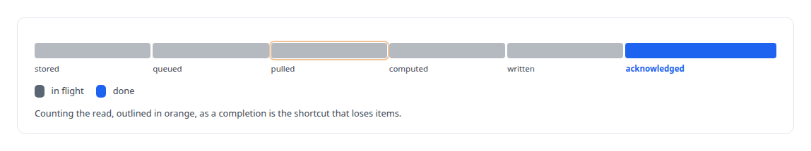
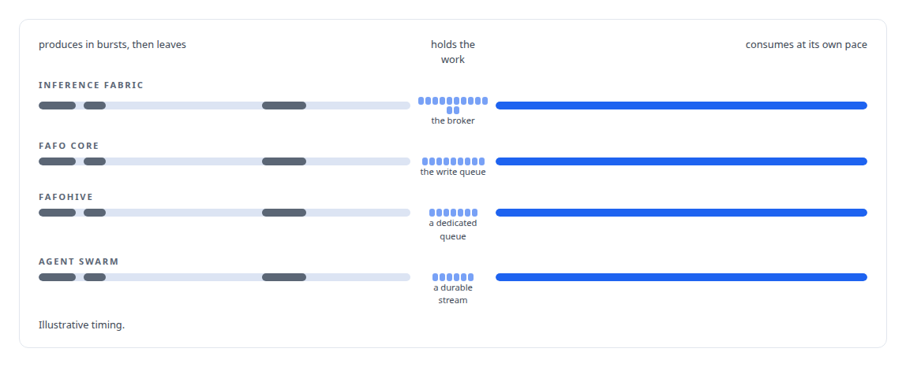

# Disconnected producers and consumers

**Nothing waits on anything else: the method under most of my high-throughput work**

Canonical: https://coreyjames.ai/ideas/disconnected-producers-and-consumers/  
Author: Corey James · Published: 2026-10-28 · Kind: idea  
Systems: [Inference Fabric](https://github.com/coreyjames-ai/inference-fabric) · [FAFO Core and Function Forge](https://github.com/coreyjames-ai/fafo-core) · [FAFOHive](https://github.com/coreyjames-ai/fafohive) · [Agent Swarm](https://github.com/coreyjames-ai/agent-swarm)  
Skills: [message broker and queue design](https://github.com/coreyjames-ai/portfolio/tree/main/skills/message-broker-and-queue-design) · [inference serving architecture](https://github.com/coreyjames-ai/portfolio/tree/main/skills/inference-serving-architecture) · [high-throughput batch inference](https://github.com/coreyjames-ai/portfolio/tree/main/skills/high-throughput-batch-inference) · [distributed systems correctness](https://github.com/coreyjames-ai/portfolio/tree/main/skills/distributed-systems-correctness)  



## Result

| Figure | What it measures |
| --- | --- |
| **163K** | tokens per second, five-minute mean on two cards, from about 44,000 |
| **3** | batching modes any Function Forge function can run in by configuration |

## What was built

Most pipelines are built as request and response: the thing that wants work done waits for the thing that does it. That coupling is why GPUs sit idle while a producer formats the next request, why a slow database stalls generation, and why a crash in one process takes the others down with it. I build the opposite shape wherever throughput or resilience matters. Producers submit work to a durable queue and exit. Consumers pull from the queue at their own pace. A separate completion path lands results where they belong. No component ever waits on another, and every component restarts on its own.

## The shape

A producer's job ends the moment its work is durably stored. It does not hold a connection open, it does not wait for a result, and it can be a short-lived process that runs, submits and dies. The queue between producer and consumer is the source of truth for in-flight work. Consumers are pull-based: a GPU worker asks for the next batch when it has capacity, so a fast consumer is never throttled by a slow producer and a slow consumer never causes a producer to block. Completion is its own service. It watches for finished work and writes results into the governed data plane, so neither the producer nor the consumer has to know where results live.



Three things follow from that shape. Backpressure is free, because a consumer that is busy just does not pull. Restarts are local, because the queue holds the truth and each side rebuilds its picture from it. And the accounting has a single place to be right.



## Where it appears

In the [Inference Fabric](https://coreyjames.ai/systems/inference-fabric), producers drop millions of tokenised tasks and walk away. This is the shape behind [From 44K to 163K tokens per second](https://coreyjames.ai/stories/from-44k-to-163k-tokens-per-second), and it is what made the broker's completion accounting the right place to fix a six-million-item loss, in [Millions of queued items that were not there](https://coreyjames.ai/stories/millions-of-queued-items-that-were-not-there).

In [FAFO Core and Function Forge](https://coreyjames.ai/systems/fafo-core), decoupled submit-and-exit is a batching mode any function can run in by configuration, beside row-count and token-budget batching. The probe-generation pipeline is where the shape was forced on me, when embedding completion in the producer made the producer wait on results, in [The workload that shaped the platform](https://coreyjames.ai/stories/the-workload-that-shaped-the-platform).

In [FAFOHive](https://coreyjames.ai/systems/fafohive), capturing what an agent did never slows the agent down, and the governed gateway logs a call's intent before the call and its completion after, so a restart can finish the accounting without repeating the call.

In [Agent Swarm](https://coreyjames.ai/systems/agent-swarm), agents message one another over durable streams rather than direct calls, so an agent that is busy or restarting loses nothing addressed to it.



## What it buys and what it costs

It buys saturation, because the expensive resource is never waiting on the cheap one. It buys resilience, because every component's restart is local. It buys honest accounting, because there is one definition of done.

It costs latency for any single item, because a queue hop and a completion hop sit between a request and its result. It costs a durable queue that must itself be correct, which is why the broker's accounting got so much of my attention. And it costs a completion service that has to be built and run. For chat-shaped work where a person is waiting, I do not use it. For everything measured in millions of items, I do.

## The judgment in it

The decision is always where to cut. 


I keep the queue dumb about what it carries except for the one thing the consumer needs to pack efficiently, which in the Fabric is the shape of the work. And I make "done" mean acknowledged completion everywhere the shape appears, because the first time I let a queue count a read as a completion, six and a half million items disappeared.

> I cut at the point where the two sides have different natural rates: producers that are bursty and cheap, consumers that are expensive and steady.

## What was verified

Each line is a claim the canonical page supports, with the figure as the page states it.

- High-throughput batch inference: producers that submit and exit, a durable queue, pull-based GPU consumers and a separate completion path, the shape behind 163K tokens per second from about 44,000.
- Message broker and queue design: backpressure by not pulling, local restarts, and one definition of done, an item complete only when its completion is acknowledged.
- Asynchronous execution design: decoupled submit-and-exit as one of 3 batching modes any Function Forge function can run in by configuration.

## Related

- [From 44K to 163K tokens per second](https://github.com/coreyjames-ai/inference-fabric/tree/main/stories/from-44k-to-163k-tokens-per-second) · https://coreyjames.ai/stories/from-44k-to-163k-tokens-per-second/
- [A message broker that understands tokens](https://github.com/coreyjames-ai/inference-fabric/tree/main/stories/a-message-broker-that-understands-tokens) · https://coreyjames.ai/stories/a-message-broker-that-understands-tokens/
- [Millions of queued items that were not there](https://github.com/coreyjames-ai/inference-fabric/tree/main/stories/millions-of-queued-items-that-were-not-there) · https://coreyjames.ai/stories/millions-of-queued-items-that-were-not-there/
- [The workload that shaped the platform](https://github.com/coreyjames-ai/fafo-core/tree/main/stories/the-workload-that-shaped-the-platform) · https://coreyjames.ai/stories/the-workload-that-shaped-the-platform/
- System: [Inference Fabric](https://github.com/coreyjames-ai/inference-fabric)
- System: [FAFO Core and Function Forge](https://github.com/coreyjames-ai/fafo-core)
- System: [FAFOHive](https://github.com/coreyjames-ai/fafohive)
- System: [Agent Swarm](https://github.com/coreyjames-ai/agent-swarm)

## Citation

Corey James. "Disconnected producers and consumers." coreyjames.ai, 2026. https://coreyjames.ai/ideas/disconnected-producers-and-consumers/

```bibtex
@misc{coreyjames-disconnected-producers-and-consumers,
  author = {Corey James},
  title = {Disconnected producers and consumers},
  year = {2026},
  howpublished = {\url{https://coreyjames.ai/ideas/disconnected-producers-and-consumers/}},
  note = {GitHub copy: https://github.com/coreyjames-ai/portfolio/tree/main/research/ideas/disconnected-producers-and-consumers}
}
```

Part of [Corey James's portfolio](https://github.com/coreyjames-ai/portfolio) · site: https://coreyjames.ai/ · MCP server: https://coreyjames.ai/mcp · agent card: https://coreyjames.ai/.well-known/agent.json
