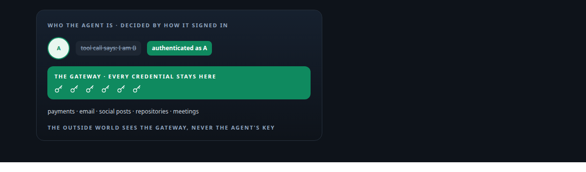
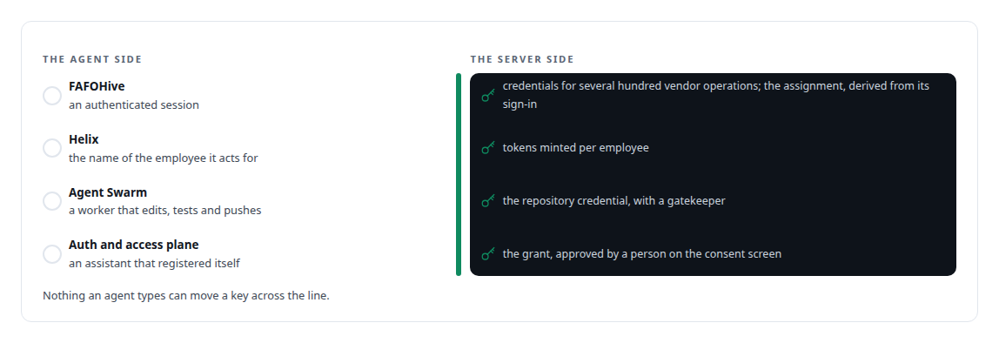
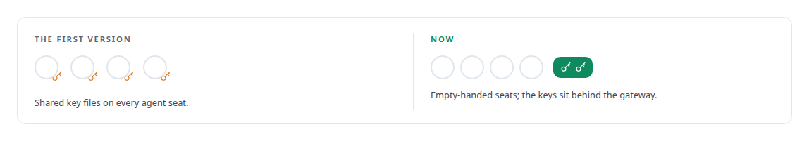

# Identity from the caller, credentials on the server

**An agent is who it authenticated as, never who it says it is, and it never holds a key it does not need**

Canonical: https://coreyjames.ai/ideas/identity-from-the-caller/  
Author: Corey James · Published: 2026-10-28 · Kind: idea  
Systems: [FAFOHive](https://github.com/coreyjames-ai/fafohive) · [Helix](https://github.com/coreyjames-ai/helix) · [Agent Swarm](https://github.com/coreyjames-ai/agent-swarm) · [Auth and access plane](https://github.com/coreyjames-ai/auth-and-access-plane)  
Skills: [distributed systems correctness](https://github.com/coreyjames-ai/portfolio/tree/main/skills/distributed-systems-correctness) · [OAuth 2.0 and identity architecture](https://github.com/coreyjames-ai/portfolio/tree/main/skills/oauth-2-0-and-identity-architecture) · [MCP server design](https://github.com/coreyjames-ai/portfolio/tree/main/skills/mcp-server-design) · [inference serving architecture](https://github.com/coreyjames-ai/portfolio/tree/main/skills/inference-serving-architecture)  



## What was built

The confused-deputy problem is the standing failure of agent systems: an agent acting for one principal is talked into acting for another, or holds a credential that leaks into a transcript. I remove it by construction. Identity is derived from how a caller authenticated, never from an argument in a tool call. Credentials for external services live on the server side of a gateway, are minted per identity where the platform allows it, and are never handed to a model.

## The shape

A gateway between agents and the outside world authenticates the agent, derives its assignment or employee identity from that authentication, and performs the external call itself with credentials it holds. Attribution is written into the external payload only where that exact operation has been shown to round-trip it. Tokens for a platform identity are minted on the server from certificate assertions and checked in-process before use. An agent that needs to touch a repository, a payment or a social post asks a gatekeeper that holds the credential.

## Where it appears

In [FAFOHive](https://coreyjames.ai/systems/fafohive), three binding tools derive an agent's assignment on the server so it cannot bind a website or mailbox for a business that is not its own: [Agents with real tools and no keys](https://coreyjames.ai/stories/agents-with-real-tools-and-no-keys).

In [Helix](https://coreyjames.ai/systems/helix), every meeting action names the digital employee it acts for: [Solving the digital-employee identity](https://coreyjames.ai/stories/solving-the-digital-employee-identity).

In [Agent Swarm](https://coreyjames.ai/systems/agent-swarm), a coding agent on a local model edits, tests and pushes: [A coding agent that never holds the keys](https://coreyjames.ai/stories/a-coding-agent-that-never-holds-the-keys).

In the [Auth and access plane](https://coreyjames.ai/systems/auth-and-access-plane), the consent screen is the real control: [The hardening fix that locked everyone out](https://coreyjames.ai/stories/the-hardening-fix-that-locked-everyone-out).



## What it buys and what it costs

It buys attribution you can trust, because the identity on an action was established by authentication. It buys a blast radius bounded by what the server will do for that identity. It buys the ability to let agents touch real systems at all.

It costs a gateway that must itself be correct, and it costs a human at the grant step. I keep that gate narrow and keep it.

## The judgment in it



The first version worked, and it was wrong, and I removed it. The lesson generalises.


> Anything that works by trusting what an agent says about itself is a design that has not failed yet.

## What was verified

Each line is a claim the canonical page supports, with the figure as the page states it.

- Identity and least privilege for AI agents: identity derived on the server from how an agent authenticated, never from an argument in a tool call.
- Credential brokering and secrets management: external credentials held behind a gateway and minted per identity on the server, never handed to a model, with the repository credential held by a gatekeeper agent.
- Digital-employee identity: every meeting action names the digital employee it acts for, with employee tokens minted on the server.

## Related

- [Agents with real tools and no keys](https://github.com/coreyjames-ai/fafohive/tree/main/stories/agents-with-real-tools-and-no-keys) · https://coreyjames.ai/stories/agents-with-real-tools-and-no-keys/
- [Solving the digital-employee identity](https://github.com/coreyjames-ai/helix/tree/main/stories/solving-the-digital-employee-identity) · https://coreyjames.ai/stories/solving-the-digital-employee-identity/
- [A coding agent that never holds the keys](https://github.com/coreyjames-ai/agent-swarm/tree/main/stories/a-coding-agent-that-never-holds-the-keys) · https://coreyjames.ai/stories/a-coding-agent-that-never-holds-the-keys/
- [The hardening fix that locked everyone out](https://github.com/coreyjames-ai/auth-and-access-plane/tree/main/stories/the-hardening-fix-that-locked-everyone-out) · https://coreyjames.ai/stories/the-hardening-fix-that-locked-everyone-out/
- System: [FAFOHive](https://github.com/coreyjames-ai/fafohive)
- System: [Helix](https://github.com/coreyjames-ai/helix)
- System: [Agent Swarm](https://github.com/coreyjames-ai/agent-swarm)
- System: [Auth and access plane](https://github.com/coreyjames-ai/auth-and-access-plane)

## Citation

Corey James. "Identity from the caller, credentials on the server." coreyjames.ai, 2026. https://coreyjames.ai/ideas/identity-from-the-caller/

```bibtex
@misc{coreyjames-identity-from-the-caller,
  author = {Corey James},
  title = {Identity from the caller, credentials on the server},
  year = {2026},
  howpublished = {\url{https://coreyjames.ai/ideas/identity-from-the-caller/}},
  note = {GitHub copy: https://github.com/coreyjames-ai/portfolio/tree/main/research/ideas/identity-from-the-caller}
}
```

Part of [Corey James's portfolio](https://github.com/coreyjames-ai/portfolio) · site: https://coreyjames.ai/ · MCP server: https://coreyjames.ai/mcp · agent card: https://coreyjames.ai/.well-known/agent.json
