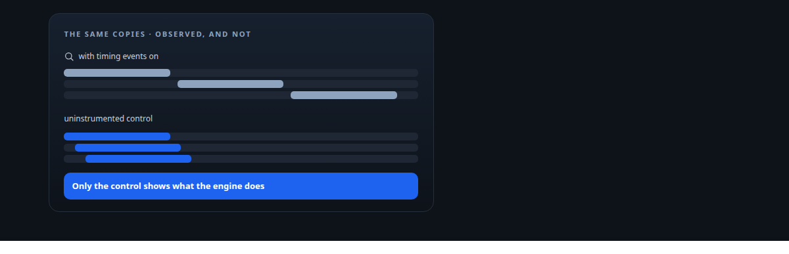
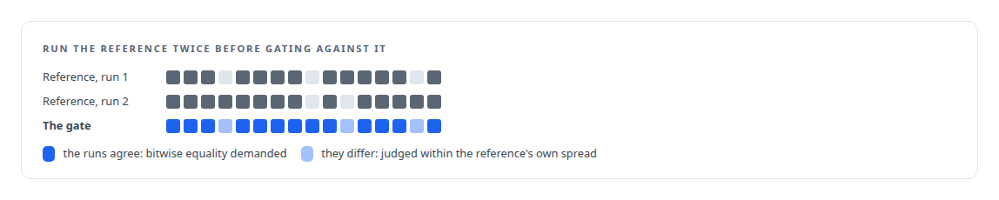
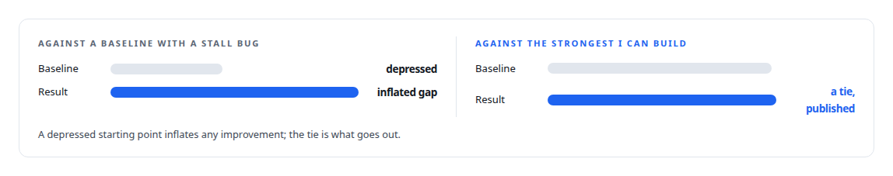

# Measure the instrument

**A result is only as good as the proof that the measurement measured the thing**

Canonical: https://coreyjames.ai/ideas/measure-the-instrument/  
Author: Corey James · Published: 2026-10-28 · Kind: idea  
Systems: [ActiveKV](https://github.com/coreyjames-ai/activekv) · [Capabilities model](https://github.com/coreyjames-ai/capabilities-model) · [Inference Fabric](https://github.com/coreyjames-ai/inference-fabric) · [AgentOS](https://github.com/coreyjames-ai/agentos)  
Skills: [evidence-gated acceptance](https://github.com/coreyjames-ai/portfolio/tree/main/skills/evidence-gated-acceptance)  



## What was built

Every performance programme I have run has produced at least one result that was really a property of the measurement. A profiler that serialised the copy engine it was observing. A test suite that passed a thousand trials against the wrong code. A benchmark whose baseline had a stall bug. A headline that beat a weak comparison. I treat the instrument as part of the experiment, and I do not act on a number until I know what the instrument did to it.

## The shape

Every instrumented run has an uninstrumented control. Every evaluation set is frozen before the model sees it and carries known-answer controls that can catch the team as readily as the model. Every "switched" claim about a code path comes with proof of binding order on the real startup path. Every baseline is the strongest one I can build, and the one that produced a flattering number is never used.



## Where it appears

In [ActiveKV](https://coreyjames.ai/systems/activekv), a confound experiment showed that timing-enabled events were lowering into timestamp commands that forced the copy engine to wait, so the serialisation the profiler reported was the profiler's. I retracted the verdict in the plan: [The observer that changed the answer](https://coreyjames.ai/stories/the-observer-that-changed-the-answer). In the same programme, over a thousand passing trials were voided when the native engine turned out to be bound after the selector that checked for it: [Proving a rewrite is the same system](https://coreyjames.ai/stories/proving-a-rewrite-is-the-same-system).

In the [Capabilities model](https://coreyjames.ai/systems/capabilities-model), the strongest classical retriever I could build tied the model: [The baseline that tied us](https://coreyjames.ai/stories/the-baseline-that-tied-us). The decoder's determinism is checked by gates across batch compositions and by a cross-check against an independent implementation: [Bit-identical across batch compositions](https://coreyjames.ai/stories/bit-identical-across-batch-compositions).

In the [Inference Fabric](https://coreyjames.ai/systems/inference-fabric), the thirty-minute run with a stall bug is excluded as a baseline, and a diagnosis of a write path was done from the database's own tuple statistics because the queue's counters measure intake: [196 deadlocks to zero](https://coreyjames.ai/stories/196-deadlocks-to-zero).



In [AgentOS](https://coreyjames.ai/systems/agentos), the principle is institutional: reviewers never match hashes, because hashes let them stop reading; they reason about content.

## What it buys and what it costs

It buys results that survive. It buys faster programmes in the long run, because a wrong verdict acted on costs more than a control run.

It costs time at every step, and it costs the occasional public retraction. I count both as cheap.

## The judgment in it


The habit I have built is to ask, before acting, what else could have produced this reading, and to run the variant that would tell me.

> The instinct to protect is the instinct to believe a number that agrees with you.

## What was verified

Each line is a claim the canonical page supports, with the figure as the page states it.

- Performance benchmarking methodology: an uninstrumented control for every instrumented run, the strongest baseline I could build, and a profiler verdict retracted when the profiler caused the serialisation.
- Numerical reproducibility and bitwise validation: parity gates bitwise only where the reference agrees with itself across two runs, judged within its own spread elsewhere.
- Evaluation design for ML: evaluation sets frozen before the model sees them, with known-answer controls, and a classical retriever that tied the model published as the result.

## Related

- [The observer that changed the answer](https://github.com/coreyjames-ai/activekv/tree/main/stories/the-observer-that-changed-the-answer) · https://coreyjames.ai/stories/the-observer-that-changed-the-answer/
- [Proving a rewrite is the same system](https://github.com/coreyjames-ai/activekv/tree/main/stories/proving-a-rewrite-is-the-same-system) · https://coreyjames.ai/stories/proving-a-rewrite-is-the-same-system/
- [The baseline that tied us](https://github.com/coreyjames-ai/capabilities-model/tree/main/stories/the-baseline-that-tied-us) · https://coreyjames.ai/stories/the-baseline-that-tied-us/
- [196 deadlocks to zero](https://github.com/coreyjames-ai/fafo-core/tree/main/stories/196-deadlocks-to-zero) · https://coreyjames.ai/stories/196-deadlocks-to-zero/
- [Bit-identical across batch compositions](https://github.com/coreyjames-ai/capabilities-model/tree/main/stories/bit-identical-across-batch-compositions) · https://coreyjames.ai/stories/bit-identical-across-batch-compositions/
- System: [ActiveKV](https://github.com/coreyjames-ai/activekv)
- System: [Capabilities model](https://github.com/coreyjames-ai/capabilities-model)
- System: [Inference Fabric](https://github.com/coreyjames-ai/inference-fabric)
- System: [AgentOS](https://github.com/coreyjames-ai/agentos)

## Citation

Corey James. "Measure the instrument." coreyjames.ai, 2026. https://coreyjames.ai/ideas/measure-the-instrument/

```bibtex
@misc{coreyjames-measure-the-instrument,
  author = {Corey James},
  title = {Measure the instrument},
  year = {2026},
  howpublished = {\url{https://coreyjames.ai/ideas/measure-the-instrument/}},
  note = {GitHub copy: https://github.com/coreyjames-ai/portfolio/tree/main/research/ideas/measure-the-instrument}
}
```

Part of [Corey James's portfolio](https://github.com/coreyjames-ai/portfolio) · site: https://coreyjames.ai/ · MCP server: https://coreyjames.ai/mcp · agent card: https://coreyjames.ai/.well-known/agent.json
