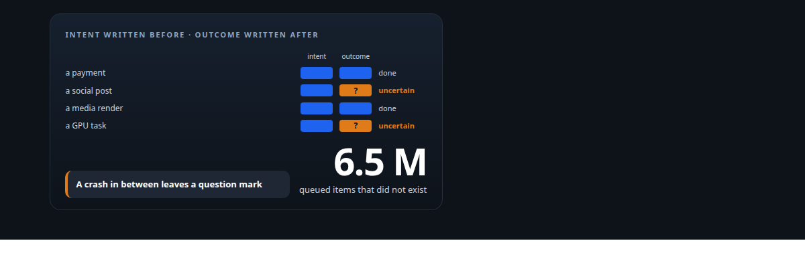
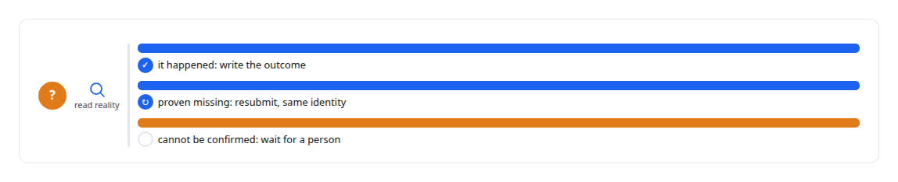
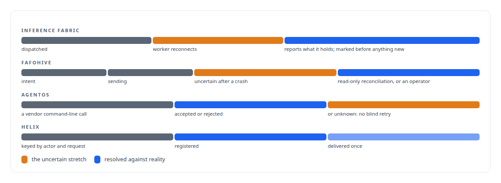

# Reconcile, never resubmit

**When a side effect may or may not have happened, write down the uncertainty and check reality before doing anything again**

Canonical: https://coreyjames.ai/ideas/reconcile-never-resubmit/  
Author: Corey James · Published: 2026-10-28 · Kind: idea  
Systems: [Inference Fabric](https://github.com/coreyjames-ai/inference-fabric) · [FAFOHive](https://github.com/coreyjames-ai/fafohive) · [AgentOS](https://github.com/coreyjames-ai/agentos) · [Helix](https://github.com/coreyjames-ai/helix)  
Skills: [exactly-once delivery and crash recovery](https://github.com/coreyjames-ai/portfolio/tree/main/skills/exactly-once-delivery-and-crash-recovery) · [distributed systems correctness](https://github.com/coreyjames-ai/portfolio/tree/main/skills/distributed-systems-correctness) · [evidence-gated acceptance](https://github.com/coreyjames-ai/portfolio/tree/main/skills/evidence-gated-acceptance)  



## What was built

A crash between making a call and logging it is the oldest problem in distributed systems, and the default answer, retry, is how you charge a customer twice, post the same message three times, or run the same inference on two GPUs. My systems do not retry blindly. They mark an effect as uncertain, reconcile against the real state, and resubmit only what is proven missing, under the same identity.

## The shape

Before an effect, a durable entry for the intent. After the effect, a durable entry for the outcome. If the process dies between the two, the entry is in an explicit uncertain state, and recovery reads reality, the provider, the GPU worker, the receiver, before deciding. Nothing is silently retried and nothing is silently dropped.



## Where it appears

In the [Inference Fabric](https://coreyjames.ai/systems/inference-fabric), completion is a durable tombstone written in a fixed order, so a crash between steps is repaired by a scan: [Millions of queued items that were not there](https://coreyjames.ai/stories/millions-of-queued-items-that-were-not-there).

In [FAFOHive](https://coreyjames.ai/systems/fafohive), a restart does not repeat a provider call: [Agents with real tools and no keys](https://coreyjames.ai/stories/agents-with-real-tools-and-no-keys).

In [AgentOS](https://coreyjames.ai/systems/agentos), resuming a work order after a stand-down is idempotent, with a stale generation explicitly superseded.

In [Helix](https://coreyjames.ai/systems/helix), the control core fences generations with execution leases so a pending intent is reconciled rather than re-run.



## What it buys and what it costs

It buys no duplicated payments, posts, renders or GPU work, and no silent loss. It buys a recovery path that can be reasoned about, because every uncertain effect has an entry.

It costs throughput and sometimes a human. Some actions stay uncertain until an operator decides, and that is the point.


## The judgment in it

The failure that taught me this was a broker that counted a read as a completion. The fix was a definition, and the definition is now everywhere a side effect crosses a boundary.

> An external effect that cannot be confirmed is not something a retry loop should decide on its own.

## What was verified

Each line is a claim the canonical page supports, with the figure as the page states it.

- Exactly-once delivery and crash recovery: intent recorded before every external effect and its outcome after, with interrupted effects held uncertain and reconciled against reality.
- Idempotent side effects and reconciliation: resubmission only of what is proven missing, under the same identity, and unverifiable sends held for an operator.
- Distributed systems correctness: a reconnecting GPU worker reports the work it holds before anything new is dispatched, so surviving work is never sent twice.

## Related

- [Millions of queued items that were not there](https://github.com/coreyjames-ai/inference-fabric/tree/main/stories/millions-of-queued-items-that-were-not-there) · https://coreyjames.ai/stories/millions-of-queued-items-that-were-not-there/
- [Agents with real tools and no keys](https://github.com/coreyjames-ai/fafohive/tree/main/stories/agents-with-real-tools-and-no-keys) · https://coreyjames.ai/stories/agents-with-real-tools-and-no-keys/
- [Closed by evidence](https://github.com/coreyjames-ai/agentos/tree/main/stories/closed-by-evidence) · https://coreyjames.ai/stories/closed-by-evidence/
- System: [Inference Fabric](https://github.com/coreyjames-ai/inference-fabric)
- System: [FAFOHive](https://github.com/coreyjames-ai/fafohive)
- System: [AgentOS](https://github.com/coreyjames-ai/agentos)
- System: [Helix](https://github.com/coreyjames-ai/helix)

## Citation

Corey James. "Reconcile, never resubmit." coreyjames.ai, 2026. https://coreyjames.ai/ideas/reconcile-never-resubmit/

```bibtex
@misc{coreyjames-reconcile-never-resubmit,
  author = {Corey James},
  title = {Reconcile, never resubmit},
  year = {2026},
  howpublished = {\url{https://coreyjames.ai/ideas/reconcile-never-resubmit/}},
  note = {GitHub copy: https://github.com/coreyjames-ai/portfolio/tree/main/research/ideas/reconcile-never-resubmit}
}
```

Part of [Corey James's portfolio](https://github.com/coreyjames-ai/portfolio) · site: https://coreyjames.ai/ · MCP server: https://coreyjames.ai/mcp · agent card: https://coreyjames.ai/.well-known/agent.json
