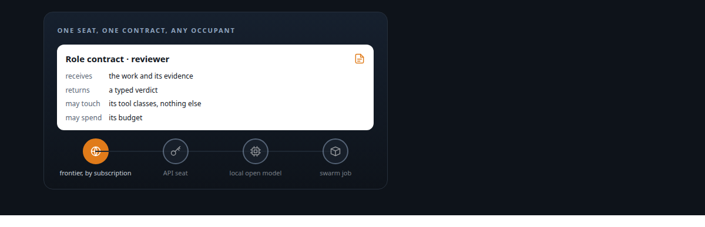
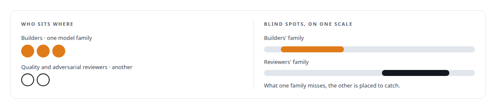
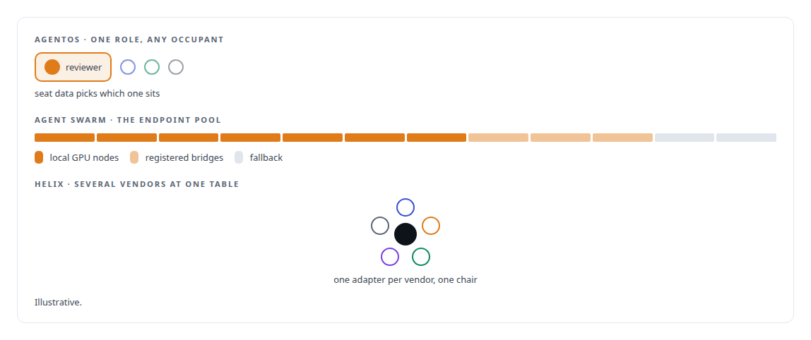

# Role contracts, with vendors as data

**Work is assigned to a role with a contract; which model fills the seat is configuration, and reviewers can be a different vendor from builders on purpose**

Canonical: https://coreyjames.ai/ideas/role-contracts-not-vendors/  
Author: Corey James · Published: 2026-10-28 · Kind: idea  
Systems: [AgentOS](https://github.com/coreyjames-ai/agentos) · [Agent Swarm](https://github.com/coreyjames-ai/agent-swarm) · [Helix](https://github.com/coreyjames-ai/helix)  
Skills: [separation of duties for AI work](https://github.com/coreyjames-ai/portfolio/tree/main/skills/separation-of-duties-for-ai-work) · [agent orchestration](https://github.com/coreyjames-ai/portfolio/tree/main/skills/agent-orchestration) · [AI-assisted engineering methodology](https://github.com/coreyjames-ai/portfolio/tree/main/skills/ai-assisted-engineering-methodology) · [tool synthesis and governed API integration](https://github.com/coreyjames-ai/portfolio/tree/main/skills/tool-synthesis-and-governed-api-integration)  



## What was built

Every model vendor would like to be the system. I treat them as workers. A job in my platform is addressed to a role with a contract: what it receives, what it must return, what it may touch, how much it may spend. Which model fills that seat, at what reasoning effort, under which account, is per-seat data. The same role can be filled by a frontier model through its subscription command-line tool, by an API seat, by a local open-source model on my own GPUs, or by a swarm job, and the contract does not change.

## The shape

A role contract names inputs, outputs, tool classes and budget. A runtime adapter drives whichever vendor sits behind it through that vendor's native channel. A terms-of-service firewall decides at registration and at route time which vendor may sit behind which role, because subscription sessions are used as their vendor permits.



## Where it appears

In [AgentOS](https://coreyjames.ai/systems/agentos), vendors' interactive command-line tools run as durable governed seats behind one supervisor; and cross-vendor review is a design rule: [Directing AI coding agents at program scale](https://coreyjames.ai/stories/directing-ai-coding-agents-at-program-scale) and [Separation of duties for AI work](https://coreyjames.ai/stories/separation-of-duties-for-ai-work).

In [Agent Swarm](https://coreyjames.ai/systems/agent-swarm), agents never hold a model address or key because the runtime proxies every call.

In [Helix](https://coreyjames.ai/systems/helix), one durable brain serves voice and chat surfaces alike: [A self-hosted colleague in a Teams call](https://coreyjames.ai/stories/a-self-hosted-colleague-in-a-teams-call).



## What it buys and what it costs

It buys independence: the organisation survives the model. It buys review diversity as policy rather than luck. It buys the use of subscriptions already paid for alongside API access and local models in one governed workflow.

It costs lowest-common-denominator interfaces and per-vendor quirks, each command-line composer needing its own number of keystrokes after a paste, for example, and it costs attention to vendor terms. I pay both.

## The judgment in it


Designing it that way from the first job meant that when a better model arrived, or a cheaper one, or a local one good enough for a task, the change was a line of configuration.

> The contract is the product and the vendor is a supplier.

## What was verified

Each line is a claim the canonical page supports, with the figure as the page states it.

- Model-agnostic agent architecture: jobs addressed to role contracts naming inputs, outputs, tool classes and budget, with model, reasoning effort and account as per-seat data.
- Separation of duties for AI work: builders on one model family and quality and adversarial reviewers on another, so their blind spots do not overlap.
- Agent orchestration: subscription command-line tools, API seats, local open-source models and swarm jobs filling the same role, behind a terms-of-service firewall.

## Related

- [Directing AI coding agents at program scale](https://github.com/coreyjames-ai/agentos/tree/main/stories/directing-ai-coding-agents-at-program-scale) · https://coreyjames.ai/stories/directing-ai-coding-agents-at-program-scale/
- [Separation of duties for AI work](https://github.com/coreyjames-ai/agentos/tree/main/stories/separation-of-duties-for-ai-work) · https://coreyjames.ai/stories/separation-of-duties-for-ai-work/
- [A self-hosted colleague in a Teams call](https://github.com/coreyjames-ai/helix/tree/main/stories/a-self-hosted-colleague-in-a-teams-call) · https://coreyjames.ai/stories/a-self-hosted-colleague-in-a-teams-call/
- System: [AgentOS](https://github.com/coreyjames-ai/agentos)
- System: [Agent Swarm](https://github.com/coreyjames-ai/agent-swarm)
- System: [Helix](https://github.com/coreyjames-ai/helix)

## Citation

Corey James. "Role contracts, with vendors as data." coreyjames.ai, 2026. https://coreyjames.ai/ideas/role-contracts-not-vendors/

```bibtex
@misc{coreyjames-role-contracts-not-vendors,
  author = {Corey James},
  title = {Role contracts, with vendors as data},
  year = {2026},
  howpublished = {\url{https://coreyjames.ai/ideas/role-contracts-not-vendors/}},
  note = {GitHub copy: https://github.com/coreyjames-ai/portfolio/tree/main/research/ideas/role-contracts-not-vendors}
}
```

Part of [Corey James's portfolio](https://github.com/coreyjames-ai/portfolio) · site: https://coreyjames.ai/ · MCP server: https://coreyjames.ai/mcp · agent card: https://coreyjames.ai/.well-known/agent.json
