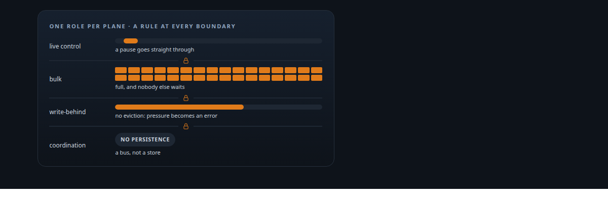
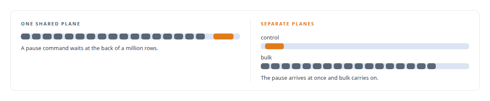
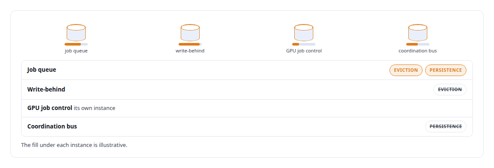

# Separate planes by role

**Traffic with different reliability, latency and durability needs gets its own infrastructure, so pressure in one role cannot starve or corrupt another**

Canonical: https://coreyjames.ai/ideas/separate-planes-by-role/  
Author: Corey James · Published: 2026-10-28 · Kind: idea  
Systems: [Agent Swarm](https://github.com/coreyjames-ai/agent-swarm) · [FAFO Core and Function Forge](https://github.com/coreyjames-ai/fafo-core) · [Auth and access plane](https://github.com/coreyjames-ai/auth-and-access-plane) · [Inference Fabric](https://github.com/coreyjames-ai/inference-fabric)  
Skills: [distributed systems correctness](https://github.com/coreyjames-ai/portfolio/tree/main/skills/distributed-systems-correctness) · [inference serving architecture](https://github.com/coreyjames-ai/portfolio/tree/main/skills/inference-serving-architecture) · [message broker and queue design](https://github.com/coreyjames-ai/portfolio/tree/main/skills/message-broker-and-queue-design) · [separation of duties for AI work](https://github.com/coreyjames-ai/portfolio/tree/main/skills/separation-of-duties-for-ai-work)  



## Result

| Figure | What it measures |
| --- | --- |
| **6** | leakage rules between the delivery, coordination and durability planes |
| **100 ms** | budget on the live-control stream, kept apart from the command stream |

## What was built

One Redis would do. One queue would do. One tunnel would do. I run several of each, because the roles that share them have different needs, and the first time a bulk job starves a control message or a cache eviction silently drops a write you learn why. Delivery, coordination and durability are separate planes with explicit rules about what may cross between them, and infrastructure is sized and configured per role.

## The shape

Name the roles: a job queue, a write-behind queue, a control stream, a coordination bus, a durability store. Give each the configuration its role needs, eviction or no eviction, append-only persistence or not, a tight latency budget or a throughput budget. Put a rule at every boundary about what may cross, and make the rule something that fails loudly.



## Where it appears

In [Agent Swarm](https://coreyjames.ai/systems/agent-swarm), the fabric keeps its planes apart, and the mesh checks every message locally so peer authorisation never waits on a central round-trip.

In [FAFO Core and Function Forge](https://coreyjames.ai/systems/fafo-core), the write path has a main lane and a bulk lane so bulk work cannot starve ordinary writes, admission is lane-separated by cost, and the control plane keeps a command stream apart from a high-priority live-control stream. The write-path diagnosis in [196 deadlocks to zero](https://coreyjames.ai/stories/196-deadlocks-to-zero) was possible because the planes were separable.

In the [Auth and access plane](https://coreyjames.ai/systems/auth-and-access-plane), Redis runs per role. Ingress is one outbound tunnel per purpose, so each surface can be cut independently.



In the [Inference Fabric](https://coreyjames.ai/systems/inference-fabric), the boundary between vector storage and the CUDA engine is a type-only crate, the sole contract both sides compile against.

## What it buys and what it costs


It buys blast-radius control. It buys the ability to tune each plane for its job instead of for the average. It buys diagnosability, because a slow write path can be measured apart from the queue in front of it.

It costs more infrastructure to run and watch. I accept that, and I document the topology so the cost is visible.

## The judgment in it

The question at every boundary is what happens under pressure. If the answer is "the other role slows down", the planes are shared and need separating. If the answer is "the other role is unaffected and this one refuses", the design is right.

> A failure in one plane is a failure in one plane.

## What was verified

Each line is a claim the canonical page supports, with the figure as the page states it.

- Distributed systems isolation: delivery, coordination and durability planes with 6 leakage rules between them, so pressure in one role cannot starve another.
- Redis architecture per role: separate instances for a job queue, a write-behind queue with no eviction, GPU job control and a coordination bus.
- Control-plane design: a live-control stream with a 100 ms budget kept apart from the command stream, and main and bulk write lanes.

## Related

- [196 deadlocks to zero](https://github.com/coreyjames-ai/fafo-core/tree/main/stories/196-deadlocks-to-zero) · https://coreyjames.ai/stories/196-deadlocks-to-zero/
- [Tools are the platform](https://github.com/coreyjames-ai/agent-swarm/tree/main/stories/tools-are-the-platform) · https://coreyjames.ai/stories/tools-are-the-platform/
- System: [Agent Swarm](https://github.com/coreyjames-ai/agent-swarm)
- System: [FAFO Core and Function Forge](https://github.com/coreyjames-ai/fafo-core)
- System: [Auth and access plane](https://github.com/coreyjames-ai/auth-and-access-plane)
- System: [Inference Fabric](https://github.com/coreyjames-ai/inference-fabric)

## Citation

Corey James. "Separate planes by role." coreyjames.ai, 2026. https://coreyjames.ai/ideas/separate-planes-by-role/

```bibtex
@misc{coreyjames-separate-planes-by-role,
  author = {Corey James},
  title = {Separate planes by role},
  year = {2026},
  howpublished = {\url{https://coreyjames.ai/ideas/separate-planes-by-role/}},
  note = {GitHub copy: https://github.com/coreyjames-ai/portfolio/tree/main/research/ideas/separate-planes-by-role}
}
```

Part of [Corey James's portfolio](https://github.com/coreyjames-ai/portfolio) · site: https://coreyjames.ai/ · MCP server: https://coreyjames.ai/mcp · agent card: https://coreyjames.ai/.well-known/agent.json
