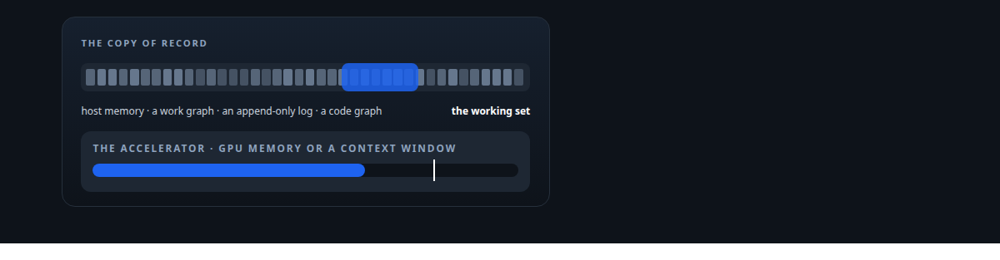
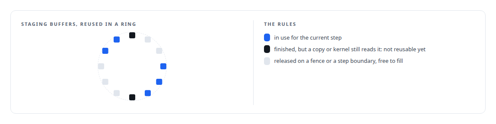
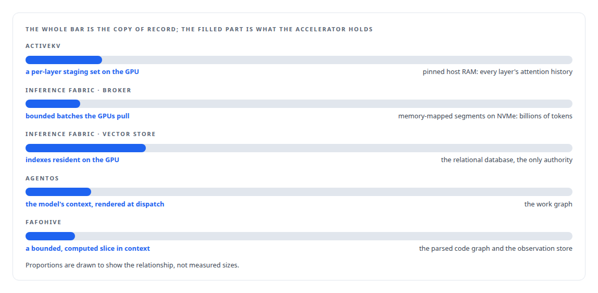

# The copy of record lives off the accelerator

**Host memory or the database holds the truth; the GPU or the model holds a bounded working set**

Canonical: https://coreyjames.ai/ideas/the-copy-of-record-lives-off-the-accelerator/  
Author: Corey James · Published: 2026-10-28 · Kind: idea  
Systems: [ActiveKV](https://github.com/coreyjames-ai/activekv) · [Inference Fabric](https://github.com/coreyjames-ai/inference-fabric) · [AgentOS](https://github.com/coreyjames-ai/agentos) · [FAFOHive](https://github.com/coreyjames-ai/fafohive)  
Skills: [KV-cache offload for LLM inference](https://github.com/coreyjames-ai/portfolio/tree/main/skills/kv-cache-offload-for-llm-inference) · [inference serving architecture](https://github.com/coreyjames-ai/portfolio/tree/main/skills/inference-serving-architecture) · [GPU inference optimisation](https://github.com/coreyjames-ai/portfolio/tree/main/skills/gpu-inference-optimisation) · [vLLM internals](https://github.com/coreyjames-ai/portfolio/tree/main/skills/vllm-internals)  



## Result

| Figure | What it measures |
| --- | --- |
| **27B** | parameter model whose attention history lives in host RAM |
| **32 GB** | one card holding only the working set |
| **128K** | token histories served from that card |

## What was built

The expensive resource in every system I build, GPU memory or a model's context window, is also the least durable and the hardest to reason about. So I never let it hold the truth. The copy of record lives somewhere cheap, durable and inspectable: pinned host memory, a PostgreSQL work graph, an append-only log, a parsed code graph. The accelerator holds a bounded working set that is staged in, used, and written back under an explicit budget.

## The shape

The authoritative state is written where it can be large and survive restarts. The working set is sized by a stated budget, filled from the copy of record on demand, and released on a fence or a step boundary.



## Where it appears

In [ActiveKV](https://coreyjames.ai/systems/activekv), the inversion is the story of [Context beyond VRAM](https://coreyjames.ai/stories/context-beyond-vram), and the staging lifecycle that makes it safe is [Staging without a stall](https://coreyjames.ai/stories/staging-without-a-stall).

In the [Inference Fabric](https://coreyjames.ai/systems/inference-fabric) the split holds twice, for the broker's backlog and for the vector store, whose GPU-resident indexes are derived serving artefacts that must prove their lineage.

In [AgentOS](https://coreyjames.ai/systems/agentos), a job is rendered with exactly the state it needs, and after a crash or a compaction the working picture is rebuilt from the graph: [Why long agent runs fail](https://coreyjames.ai/stories/why-long-agent-runs-fail).

In [FAFOHive](https://coreyjames.ai/systems/fafohive), the memory capability follows the same split.



## What it buys and what it costs

It buys capacity beyond the accelerator, durability across restarts, and a place to inspect the truth that no model has edited. It buys swappable accelerators and swappable models, because the working set is derived.

It costs the staging path, which is engineering in its own right, and it costs per-step bandwidth. ActiveKV pays the bus on every token at long contexts, which is why the compressed tier and the exact merge exist.

## The judgment in it

The decision is where to draw the budget line and what to do when it is crossed. I draw it explicitly, in whole units an operator chose, and when it is crossed I refuse or shrink with a reason. 


> An automatic size hides the operator's choice, and a silent degradation hides the failure.

## What was verified

Each line is a claim the canonical page supports, with the figure as the page states it.

- KV-cache offload for LLM inference: attention history for a 27B model held in pinned host RAM and staged per layer, serving 128K-token histories on one 32 GB card.
- GPU memory management: staging buffers reused only after every copy and kernel reading them has finished, refusing or shrinking rather than degrading when the working set cannot fit.
- Agent state management: the work graph as the copy of record and the model's context as a working set rendered at dispatch and rebuilt after a crash.

## Related

- [Context beyond VRAM](https://github.com/coreyjames-ai/activekv/tree/main/stories/context-beyond-vram) · https://coreyjames.ai/stories/context-beyond-vram/
- [Staging without a stall](https://github.com/coreyjames-ai/activekv/tree/main/stories/staging-without-a-stall) · https://coreyjames.ai/stories/staging-without-a-stall/
- [Why long agent runs fail](https://github.com/coreyjames-ai/agentos/tree/main/stories/why-long-agent-runs-fail) · https://coreyjames.ai/stories/why-long-agent-runs-fail/
- [A code explainer that is not allowed to invent](https://github.com/coreyjames-ai/fafohive/tree/main/stories/a-code-explainer-that-is-not-allowed-to-invent) · https://coreyjames.ai/stories/a-code-explainer-that-is-not-allowed-to-invent/
- System: [ActiveKV](https://github.com/coreyjames-ai/activekv)
- System: [Inference Fabric](https://github.com/coreyjames-ai/inference-fabric)
- System: [AgentOS](https://github.com/coreyjames-ai/agentos)
- System: [FAFOHive](https://github.com/coreyjames-ai/fafohive)

## Citation

Corey James. "The copy of record lives off the accelerator." coreyjames.ai, 2026. https://coreyjames.ai/ideas/the-copy-of-record-lives-off-the-accelerator/

```bibtex
@misc{coreyjames-the-copy-of-record-lives-off-the-accelerator,
  author = {Corey James},
  title = {The copy of record lives off the accelerator},
  year = {2026},
  howpublished = {\url{https://coreyjames.ai/ideas/the-copy-of-record-lives-off-the-accelerator/}},
  note = {GitHub copy: https://github.com/coreyjames-ai/portfolio/tree/main/research/ideas/the-copy-of-record-lives-off-the-accelerator}
}
```

Part of [Corey James's portfolio](https://github.com/coreyjames-ai/portfolio) · site: https://coreyjames.ai/ · MCP server: https://coreyjames.ai/mcp · agent card: https://coreyjames.ai/.well-known/agent.json
