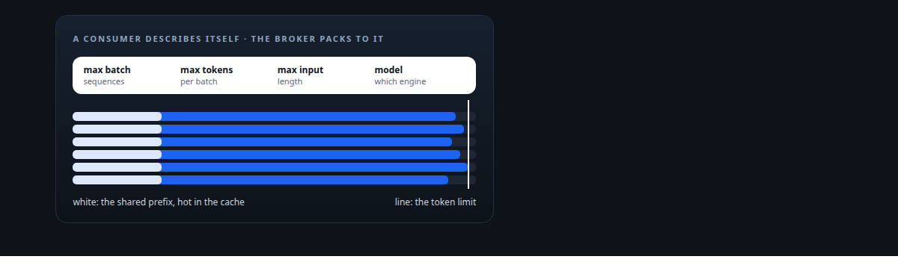
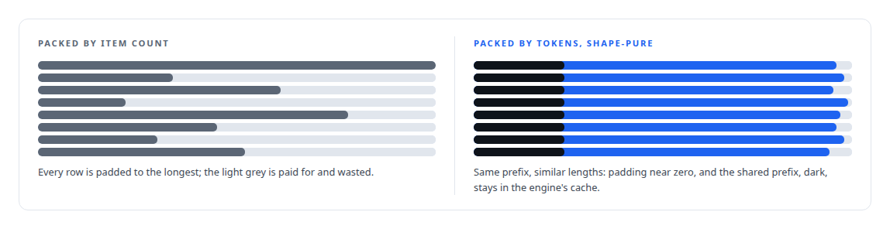
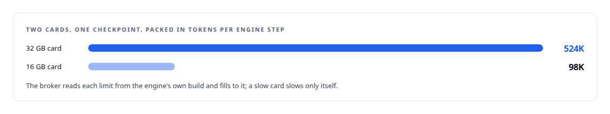
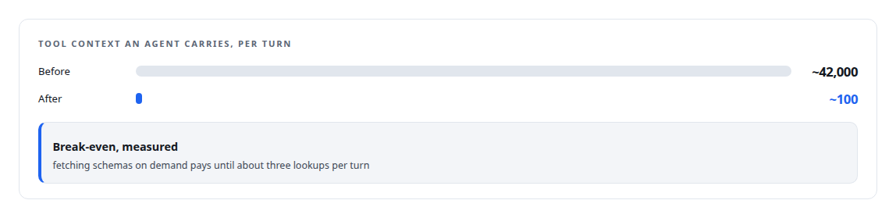

# The token as the unit

**Schedule, budget and account for GPU work in the unit the hardware actually pays in**

Canonical: https://coreyjames.ai/ideas/the-token-as-the-unit/  
Author: Corey James · Published: 2026-10-28 · Kind: idea  
Systems: [Inference Fabric](https://github.com/coreyjames-ai/inference-fabric) · [FAFO Core and Function Forge](https://github.com/coreyjames-ai/fafo-core) · [ActiveKV](https://github.com/coreyjames-ai/activekv) · [Capabilities model](https://github.com/coreyjames-ai/capabilities-model)  
Skills: [token-aware scheduling](https://github.com/coreyjames-ai/portfolio/tree/main/skills/token-aware-scheduling) · [distributed systems correctness](https://github.com/coreyjames-ai/portfolio/tree/main/skills/distributed-systems-correctness) · [cost attribution for AI work](https://github.com/coreyjames-ai/portfolio/tree/main/skills/cost-attribution-for-ai-work) · [GPU inference optimisation](https://github.com/coreyjames-ai/portfolio/tree/main/skills/gpu-inference-optimisation)  



## Result

| Figure | What it measures |
| --- | --- |
| **0.42%** | padding waste across two NVIDIA Blackwell GPUs |
| **99.9%** | cache hit rate on the same pair |
| **12.3 B** | tokens received, balanced against the same number routed |

## What was built

Queues move messages. Schedulers count jobs. Budgets count dollars or requests. None of those is what a GPU pays in. A GPU pays in tokens, and its cost for a batch depends on the shape of those tokens: how long each sequence is, how much of each prefix is shared with its neighbours, how much padding the batch carries, whether the cache already holds the work. Once I made the token the unit of scheduling, packing, budgeting and accounting, a whole class of inefficiency became visible and fixable.

## The shape

Work is described to the scheduler by its token geometry. Batches are packed to a consumer's declared token limits, not to a count of items.



Budgets for a function are stated in tokens per step. Accounting counts tokens received, routed and completed, so a leak shows up as a difference between two large numbers instead of as a vague slowdown.

## Where it appears

In the [Inference Fabric](https://coreyjames.ai/systems/inference-fabric), the broker's unit of scheduling is the token, and it packs for any card from what the consumer declares: [A message broker that understands tokens](https://coreyjames.ai/stories/a-message-broker-that-understands-tokens).



In [FAFO Core and Function Forge](https://coreyjames.ai/systems/fafo-core), token-aware batching is one of the three batching modes any function can select by configuration, with memory-budget packing beside it. The probe-generation pipeline is where it was forced into the substrate, in [The workload that shaped the platform](https://coreyjames.ai/stories/the-workload-that-shaped-the-platform).

In [ActiveKV](https://coreyjames.ai/systems/activekv), the token is the unit of the economics: a compressed representation is judged on bytes saved per token against GPU time added, and instrumentation follows each token from scheduler to device to client.

In the [Capabilities model](https://coreyjames.ai/systems/capabilities-model), the whole project is a token budget.



## What it buys and what it costs

It buys saturation on mixed hardware, because packing by tokens lets a 16 GB card and a 32 GB card drain the same backlog at full tilt. It buys accounting that can balance. It buys honest cost comparisons between designs, because bytes and tokens do not lie about where time goes.

It costs a scheduler that has to understand shape, which is more code than a queue that moves bytes, and it costs producers that must tokenise before they submit. For chat-shaped traffic where each request is its own world, the shape of a batch matters less and a simpler scheduler is fine.

## The judgment in it

The trick is abstracting at exactly the right level.


Everything above that is the engine's business and everything below it is bytes.

> The broker must not know the model; it must know only what the consumer needs to pack well, and four integers turn out to be enough.

## What was verified

Each line is a claim the canonical page supports, with the figure as the page states it.

- Token-aware scheduling: shape-pure batches packed to each consumer's declared token limits, with 0.42% padding waste and a 99.9% cache hit rate across two NVIDIA Blackwell GPUs.
- Distributed systems correctness: token accounting that balanced 12.3 B tokens received against the same number routed.

## Related

- [A message broker that understands tokens](https://github.com/coreyjames-ai/inference-fabric/tree/main/stories/a-message-broker-that-understands-tokens) · https://coreyjames.ai/stories/a-message-broker-that-understands-tokens/
- [From 44K to 163K tokens per second](https://github.com/coreyjames-ai/inference-fabric/tree/main/stories/from-44k-to-163k-tokens-per-second) · https://coreyjames.ai/stories/from-44k-to-163k-tokens-per-second/
- [The workload that shaped the platform](https://github.com/coreyjames-ai/fafo-core/tree/main/stories/the-workload-that-shaped-the-platform) · https://coreyjames.ai/stories/the-workload-that-shaped-the-platform/
- [A hundred tokens instead of forty-two thousand](https://github.com/coreyjames-ai/capabilities-model/tree/main/stories/a-hundred-tokens-instead-of-forty-two-thousand) · https://coreyjames.ai/stories/a-hundred-tokens-instead-of-forty-two-thousand/
- System: [Inference Fabric](https://github.com/coreyjames-ai/inference-fabric)
- System: [FAFO Core and Function Forge](https://github.com/coreyjames-ai/fafo-core)
- System: [ActiveKV](https://github.com/coreyjames-ai/activekv)
- System: [Capabilities model](https://github.com/coreyjames-ai/capabilities-model)

## Citation

Corey James. "The token as the unit." coreyjames.ai, 2026. https://coreyjames.ai/ideas/the-token-as-the-unit/

```bibtex
@misc{coreyjames-the-token-as-the-unit,
  author = {Corey James},
  title = {The token as the unit},
  year = {2026},
  howpublished = {\url{https://coreyjames.ai/ideas/the-token-as-the-unit/}},
  note = {GitHub copy: https://github.com/coreyjames-ai/portfolio/tree/main/research/ideas/the-token-as-the-unit}
}
```

Part of [Corey James's portfolio](https://github.com/coreyjames-ai/portfolio) · site: https://coreyjames.ai/ · MCP server: https://coreyjames.ai/mcp · agent card: https://coreyjames.ai/.well-known/agent.json
