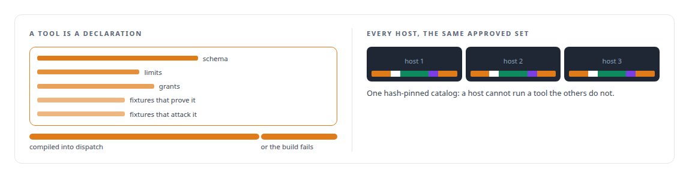
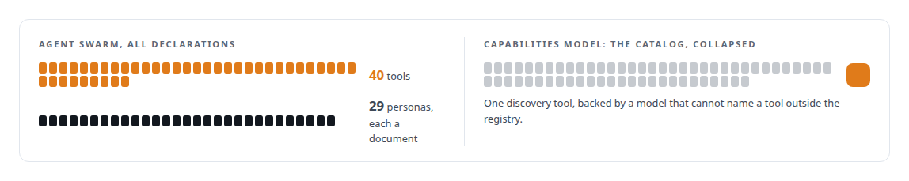

# Tools are the platform

**Build the safety machinery once, make it the only path, and let everything else be a declaration**

Canonical: https://coreyjames.ai/ideas/tools-are-the-platform/  
Author: Corey James · Published: 2026-10-28 · Kind: idea  
Systems: [Agent Swarm](https://github.com/coreyjames-ai/agent-swarm) · [FAFO Core and Function Forge](https://github.com/coreyjames-ai/fafo-core) · [FAFOHive](https://github.com/coreyjames-ai/fafohive) · [Capabilities model](https://github.com/coreyjames-ai/capabilities-model)  
Skills: [tool synthesis and governed API integration](https://github.com/coreyjames-ai/portfolio/tree/main/skills/tool-synthesis-and-governed-api-integration) · [MCP server design](https://github.com/coreyjames-ai/portfolio/tree/main/skills/mcp-server-design) · [AI-assisted engineering methodology](https://github.com/coreyjames-ai/portfolio/tree/main/skills/ai-assisted-engineering-methodology) · [inference serving architecture](https://github.com/coreyjames-ai/portfolio/tree/main/skills/inference-serving-architecture)  


## Result

| Figure | What it measures |
| --- | --- |
| **474** | tools behind one authenticated FAFOHive endpoint, under one trust model |
| **12** | steps in the frozen pipeline every Agent Swarm call passes |
| **~180** | gateway actions compiled from YAML schemas into dispatch |

## What was built

An agent is only as capable as the tools it can reach and only as safe as the path those tools take. I decided that the path would be built once, that it would be the only path, and that adding capability would be a matter of declaring a tool rather than writing a service. Validation, authorisation, limits, sanitisation, audit and observation happen in one pipeline for every call. A tool contributes its core behaviour and nothing else. An agent class is a composition of a tool subset, a policy, a workspace and a profile.

## The shape

One frozen pipeline in a fixed order. Tools declared as data. Composition is declarative: a persona is a document, a function is a generated unit, a tool estate is a registry.



## Where it appears

In [Agent Swarm](https://coreyjames.ai/systems/agent-swarm), the pipeline's order cannot change without sign-off: [Tools are the platform](https://coreyjames.ai/stories/tools-are-the-platform).

In [FAFO Core and Function Forge](https://coreyjames.ai/systems/fafo-core), one function definition becomes an orchestrated, budgeted, agent-callable tool, and agents can author new tools inside a sandbox that becomes callable only after a human restart: [Tools that build tools, under governance](https://coreyjames.ai/stories/tools-that-build-tools-under-governance).

In [FAFOHive](https://coreyjames.ai/systems/fafohive), the endpoint has three dispatch paths, and the business providers' APIs are rebuilt as tools under stable namespaces so agents see a steady surface: [Agents with real tools and no keys](https://coreyjames.ai/stories/agents-with-real-tools-and-no-keys).

The [Capabilities model](https://coreyjames.ai/systems/capabilities-model) is where the size of the estate was answered: [A hundred tokens instead of forty-two thousand](https://coreyjames.ai/stories/a-hundred-tokens-instead-of-forty-two-thousand).



## What it buys and what it costs

It buys a security posture that does not erode as the estate grows, because the hundredth tool gets exactly the scrutiny the first one got. It buys speed of extension, because declaring is cheaper than coding. It buys a catalog large enough that it needed its own routing model.

It costs flexibility: a frozen pipeline cannot be special-cased, and a tool that needs something the pipeline does not offer waits for the pipeline to grow. I pay that, because the alternative is a hole per tool.

## The judgment in it

The hard discipline is refusing the exception. The trivial tool still needs fixtures, the unfinished tool kind stays unrunnable, and the generator that could hot-load a function rebuilds and waits for a human instead. 


> Exceptions are where the holes are.

## What was verified

Each line is a claim the canonical page supports, with the figure as the page states it.

- Tool synthesis and governed API integration: one frozen pipeline of 12 steps for every call, with tools declared as data and compiled into dispatch so a tool is fully wired or the build fails.
- MCP server design: 474 tools behind one authenticated endpoint under one trust model, and ~180 gateway actions compiled from YAML schemas.
- Declarative agent definition: tools and personas defined as declarations, with hash-pinned catalogs so every host runs the same approved set.

## Related

- [Tools are the platform](https://github.com/coreyjames-ai/agent-swarm/tree/main/stories/tools-are-the-platform) · https://coreyjames.ai/stories/tools-are-the-platform/
- [Tools that build tools, under governance](https://github.com/coreyjames-ai/fafo-core/tree/main/stories/tools-that-build-tools-under-governance) · https://coreyjames.ai/stories/tools-that-build-tools-under-governance/
- [Agents with real tools and no keys](https://github.com/coreyjames-ai/fafohive/tree/main/stories/agents-with-real-tools-and-no-keys) · https://coreyjames.ai/stories/agents-with-real-tools-and-no-keys/
- [A hundred tokens instead of forty-two thousand](https://github.com/coreyjames-ai/capabilities-model/tree/main/stories/a-hundred-tokens-instead-of-forty-two-thousand) · https://coreyjames.ai/stories/a-hundred-tokens-instead-of-forty-two-thousand/
- System: [Agent Swarm](https://github.com/coreyjames-ai/agent-swarm)
- System: [FAFO Core and Function Forge](https://github.com/coreyjames-ai/fafo-core)
- System: [FAFOHive](https://github.com/coreyjames-ai/fafohive)
- System: [Capabilities model](https://github.com/coreyjames-ai/capabilities-model)

## Citation

Corey James. "Tools are the platform." coreyjames.ai, 2026. https://coreyjames.ai/ideas/tools-are-the-platform/

```bibtex
@misc{coreyjames-tools-are-the-platform,
  author = {Corey James},
  title = {Tools are the platform},
  year = {2026},
  howpublished = {\url{https://coreyjames.ai/ideas/tools-are-the-platform/}},
  note = {GitHub copy: https://github.com/coreyjames-ai/portfolio/tree/main/research/ideas/tools-are-the-platform}
}
```

Part of [Corey James's portfolio](https://github.com/coreyjames-ai/portfolio) · site: https://coreyjames.ai/ · MCP server: https://coreyjames.ai/mcp · agent card: https://coreyjames.ai/.well-known/agent.json
