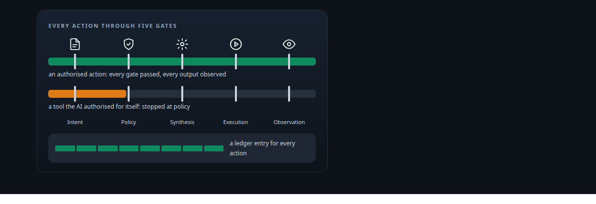
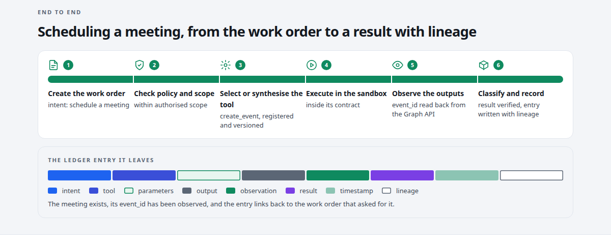
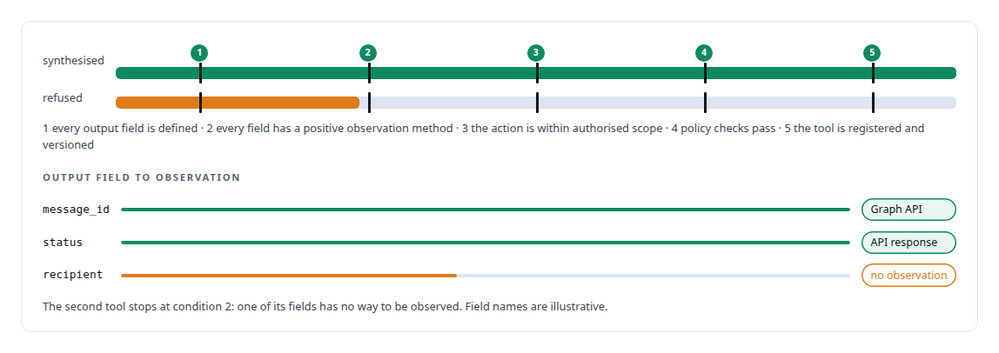
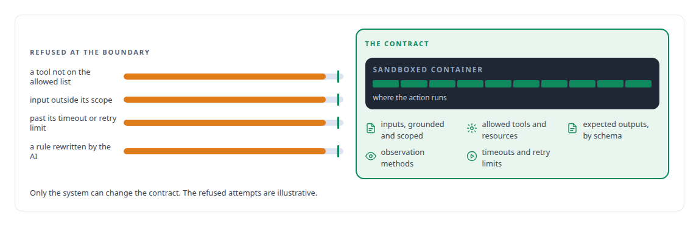
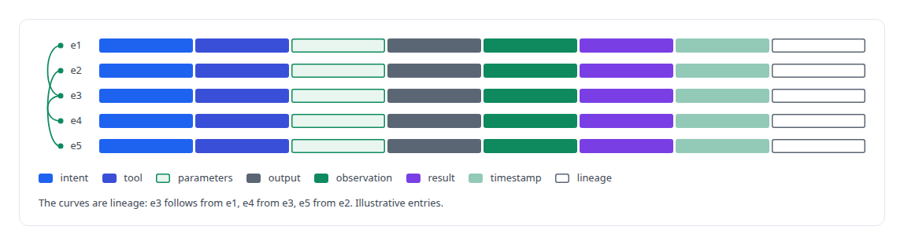
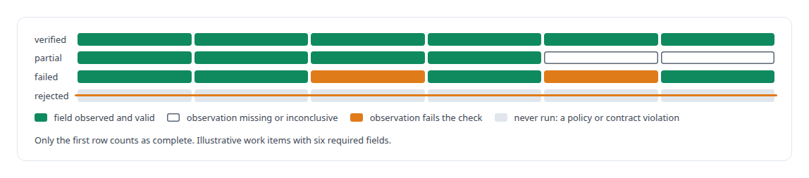
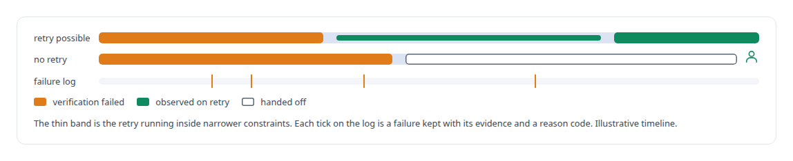
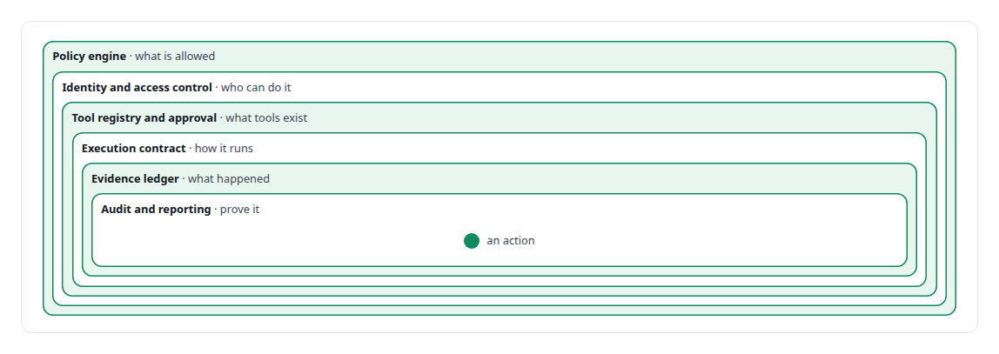

# Family Five: Verifiable AI action, tool synthesis and governance

**Every action is authorised, every output is observed, every result is verifiable; AI cannot self-authorise a tool.**

Canonical: https://coreyjames.ai/research/family-five-verifiable-ai-action-and-tool-synthesis/  
Author: Corey James · Published: 2026-10-28 · Kind: patent family  
Systems: [FAFO Core and Function Forge](https://github.com/coreyjames-ai/fafo-core)  
Skills: [tool synthesis and governed API integration](https://github.com/coreyjames-ai/portfolio/tree/main/skills/tool-synthesis-and-governed-api-integration) · [evidence-gated acceptance](https://github.com/coreyjames-ai/portfolio/tree/main/skills/evidence-gated-acceptance) · [sandboxing and container hardening](https://github.com/coreyjames-ai/portfolio/tree/main/skills/sandboxing-and-container-hardening) · [AI-assisted engineering methodology](https://github.com/coreyjames-ai/portfolio/tree/main/skills/ai-assisted-engineering-methodology)  

Provisional patent application, patent pending. Application number 64/148,105.



## Result

| Figure | What it measures |
| --- | --- |
| **5** | conditions a tool must meet before it can be synthesised |
| **8** | fields in every evidence-ledger entry, lineage among them |
| **4** | result classes, assigned from observed evidence |
| **6** | layers of governance around each action |



## What was built

Methods and Systems for Evidence-Gated Synthesis and Governance of Agent-Callable Application Programming Interface Tools, and for Reconciled Execution of Mutations Against Ephemeral Third-Party Application Programming Interfaces. U.S. Provisional Patent Application No. 64/148,105 (patent pending). Embodied in the API integration platform of [FAFO Core and Function Forge](https://coreyjames.ai/systems/fafo-core).

Unconstrained AI invents tools or actions, acts outside intent, returns unverified results, and is hard to audit. This invention puts every action through one governed pipeline, from the intent that asks for it to an observation that must prove its result.

## A tool only with positive observation

A tool may be synthesised only when five conditions hold. The one that does the work is the second: for every output field of the tool there must exist an observation in the evidence ledger, so a field the system has no way to observe blocks the tool.



## The execution contract

Each action runs inside an execution contract that fixes what can be accessed, what can be modified and how results must be reported.




## An evidence ledger with lineage

Every action produces an entry in the evidence ledger: what was attempted, what happened and how it was observed, linked to the entry it came from.



## Results from evidence, not model claims

Results are classified from observable evidence; what the model says about its own work plays no part. A work item counts as complete only when every one of its required output fields has a positive observation.



## Retry within constraints, or a person

When verification fails the system retries within constraints or escalates to a person or another agent. Every failure is logged with its evidence and a reason code, and unverified results are never marked complete.



## Governance in nested layers

Layered governance enforces safety, compliance and control across all actions, from the policy that says what is allowed to the audit that proves what happened. The guarantees: no unauthorised actions, no unobserved outputs, no silent failures, full auditability and replay.



> No action can run outside the contract, and the AI cannot change the rules.

## What was verified

Each line is a claim the canonical page supports, with the figure as the page states it.

- Tool synthesis and governed API integration: an agent-callable tool synthesised only when 5 conditions hold, including a positive observation method for every output field.
- Evidence-gated acceptance: results placed in 4 classes from observed evidence, never from the model's own account, and complete only when every required field is observed.
- Audit trails for AI actions: an evidence entry with 8 fields for every action, including intent, observation and lineage to the entry it came from.
- Sandboxing and execution contracts: each action confined to a contract fixing inputs, allowed tools, outputs, observation methods and limits, inside 6 nested layers of governance.
- Patent filing for AI systems: U.S. Provisional Patent Application No. 64/148,105 (patent pending) on evidence-gated synthesis and governance of agent-callable API tools.

## Related

- System: [FAFO Core and Function Forge](https://github.com/coreyjames-ai/fafo-core)

## Citation

Corey James. "Family Five: Verifiable AI action, tool synthesis and governance." coreyjames.ai, 2026. https://coreyjames.ai/research/family-five-verifiable-ai-action-and-tool-synthesis/

```bibtex
@misc{coreyjames-family-five-verifiable-ai-action-and-tool-synthesis,
  author = {Corey James},
  title = {Family Five: Verifiable AI action, tool synthesis and governance},
  year = {2026},
  howpublished = {\url{https://coreyjames.ai/research/family-five-verifiable-ai-action-and-tool-synthesis/}},
  note = {GitHub copy: https://github.com/coreyjames-ai/portfolio/tree/main/research/patent-families/family-five-verifiable-ai-action-and-tool-synthesis}
}
```

Part of [Corey James's portfolio](https://github.com/coreyjames-ai/portfolio) · site: https://coreyjames.ai/ · MCP server: https://coreyjames.ai/mcp · agent card: https://coreyjames.ai/.well-known/agent.json
