# Family Four: Self-verifying vector and GPU retrieval substrate

**Same data, same result, verifiable at every step: every index proves it was built from the database it serves.**

Canonical: https://coreyjames.ai/research/family-four-self-verifying-vector-substrate/  
Author: Corey James · Published: 2026-10-28 · Kind: patent family  
Systems: [Inference Fabric](https://github.com/coreyjames-ai/inference-fabric)  
Skills: [vector search and ANN indexes](https://github.com/coreyjames-ai/portfolio/tree/main/skills/vector-search-and-ann-indexes) · [embedding analytics and cluster metrics](https://github.com/coreyjames-ai/portfolio/tree/main/skills/embedding-analytics-and-cluster-metrics) · [distributed systems correctness](https://github.com/coreyjames-ai/portfolio/tree/main/skills/distributed-systems-correctness) · [AI-assisted engineering methodology](https://github.com/coreyjames-ai/portfolio/tree/main/skills/ai-assisted-engineering-methodology)  

Provisional patent application, patent pending. Application number 64/148,001.

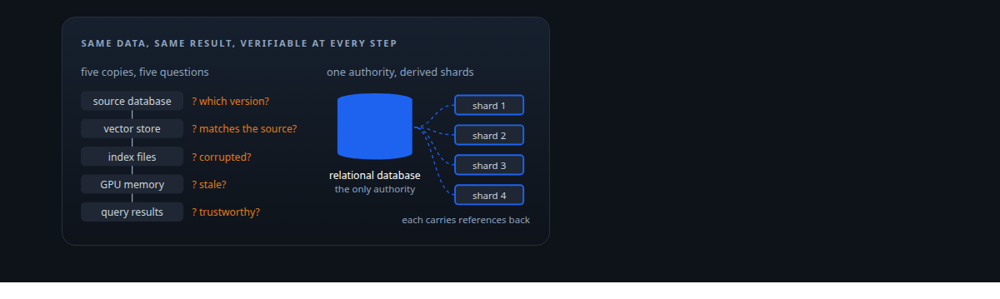

## Result

| Figure | What it measures |
| --- | --- |
| **8** | properties bound into every index's attestation |
| **4** | checks: build, persist, publish and load |
| **≤ 1** | active generation per index at any moment |
| **1 → 2** | one GPU read per member vector, two computations from it |

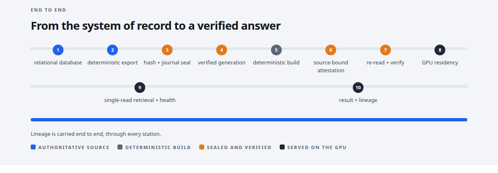

## What was built

Methods and Systems for a Self-Verifying Deterministic Vector Index and GPU Retrieval Substrate Materialized From a Relational System of Record. U.S. Provisional Patent Application No. 64/148,001 (patent pending). Embodied in the vector store of the [Inference Fabric](https://coreyjames.ai/systems/inference-fabric).

## One authoritative source

Traditional vector pipelines create multiple copies of data, a source database, a vector store, index files, GPU memory, with no provable link between them. Data can drift, go stale or be corrupted, and nobody can prove what produced a result. Here the relational database is the only authority. Vectors are exported deterministically into memory-mapped shards that serve reads and carry references back to the database; they are serving representations, never another authoritative copy.

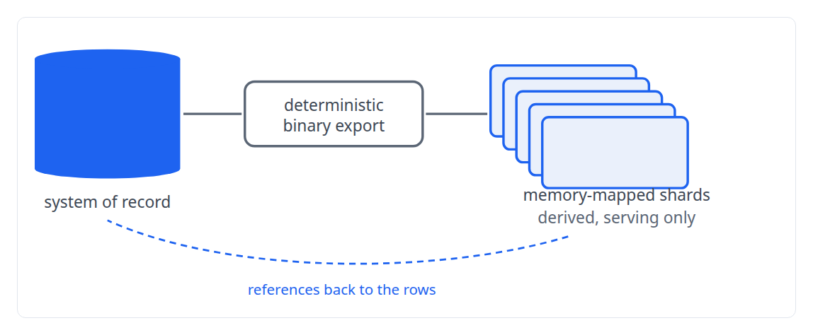

## Deterministic construction

Index construction is deterministic: given the same inputs, parameters, seed, format and implementation, the index body is byte-identical. That makes index artifacts repeatable and checkable rather than one-off files.

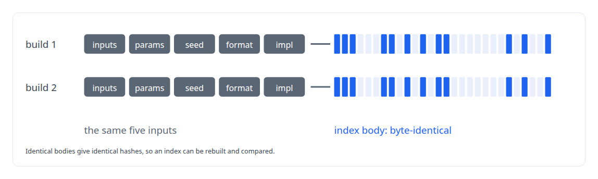

## Source-bound attestation

Every index is cryptographically bound to its source data and build conditions. A binding hash ties the full input identity, the build parameters, the format version and the index body together.

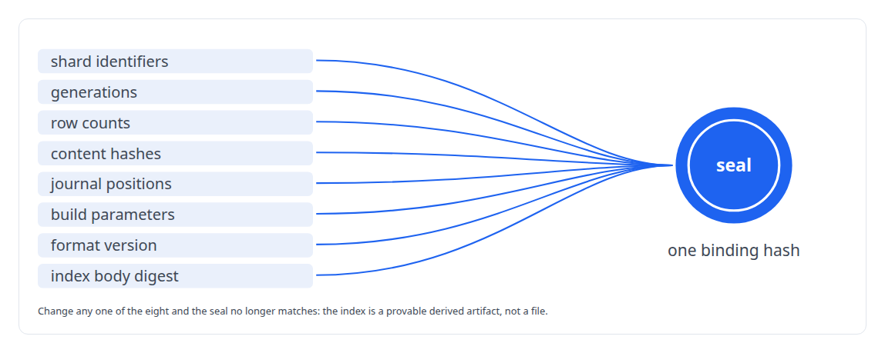

## Refuse rather than trust

Artifacts are checked at build, at persist and at load time, and publishing is allowed only when what reached the disk matches what was built in memory. A mismatch is a refusal, never a warning.

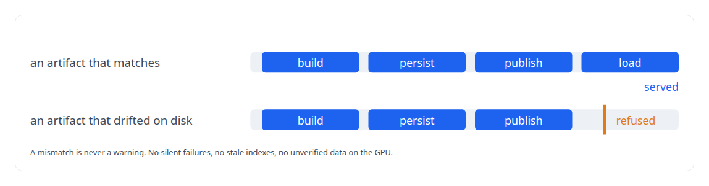

## Verified generations

All artifacts of a generation, centroids, members and derived data, are verified together before the generation is activated, so readers never see a torn set.

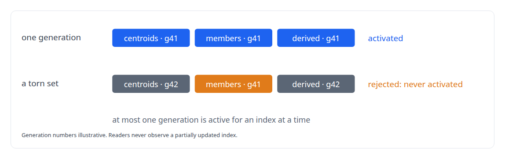

## Journal-bound windows

Data windows are sealed with a content hash and a journal sequence, and consumers re-verify them before use.

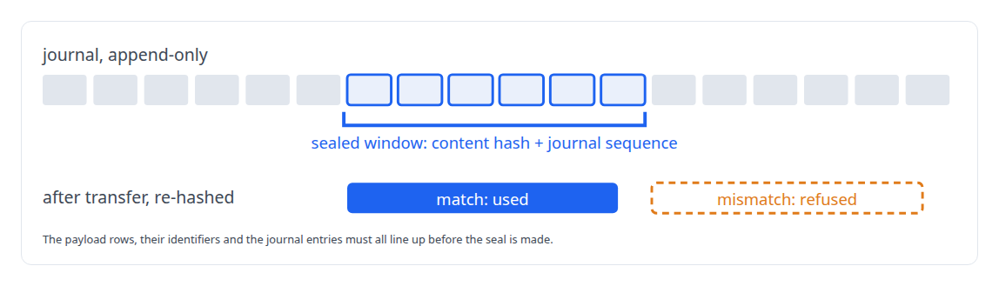

## One GPU read, two computations

The retrieval does two computations from one read: each member vector is read from GPU memory once and feeds both the similarity score and the cluster-health metrics.

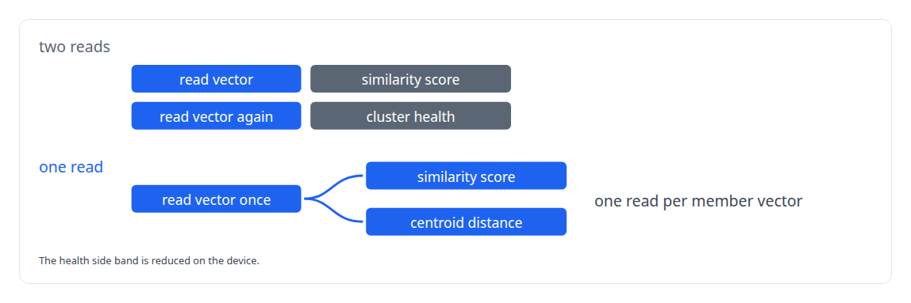

## Cluster health beside every result

The health metrics are the mean distance to the centroid, the mean squared distance, and two bounded health scores derived from them, so results carry both what is closest and how coherent the region was.

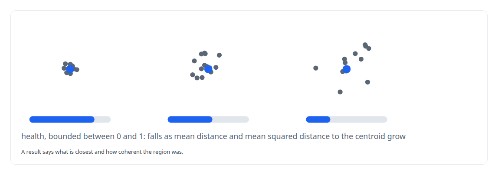

## Lineage that survives partial failure

Results and health metrics carry the same lineage even when one component fails, so the relationship between a result and its health computation is never lost.

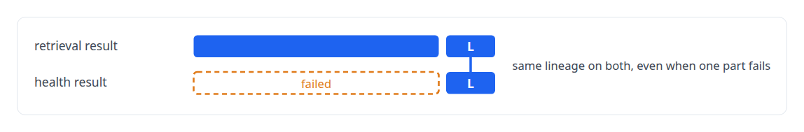

## Residency keyed by generation

GPU memory tracks which data generations it holds and evicts only the artifacts a change affected, never the whole cache.

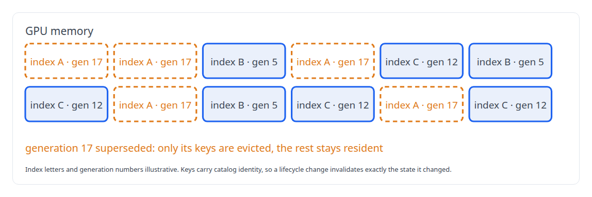

From an authoritative source through deterministic materialisation and attestable indexes to GPU retrieval with provenance, the same data gives the same result along a path that can be checked from source to answer.


> Every boundary is identifiable, verifiable, or refused.

## What was verified

Each line is a claim the canonical page supports, with the figure as the page states it.

- Vector search and ANN indexes: vectors exported deterministically from a relational database, the only authority, into memory-mapped shards; the same inputs, parameters, seed, format and implementation give a byte-identical index body.
- Data provenance for retrieval: every index bound to its source data and build conditions by one binding hash over 8 properties, including shard identifiers, generations, row counts, content hashes and journal positions.
- Fail-closed artifact pipelines: 4 checks at build, persist, publish and load, where a mismatch between disk and memory is a refusal, and at most 1 active generation per index so readers never see a torn set.
- Embedding analytics and cluster metrics: each member vector read from GPU memory once to feed 2 computations, the similarity score and cluster-health metrics from mean and mean squared distance to the centroid.
- GPU memory management: GPU residency keyed by data generation, evicting only the artifacts a change affected and never the whole cache.

## Related

- System: [Inference Fabric](https://github.com/coreyjames-ai/inference-fabric)

## Citation

Corey James. "Family Four: Self-verifying vector and GPU retrieval substrate." coreyjames.ai, 2026. https://coreyjames.ai/research/family-four-self-verifying-vector-substrate/

```bibtex
@misc{coreyjames-family-four-self-verifying-vector-substrate,
  author = {Corey James},
  title = {Family Four: Self-verifying vector and GPU retrieval substrate},
  year = {2026},
  howpublished = {\url{https://coreyjames.ai/research/family-four-self-verifying-vector-substrate/}},
  note = {GitHub copy: https://github.com/coreyjames-ai/portfolio/tree/main/research/patent-families/family-four-self-verifying-vector-substrate}
}
```

Part of [Corey James's portfolio](https://github.com/coreyjames-ai/portfolio) · site: https://coreyjames.ai/ · MCP server: https://coreyjames.ai/mcp · agent card: https://coreyjames.ai/.well-known/agent.json
