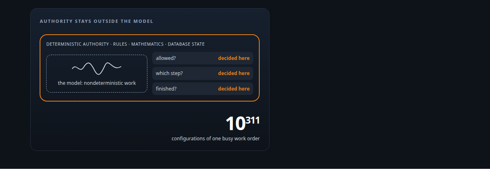
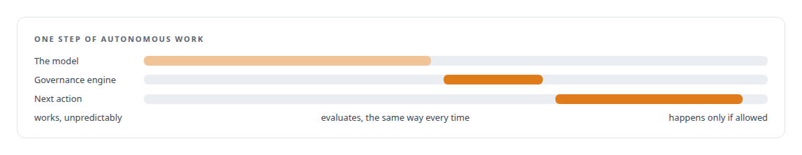
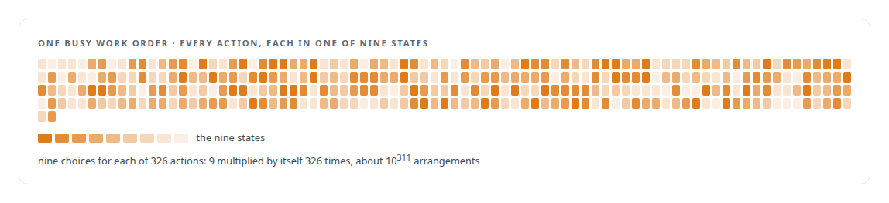
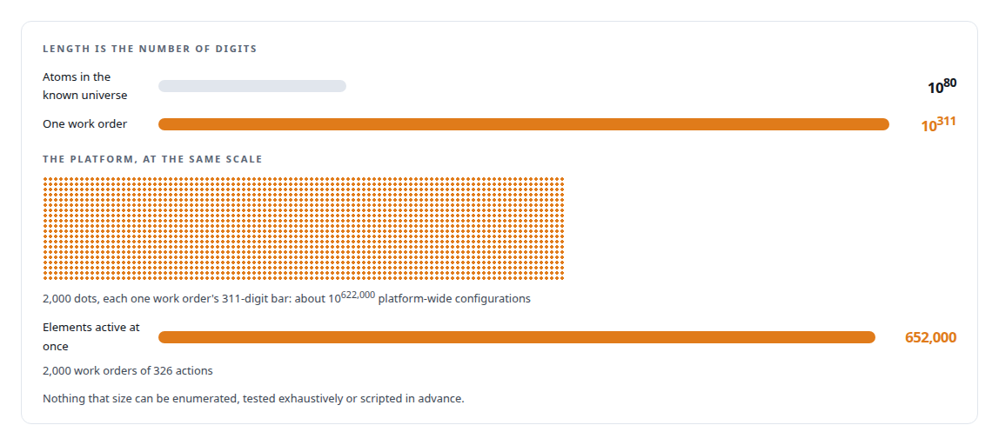
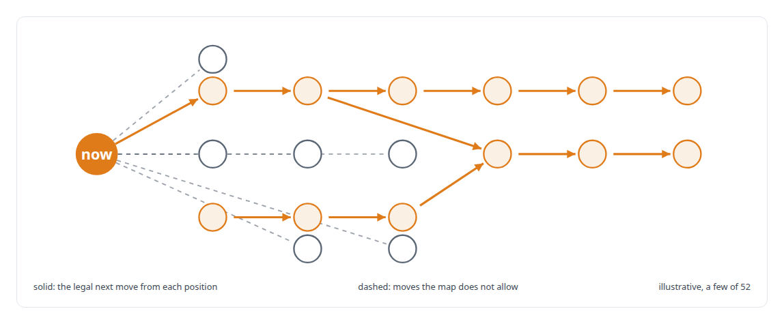
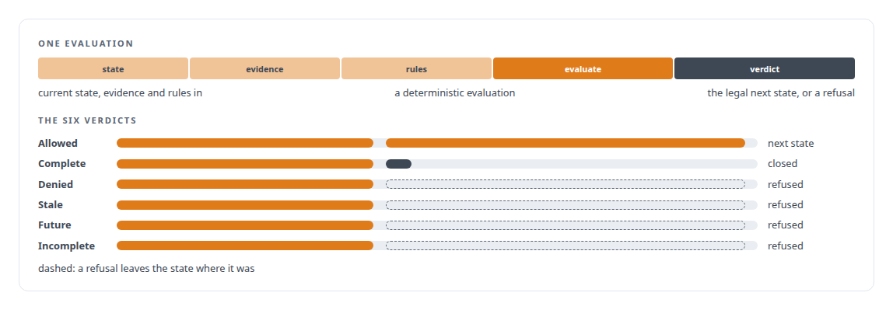

# Family One: Deterministic external governance of autonomous AI work

**The AI never decides what it is allowed to do, what step it is on, or whether it is finished. External deterministic rules do.**

Canonical: https://coreyjames.ai/research/family-one-deterministic-external-governance/  
Author: Corey James · Published: 2026-10-28 · Kind: patent family  
Systems: [AgentOS](https://github.com/coreyjames-ai/agentos)  
Skills: [evidence-gated acceptance](https://github.com/coreyjames-ai/portfolio/tree/main/skills/evidence-gated-acceptance) · [multi-agent governance](https://github.com/coreyjames-ai/portfolio/tree/main/skills/multi-agent-governance) · [agent orchestration](https://github.com/coreyjames-ai/portfolio/tree/main/skills/agent-orchestration) · [AI-assisted engineering methodology](https://github.com/coreyjames-ai/portfolio/tree/main/skills/ai-assisted-engineering-methodology)  

Provisional patent application, patent pending. Application number 64/146,881.



## Result

| Figure | What it measures |
| --- | --- |
| **9** | states each action can be in |
| **326** | actions active at once in one busy work order |
| **2,000** | work orders the platform runs at the same time |
| **52** | legal transitions in the whole governance map |

## What was built

Systems and Methods for Structurally Enforced Governance of Autonomous AI Agents. U.S. Provisional Patent Application No. 64/146,881 (patent pending). Embodied in [AgentOS](https://coreyjames.ai/systems/agentos).

## Authority outside the model

The model is a nondeterministic worker inside a deterministic authority system. It does the work; it never decides what it is allowed to do, what step it is on, or whether it is finished. External rules, mathematics and database state decide all of that, and they decide it the same way every time.



## A state space nothing can enumerate

The reason this has to be structural is the size of the state space. Each action in a work order sits in one of nine states, and one busy work order had 326 actions active at once.



The platform runs about two thousand work orders at the same time, and every one of them multiplies the arrangements again.



## Fifty-two legal moves

The invention does the opposite of enumerating. It does not explore the space; it constrains which transitions are legal from the current state. The whole governance map allows 52 legal transitions, and most positions have exactly one legal next move.



## A deterministic verdict on every step

Current state, evidence and rules go through a deterministic evaluation that yields the legal next state or an explicit refusal, as one of six verdicts. A refusal is an answer with a reason, not a silent stop.



Completion is one of those verdicts, reached only when the evidence for it is there.


The result is that an astronomically large space of autonomous work becomes a governed system: deterministic authority, bounded legal transitions and external proof of completion, all resolved outside the model.

> Completion is evidence-based; the AI never self-declares it.

## What was verified

Each line is a claim the canonical page supports, with the figure as the page states it.

- Multi-agent governance: autonomous AI work governed by external deterministic rules that decide what the model may do, what step it is on and whether it is finished.
- State-machine design for AI agents: a governance map of 52 legal transitions over actions in 9 states, constraining moves instead of enumerating a space of 326 concurrent actions.
- Evidence-gated acceptance: every step evaluated deterministically into one of six verdicts, completion reached only on evidence and every refusal an answer with a reason.
- Scale analysis of agent state spaces: about 2,000 concurrent work orders, each with about 10 to the 311 arrangements, shown to be beyond enumeration or exhaustive testing.
- Patent filing for AI systems: U.S. Provisional Patent Application No. 64/146,881 (patent pending) on structurally enforced governance of autonomous AI agents.

## Related

- System: [AgentOS](https://github.com/coreyjames-ai/agentos)

## Citation

Corey James. "Family One: Deterministic external governance of autonomous AI work." coreyjames.ai, 2026. https://coreyjames.ai/research/family-one-deterministic-external-governance/

```bibtex
@misc{coreyjames-family-one-deterministic-external-governance,
  author = {Corey James},
  title = {Family One: Deterministic external governance of autonomous AI work},
  year = {2026},
  howpublished = {\url{https://coreyjames.ai/research/family-one-deterministic-external-governance/}},
  note = {GitHub copy: https://github.com/coreyjames-ai/portfolio/tree/main/research/patent-families/family-one-deterministic-external-governance}
}
```

Part of [Corey James's portfolio](https://github.com/coreyjames-ai/portfolio) · site: https://coreyjames.ai/ · MCP server: https://coreyjames.ai/mcp · agent card: https://coreyjames.ai/.well-known/agent.json
