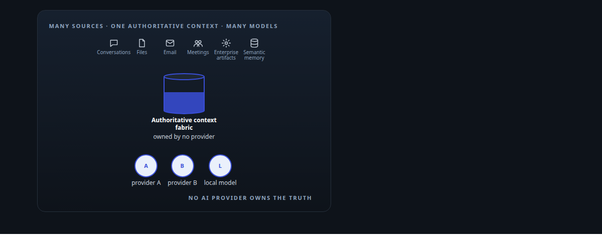
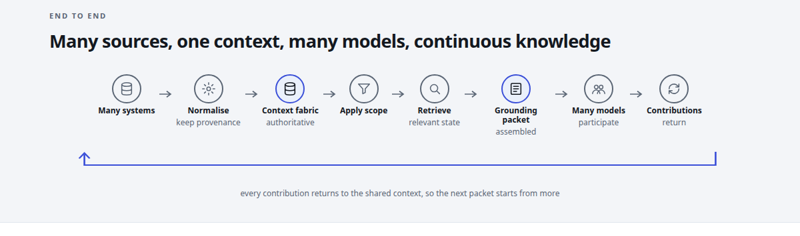
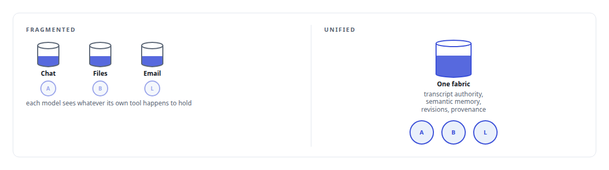
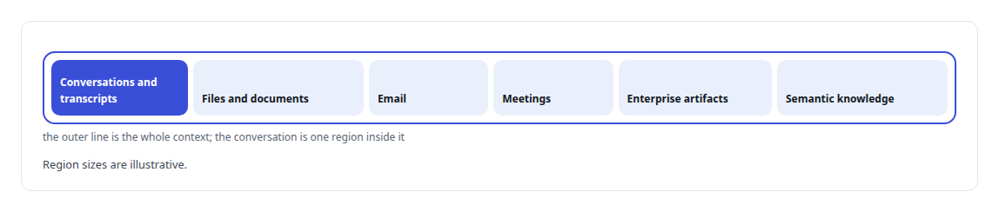
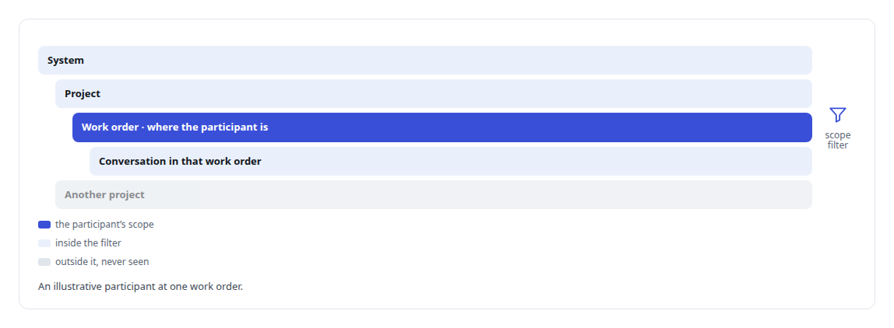
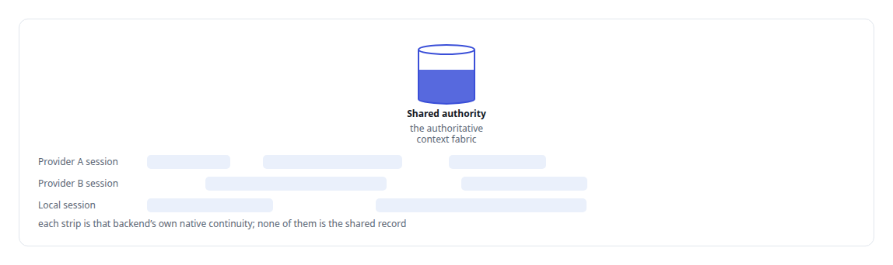
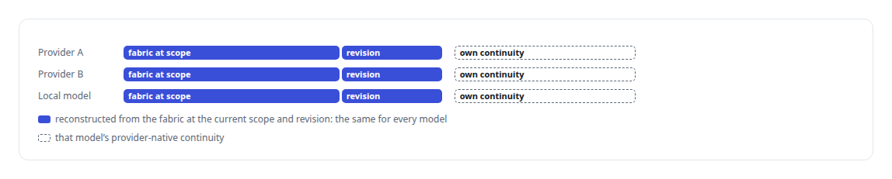
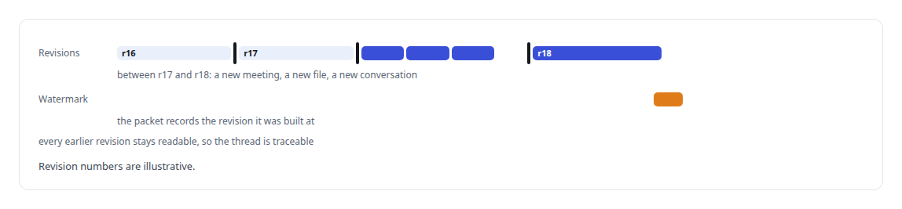
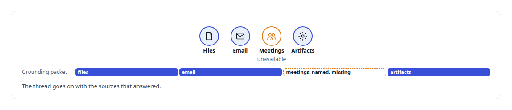
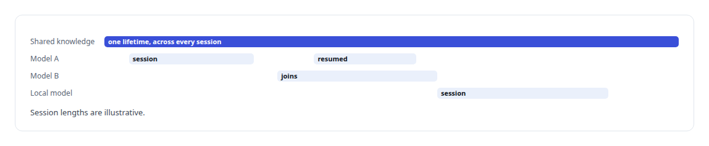

# Family Three: Unified context across AI models and knowledge systems

**One authoritative context. Many models. Many sources. No AI provider owns the truth.**

Canonical: https://coreyjames.ai/research/family-three-unified-context-across-models/  
Author: Corey James · Published: 2026-10-28 · Kind: patent family  
DOI: https://doi.org/10.5281/zenodo.23735142  
Systems: [Helix](https://github.com/coreyjames-ai/helix)  
Skills: [AI-assisted engineering methodology](https://github.com/coreyjames-ai/portfolio/tree/main/skills/ai-assisted-engineering-methodology)  

Provisional patent application, patent pending. Application number 64/147,766.



## Result

| Figure | What it measures |
| --- | --- |
| **1** | authoritative context fabric |
| **6** | kinds of source in that context |
| **4** | scope levels a participant is filtered by |
| **0** | AI providers that own the truth |



## What was built

Methods and Systems for Maintaining Unified Conversation Context Across Heterogeneous Reasoning Backends Using a Provider-Neutral Substrate and a Transcript Authority Decoupled From a Scoped Semantic Store. U.S. Provisional Patent Application No. 64/147,766 (patent pending). Embodied in the collaboration shell of [Helix](https://coreyjames.ai/systems/helix).

## One fabric instead of scattered sources

Traditional AI systems inherit fragmented context from whichever tool or provider they happen to be using: conversations in one place, files in another, email, meetings and enterprise artifacts elsewhere, with no single complete view. This invention holds context in one authoritative context fabric that no provider owns, which any of many heterogeneous models can be grounded from.



The fabric keeps the transcript authority, the semantic memory, the revisions with their watermarks and the provenance of every source, and the shared thread is authoritative independently of any provider's native session.

## Context is more than conversation

Context is the union of many knowledge sources: conversations and transcripts, files and documents, email, meetings, application or enterprise artifacts, and semantic knowledge. A chat history is one part of it, never the whole.



## Context filtered by scope

Each participant receives context appropriate to its operating scope, system, project, work order or conversation, rather than the entire corpus. Context is filtered by scope, so a model sees only what it is authorised to see.



## Shared authority, separate native continuity

The invention separates the authoritative shared context from each backend's own session continuity. Each provider keeps its native continuity for what it is good at, and none of those sessions becomes the record.



What a provider remembers in its own session never stands in for the shared record.


## A grounding packet for the current moment

Each model receives a grounding packet reconstructed from the authoritative fabric at the current scope and the current revision, combined with that model's own provider-native continuity, rather than owning the full authoritative memory itself.



## Revisions under a watermark

Semantic memory evolves under explicit revisions, each change applied to the previous revision to produce the next, and a watermark records which revision a packet reflects. The authoritative historical thread stays traceable.



## Additive degradation

If one context source is temporarily unavailable, the system degrades additively: it grounds on the sources it has, names the one that is missing, and does not lose the thread.



## Knowledge that outlives any session

Knowledge lifetime exceeds model session lifetime. Many systems contribute to one authoritative context, and many models can join, leave and resume without any one provider becoming the owner of the truth.



> Model memory is not system memory.

## What was verified

Each line is a claim the canonical page supports, with the figure as the page states it.

- Context engineering for LLMs: 1 authoritative, provider-neutral context fabric from which many heterogeneous models are grounded, so 0 AI providers own the truth.
- Retrieval and knowledge integration: context drawn from 6 kinds of source, conversations, files, email, meetings, enterprise artifacts and semantic knowledge.
- Access control for AI context: each participant filtered to its scope at one of 4 levels, system, project, work order or conversation, seeing only what it is authorised to see.
- Multi-model orchestration: grounding packets rebuilt from the shared fabric at the current scope and revision beside each provider's own continuity, degrading additively when a source is missing.
- Patent filing for AI systems: U.S. Provisional Patent Application No. 64/147,766 (patent pending) on unified conversation context across heterogeneous reasoning backends.

## Related

- System: [Helix](https://github.com/coreyjames-ai/helix)

## Citation

Corey James. "Family Three: Unified context across AI models and knowledge systems." coreyjames.ai, 2026. https://coreyjames.ai/research/family-three-unified-context-across-models/ In: the portfolio technical report, doi:10.5281/zenodo.23735142.

```bibtex
@misc{coreyjames-family-three-unified-context-across-models,
  author = {Corey James},
  title = {Family Three: Unified context across AI models and knowledge systems},
  year = {2026},
  howpublished = {\url{https://coreyjames.ai/research/family-three-unified-context-across-models/}},
  note = {GitHub copy: https://github.com/coreyjames-ai/portfolio/tree/main/research/patent-families/family-three-unified-context-across-models},
  doi = {10.5281/zenodo.23735142}
}
```

Part of [Corey James's portfolio](https://github.com/coreyjames-ai/portfolio) · site: https://coreyjames.ai/ · MCP server: https://coreyjames.ai/mcp · agent card: https://coreyjames.ai/.well-known/agent.json
