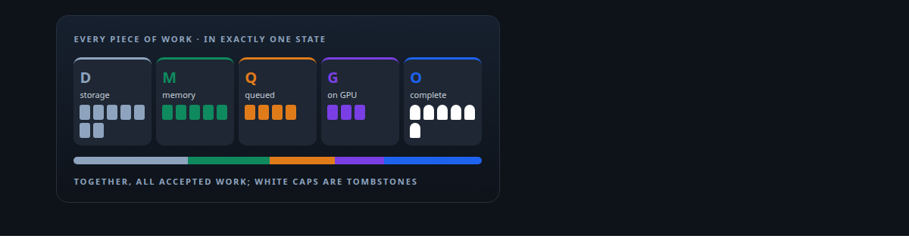
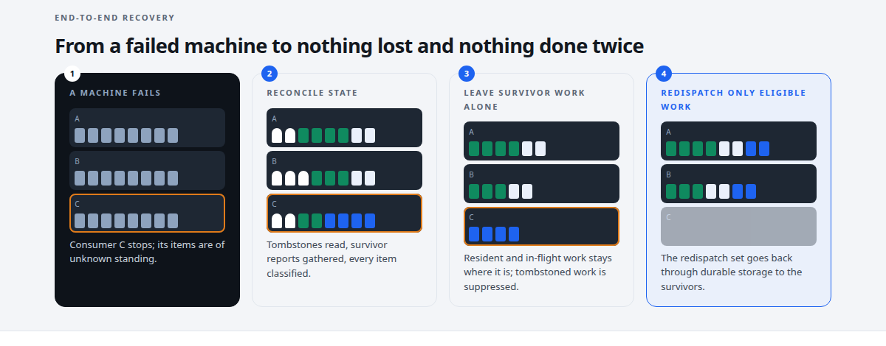
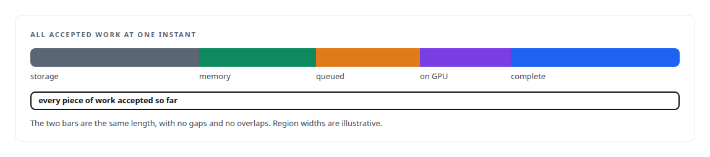
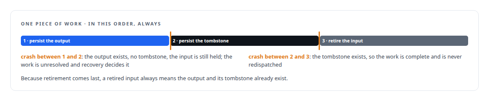
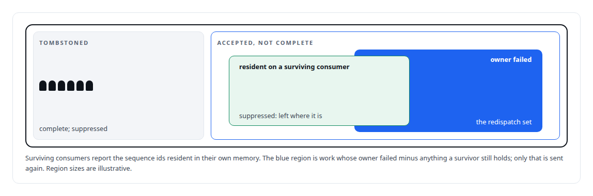
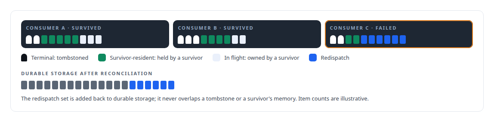
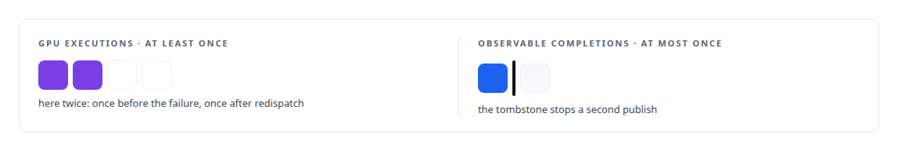

# Family Two: Durable work, tombstones and lossless recovery

**No accepted work is lost, and no completed result is delivered twice, across a durable broker and GPU runtimes.**

Canonical: https://coreyjames.ai/research/family-two-durable-work-and-lossless-recovery/  
Author: Corey James · Published: 2026-10-28 · Kind: patent family  
DOI: https://doi.org/10.5281/zenodo.23735144  
Systems: [Inference Fabric](https://github.com/coreyjames-ai/inference-fabric)  
Skills: [exactly-once delivery and crash recovery](https://github.com/coreyjames-ai/portfolio/tree/main/skills/exactly-once-delivery-and-crash-recovery) · [message broker and queue design](https://github.com/coreyjames-ai/portfolio/tree/main/skills/message-broker-and-queue-design) · [distributed systems correctness](https://github.com/coreyjames-ai/portfolio/tree/main/skills/distributed-systems-correctness) · [AI-assisted engineering methodology](https://github.com/coreyjames-ai/portfolio/tree/main/skills/ai-assisted-engineering-methodology)  

Provisional patent application, patent pending. Application number 64/147,527.



## Result

| Figure | What it measures |
| --- | --- |
| **5** | states; every piece of work is in exactly one |
| **1** | durable tombstone marks a completion |
| **4** | outcomes for every item at reconciliation |
| **6 M** | queued items in the loss this design closed |



## What was built

Methods and Systems for No-Loss Work Reconciliation Between a Durable-Log Broker and Accelerator Inference Runtimes Using Consumer-Reported Hardware Residency. U.S. Provisional Patent Application No. 64/147,527 (patent pending). Embodied in the broker of the [Inference Fabric](https://coreyjames.ai/systems/inference-fabric).

## Five states, every piece of work in exactly one

Every piece of work is in exactly one of five states at any time: durable storage, consumer memory, queued for GPU, running on GPU, or durably complete. At any instant all accepted work is the disjoint union of those five sets, so nothing is ever unaccounted for.



## A tombstone, and a fixed durability order

Completion is marked by a durable tombstone, and the durability order is fixed: the output is persisted, then the tombstone, and only then is the input retired.



## Recovery as a classification

Recovery is a classification. After a failure the system identifies the work that is accepted but not complete, the work that surviving consumers report as resident in their own memory, and the work whose owner was a failed consumer.



Only work that is unresolved, not tombstoned, not resident on a survivor, and owned by a failed consumer is redispatched. Everything else is suppressed, and each item comes out of reconciliation with exactly one of four outcomes.



## At-least-once execution, at-most-once completion

The guarantees fall out of the model: no accepted work is lost, and no completed result is delivered twice.




That is the design that closed a six-million-item loss and balanced the token ledger to zero, told in [Millions of queued items that were not there](https://coreyjames.ai/stories/millions-of-queued-items-that-were-not-there).

> A piece of work may execute more than once on GPUs, and the outside world observes its completion at most once.

## What was verified

Each line is a claim the canonical page supports, with the figure as the page states it.

- Exactly-once delivery and crash recovery: a model of 5 states in which every accepted piece of work is in exactly one, so all accepted work is always accounted for.
- Write-ordering and durability design: a tombstone persisted after the output and before the input is retired, so a retired input always means the result is stored.
- Distributed systems correctness: recovery as a classification into 4 outcomes, redispatching only unresolved work owned by a failed consumer and not resident on a survivor.
- Message broker and queue design: at-least-once execution on GPUs with at-most-once observable completion, the design that closed a 6 M-item queue loss and balanced the token count to zero.
- Patent filing for AI infrastructure: U.S. Provisional Patent Application No. 64/147,527 (patent pending) on no-loss work reconciliation between a durable-log broker and GPU runtimes.

## Related

- [Millions of queued items that were not there](https://github.com/coreyjames-ai/inference-fabric/tree/main/stories/millions-of-queued-items-that-were-not-there) · https://coreyjames.ai/stories/millions-of-queued-items-that-were-not-there/
- System: [Inference Fabric](https://github.com/coreyjames-ai/inference-fabric)

## Citation

Corey James. "Family Two: Durable work, tombstones and lossless recovery." coreyjames.ai, 2026. https://coreyjames.ai/research/family-two-durable-work-and-lossless-recovery/ In: the portfolio technical report, doi:10.5281/zenodo.23735144.

```bibtex
@misc{coreyjames-family-two-durable-work-and-lossless-recovery,
  author = {Corey James},
  title = {Family Two: Durable work, tombstones and lossless recovery},
  year = {2026},
  howpublished = {\url{https://coreyjames.ai/research/family-two-durable-work-and-lossless-recovery/}},
  note = {GitHub copy: https://github.com/coreyjames-ai/portfolio/tree/main/research/patent-families/family-two-durable-work-and-lossless-recovery},
  doi = {10.5281/zenodo.23735144}
}
```

Part of [Corey James's portfolio](https://github.com/coreyjames-ai/portfolio) · site: https://coreyjames.ai/ · MCP server: https://coreyjames.ai/mcp · agent card: https://coreyjames.ai/.well-known/agent.json
