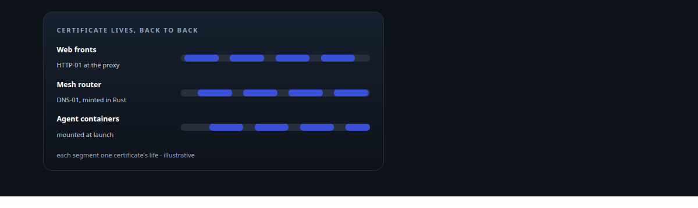
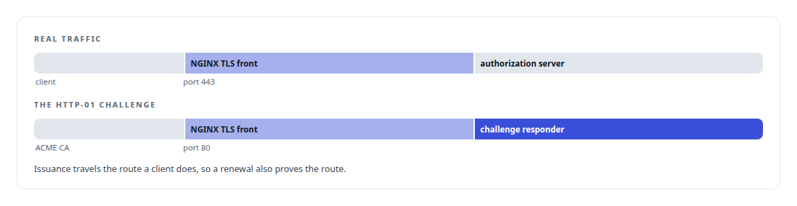
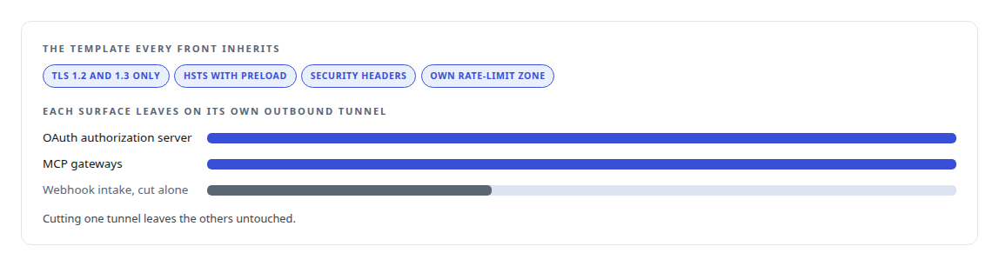
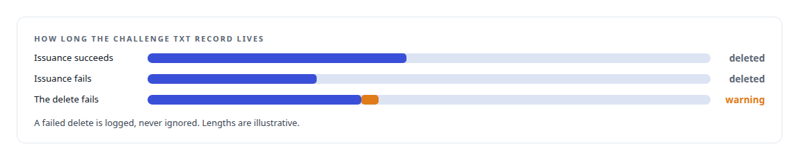
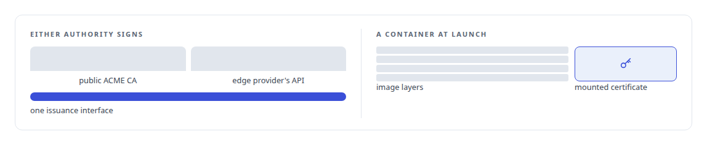
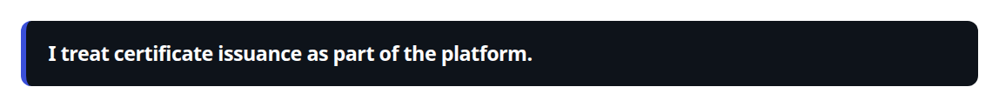

# ACME

**Automated certificate issuance keeps my services' TLS current without a human in the loop, in the agent runtime and the access plane.**

Canonical: https://coreyjames.ai/technologies/acme/  
Author: Corey James · Published: 2026-10-28 · Kind: technology  
Systems: [Auth and access plane](https://github.com/coreyjames-ai/auth-and-access-plane) · [Agent Swarm](https://github.com/coreyjames-ai/agent-swarm)  
Skills: [Rust systems engineering](https://github.com/coreyjames-ai/portfolio/tree/main/skills/rust-systems-engineering) · [distributed systems correctness](https://github.com/coreyjames-ai/portfolio/tree/main/skills/distributed-systems-correctness)  



## Result

| Figure | What it measures |
| --- | --- |
| **46** | lines of Python in the HTTP-01 challenge responder |
| **2** | challenge types, picked per surface |
| **2** | issuance backends behind one interface |

## What was built

### Renewing the web fronts without me

[Auth and access plane](https://coreyjames.ai/systems/auth-and-access-plane) serves an OAuth authorization server, MCP gateways and webhook intake to the internet from an estate with no open inbound ports. Every one of those surfaces sits behind an [NGINX](https://coreyjames.ai/technologies/nginx) TLS front, and I wanted each certificate to renew without me.

I chose ACME's HTTP-01 challenge for the web fronts, where a proxy already answers on port 80, and answered it on the same proxy path that carries real traffic.



The front it serves is the template for the rest, and that pattern is on the [Zero-inbound network exposure](https://coreyjames.ai/technologies/zero-inbound-network-exposure) page.



### Minting certificates inside the agent runtime

[Agent Swarm](https://coreyjames.ai/systems/agent-swarm) had a different problem. Agent containers and the mesh router need TLS material, their certificates belong to services with no public web front that could answer a challenge, and nobody should copy private keys between hosts.

I chose DNS-01 and wrote minting into the runtime as Rust crates. The ACME crate cleans up its challenge record on every exit, because stale challenge records otherwise pile up in the zone without anyone noticing; a failed issuance that leaves records behind becomes a slow leak.



### One interface, and no key in any image

A second crate issues through the edge provider's certificate API, and both backends sit behind one interface, so code that consumes a certificate does not care which authority signed it.



Minted certificates are mounted into containers at launch and never sit in an image, so rebuilding an image can never ship a key. The internal CA the message bus trusts is covered on the [TLS and mTLS](https://coreyjames.ai/technologies/tls-and-mtls) page.



I used existing ACME clients and the standard protocol; I did not write an ACME client or run a public CA.

> I treat certificate issuance as part of the platform.

## What was verified

Each line is a claim the canonical page supports, with the figure as the page states it.

- TLS certificate automation: ACME issuance for web fronts and agent containers with no person in the loop, HTTP-01 answered by a 46-line responder on the path real traffic takes.
- Rust systems engineering: DNS-01 certificate minting written into the agent runtime as Rust crates, two issuance backends behind one interface, challenge records removed on every exit path.
- Secrets hygiene in container platforms: certificates mounted into containers at launch and never baked into an image, so rebuilding an image can never ship a key.

## Related

- [NGINX](https://github.com/coreyjames-ai/portfolio/tree/main/technologies/nginx) · https://coreyjames.ai/technologies/nginx/
- [Zero-inbound network exposure](https://github.com/coreyjames-ai/portfolio/tree/main/technologies/zero-inbound-network-exposure) · https://coreyjames.ai/technologies/zero-inbound-network-exposure/
- [TLS and mTLS](https://github.com/coreyjames-ai/portfolio/tree/main/technologies/tls-and-mtls) · https://coreyjames.ai/technologies/tls-and-mtls/
- System: [Auth and access plane](https://github.com/coreyjames-ai/auth-and-access-plane)
- System: [Agent Swarm](https://github.com/coreyjames-ai/agent-swarm)

## Citation

Corey James. "ACME." coreyjames.ai, 2026. https://coreyjames.ai/technologies/acme/

```bibtex
@misc{coreyjames-acme,
  author = {Corey James},
  title = {ACME},
  year = {2026},
  howpublished = {\url{https://coreyjames.ai/technologies/acme/}},
  note = {GitHub copy: https://github.com/coreyjames-ai/portfolio/tree/main/technologies/acme}
}
```

Part of [Corey James's portfolio](https://github.com/coreyjames-ai/portfolio) · site: https://coreyjames.ai/ · MCP server: https://coreyjames.ai/mcp · agent card: https://coreyjames.ai/.well-known/agent.json
