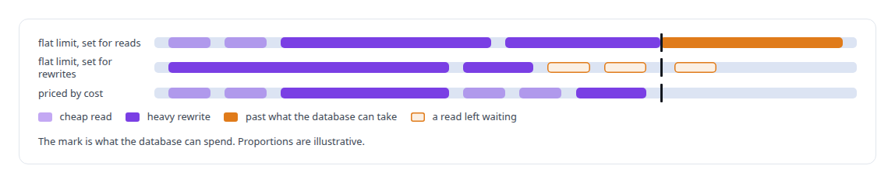
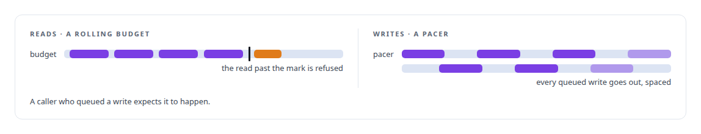
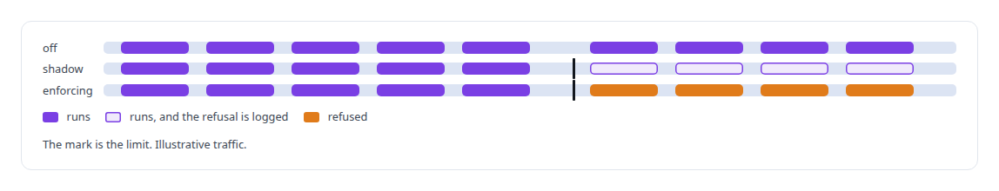
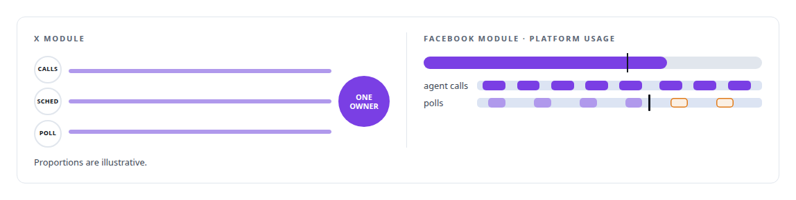
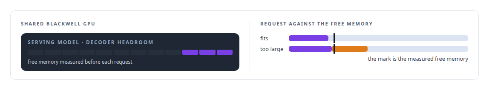

# Admission control and rate limiting

**Every surface I expose has a stated limit and a typed refusal.**

Canonical: https://coreyjames.ai/technologies/admission-control-and-rate-limiting/  
Author: Corey James · Published: 2026-10-28 · Kind: technology  
Systems: [FAFO Core and Function Forge](https://github.com/coreyjames-ai/fafo-core) · [PostgreSQL Fabric](https://github.com/coreyjames-ai/postgresql-fabric) · [FAFOHive](https://github.com/coreyjames-ai/fafohive) · [Capabilities model](https://github.com/coreyjames-ai/capabilities-model)  
Skills: [database admission control](https://github.com/coreyjames-ai/portfolio/tree/main/skills/database-admission-control) · [Rust systems engineering](https://github.com/coreyjames-ai/portfolio/tree/main/skills/rust-systems-engineering) · [tool synthesis and governed API integration](https://github.com/coreyjames-ai/portfolio/tree/main/skills/tool-synthesis-and-governed-api-integration) · [inference serving architecture](https://github.com/coreyjames-ai/portfolio/tree/main/skills/inference-serving-architecture)  


## Result

| Figure | What it measures |
| --- | --- |
| **3 modes** | for every admission limit, so a new one is watched before it refuses |
| **3** | processes, agent calls, a scheduler and a poller, on one account-wide X limit |
| **60%** | platform usage past which the Facebook poller skips its run |
| **0** | daily caps of my own on the social modules |

## What was built

I built admission control into the memory service, the execution substrate's admission controller and a GPU decoder that refuses with a number rather than queueing silently. I decide where a limit sits by asking what the protected resource actually runs out of.

## Pricing database work by its cost

[FAFO Core and Function Forge](https://coreyjames.ai/systems/fafo-core) lets agents call database-heavy functions over MCP, and agents submit as much work as you let them. The database has a fixed number of connections, a fixed write budget and fixed I/O, and the operations behind those functions range from zero-write reads to rewrites of a whole vector lattice.

One request-per-second limit cannot fit that range. I priced every request by its expected cost to the database, because database operations differ too much for a flat count to mean anything, and put that pricing in a dedicated Rust admission service in front of the governed data plane, so heavy work waits and cheap work flows.



## Two shapes of third-party budget

The API integration platform I built beside Core applies the same thinking to third-party APIs, with one rule for reads and another for writes. Both buckets sit in [Redis](https://coreyjames.ai/technologies/redis) and read the Redis server's clock, so several consumer instances share one budget with no clock skew between them.



## Watching a limit before it refuses

[FAFOHive](https://coreyjames.ai/systems/fafohive) exposes the admission service and the bulk database writer to operators, and I wanted a new limit to be watched before it could refuse anything. Shadow mode runs a limit against real traffic and logs what it would have refused while refusing nothing; only then is it switched to enforcing.



## One owner for each shared quota

The in-house X module had a different problem. Agent calls, a per-minute scheduler and a poller all draw on one account-wide platform rate limit and one budget, and each would believe it owned the whole allowance. I put one service in charge of the HTTP client, a sliding-window limiter, a concurrency cap, budget reservations, pacing, a circuit breaker and the write gate; the timers are thin clients that ask it to wake up. The design is deliberately small: no queue broker and no distributed workers.

The Facebook module puts the platform's own usage headers into every tool result, so its background poller can leave room for the agents. I removed the daily caps first set on the social modules and kept only the platforms' own limits, under my rule of no arbitrary limits.



## A decoder that refuses with a number

[Capabilities model](https://coreyjames.ai/systems/capabilities-model) runs a tool-discovery decoder on an [NVIDIA Blackwell GPU](https://coreyjames.ai/technologies/nvidia-blackwell-gpus) that also holds a large serving model. I made it admit work against measured free memory before accepting a request, and answer a full engine with a typed busy response that carries a retry hint. The story is [A router beside a production model](https://coreyjames.ai/stories/a-router-beside-a-production-model).




> A refusal carries a type and a number the caller can act on; a silent queue or a timeout gives the caller nothing.

## What was verified

Each line is a claim the canonical page supports, with the figure as the page states it.

- Database admission control: a Rust admission service that prices each request by its expected cost to the database, so heavy rewrites wait and cheap reads flow, with off, shadow and enforcing modes.
- Rate limiting for third-party APIs: Redis buckets on the server's clock, reads refused when a rolling budget is spent and writes paced, never rejected; one service owning a limit shared by 3 processes.
- API quota sharing: a Facebook module that returns the platform's usage headers with every tool result and skips background polls past 60 percent usage, leaving room for agents.
- Backpressure with typed refusal: a GPU tool-discovery decoder that admits work against measured free memory beside a serving model and answers a full engine with a typed busy response and a retry hint.

## Related

- [A router beside a production model](https://github.com/coreyjames-ai/capabilities-model/tree/main/stories/a-router-beside-a-production-model) · https://coreyjames.ai/stories/a-router-beside-a-production-model/
- [Redis](https://github.com/coreyjames-ai/portfolio/tree/main/technologies/redis) · https://coreyjames.ai/technologies/redis/
- [NVIDIA Blackwell GPUs](https://github.com/coreyjames-ai/portfolio/tree/main/technologies/nvidia-blackwell-gpus) · https://coreyjames.ai/technologies/nvidia-blackwell-gpus/
- System: [FAFO Core and Function Forge](https://github.com/coreyjames-ai/fafo-core)
- System: [PostgreSQL Fabric](https://github.com/coreyjames-ai/postgresql-fabric)
- System: [FAFOHive](https://github.com/coreyjames-ai/fafohive)
- System: [Capabilities model](https://github.com/coreyjames-ai/capabilities-model)

## Citation

Corey James. "Admission control and rate limiting." coreyjames.ai, 2026. https://coreyjames.ai/technologies/admission-control-and-rate-limiting/

```bibtex
@misc{coreyjames-admission-control-and-rate-limiting,
  author = {Corey James},
  title = {Admission control and rate limiting},
  year = {2026},
  howpublished = {\url{https://coreyjames.ai/technologies/admission-control-and-rate-limiting/}},
  note = {GitHub copy: https://github.com/coreyjames-ai/portfolio/tree/main/technologies/admission-control-and-rate-limiting}
}
```

Part of [Corey James's portfolio](https://github.com/coreyjames-ai/portfolio) · site: https://coreyjames.ai/ · MCP server: https://coreyjames.ai/mcp · agent card: https://coreyjames.ai/.well-known/agent.json
