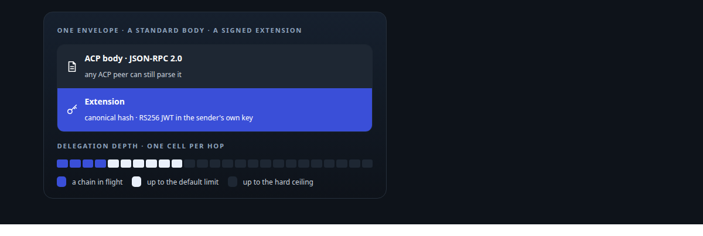
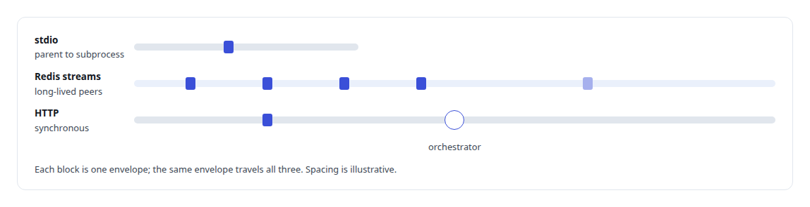
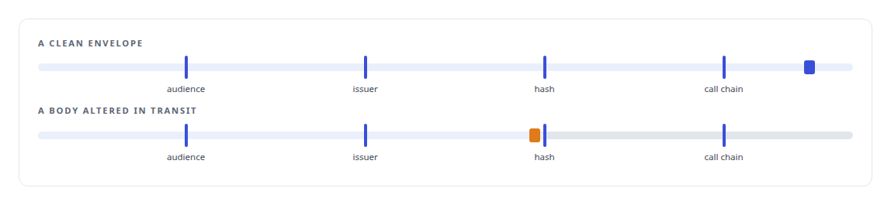
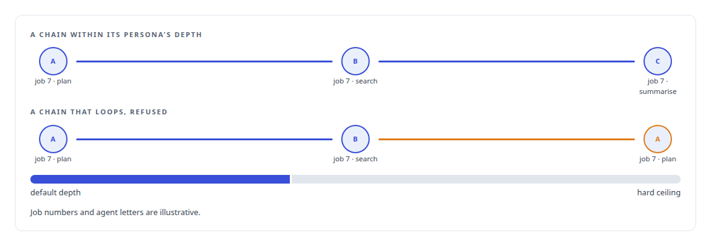
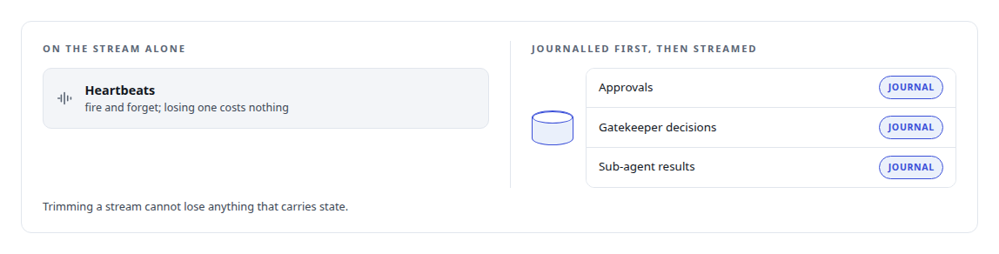
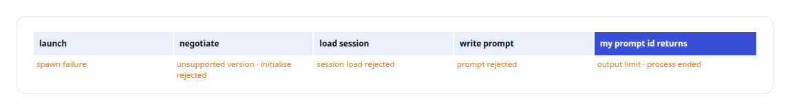
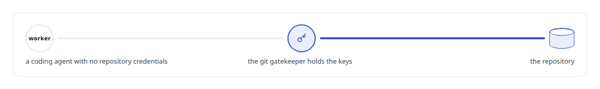

# Agent Client Protocol (ACP)

**I built agents that speak the Agent Client Protocol so coding assistants can be driven as governed workers rather than chat windows.**

Canonical: https://coreyjames.ai/technologies/agent-client-protocol-acp/  
Author: Corey James · Published: 2026-10-28 · Kind: technology  
Systems: [AgentOS](https://github.com/coreyjames-ai/agentos) · [Agent Swarm](https://github.com/coreyjames-ai/agent-swarm)  
Skills: [multi-agent governance](https://github.com/coreyjames-ai/portfolio/tree/main/skills/multi-agent-governance) · [agent orchestration](https://github.com/coreyjames-ai/portfolio/tree/main/skills/agent-orchestration) · [tool synthesis and governed API integration](https://github.com/coreyjames-ai/portfolio/tree/main/skills/tool-synthesis-and-governed-api-integration) · [distributed systems correctness](https://github.com/coreyjames-ai/portfolio/tree/main/skills/distributed-systems-correctness)  



## Result

| Figure | What it measures |
| --- | --- |
| **25** | hard ceiling on delegation depth; a persona configured deeper is refused |
| **4** | checks on every receipt: audience, issuer, hash and call chain |
| **2** | transports for the same envelopes: stdio and Redis streams |
| **7** | typed endings in the delivery adapter besides acceptance |

## What was built

ACP is the seam between my governance platform and the vendors' own tools.

## A signed wire for agents that delegate to agents

[Agent Swarm](https://coreyjames.ai/systems/agent-swarm) lets agents delegate to one another, and a receiving agent has to know who really sent a request, on whose behalf, and that the chain of delegation is not looping or growing without end. I did not want a home-grown protocol for that. I adopted the Agent Client Protocol, which is [JSON-RPC](https://coreyjames.ai/technologies/json-rpc) 2.0, as the cross-vendor agent protocol and locked the choice into the runtime's master plan; I did not author ACP, I use it and extend it.

ACP runs over stdio for agents started as subprocesses; between long-lived agents the same envelopes travel on [Redis](https://coreyjames.ai/technologies/redis) streams, and synchronous calls go through the orchestrator over HTTP.



On top of the standard body I added an extension: each envelope is canonicalised and hashed, signed as an RS256 [JWT](https://coreyjames.ai/technologies/json-web-token-jwt) with the sending agent's own key, and checked on arrival.



The extension keeps the base protocol standard, and the wire contract is a small crate with no I/O and no business logic, with signing in a separate crate, so the protocol stack can leave the estate on its own.

## Delegation bounded on every receipt

The chain check enforces a depth limit for each persona, ten unless the persona sets its own, under a hard ceiling of 25 that no persona can raise; a limit of zero forbids peer calls entirely. It also rejects any chain in which the same job and action appear twice.



Confused-deputy calls and runaway delegation are the failure modes that matter when language models call each other, so bounded delegation is a protocol rule rather than a convention, checked by every receiver.


## Journalled before it is streamed

Messages whose loss would corrupt agent state are written to [PostgreSQL](https://coreyjames.ai/technologies/postgresql) before they go on the stream.



A trace id in every envelope lets an operator join the journal with the audit log and find the first message that was never acknowledged, across hosts.

## Typed endings for a vendor's coding tool

[AgentOS](https://coreyjames.ai/systems/agentos) drives vendors' own coding tools as governed seats, and ACP is one way it hands them work. For a third frontier family I built a bounded delivery adapter. It reports acceptance only when the vendor's own queue notification comes back carrying the prompt id the adapter chose, because a prompt that was written to a pipe has not yet been accepted by anything.



The adapter leaves the vendor's own session socket alone and talks only through the supported bridge. Adding a vendor follows a runbook that keeps provider names out of central code and needs no schema migration.

## A gatekeeper for sensitive operations

The same signed messaging carries the gatekeeper pattern, in which a worker asks a trusted agent to perform a sensitive operation instead of holding the credentials itself.



The git gatekeeper that opens merge requests for coding agents is the example in use, told in [A coding agent that never holds the keys](https://coreyjames.ai/stories/a-coding-agent-that-never-holds-the-keys).

> I put identity and delegation limits into the wire itself.

## What was verified

Each line is a claim the canonical page supports, with the figure as the page states it.

- Agent-to-agent protocol design: the Agent Client Protocol adopted as the cross-vendor wire and extended with canonical hashing and RS256-signed envelopes, keeping the base protocol standard.
- Multi-agent governance: bounded delegation enforced on every receipt with 4 checks (audience, issuer, hash and call chain) and a hard depth ceiling of 25 that no persona can raise.
- Agent orchestration: a delivery adapter that drives a vendor's own coding tool through its supported ACP bridge and counts a prompt accepted only on the vendor's own acknowledgement, with 7 typed endings.

## Related

- [A coding agent that never holds the keys](https://github.com/coreyjames-ai/agent-swarm/tree/main/stories/a-coding-agent-that-never-holds-the-keys) · https://coreyjames.ai/stories/a-coding-agent-that-never-holds-the-keys/
- [JSON-RPC](https://github.com/coreyjames-ai/portfolio/tree/main/technologies/json-rpc) · https://coreyjames.ai/technologies/json-rpc/
- [Redis](https://github.com/coreyjames-ai/portfolio/tree/main/technologies/redis) · https://coreyjames.ai/technologies/redis/
- [JSON Web Token (JWT)](https://github.com/coreyjames-ai/portfolio/tree/main/technologies/json-web-token-jwt) · https://coreyjames.ai/technologies/json-web-token-jwt/
- [PostgreSQL](https://github.com/coreyjames-ai/portfolio/tree/main/technologies/postgresql) · https://coreyjames.ai/technologies/postgresql/
- System: [AgentOS](https://github.com/coreyjames-ai/agentos)
- System: [Agent Swarm](https://github.com/coreyjames-ai/agent-swarm)

## Citation

Corey James. "Agent Client Protocol (ACP)." coreyjames.ai, 2026. https://coreyjames.ai/technologies/agent-client-protocol-acp/

```bibtex
@misc{coreyjames-agent-client-protocol-acp,
  author = {Corey James},
  title = {Agent Client Protocol (ACP)},
  year = {2026},
  howpublished = {\url{https://coreyjames.ai/technologies/agent-client-protocol-acp/}},
  note = {GitHub copy: https://github.com/coreyjames-ai/portfolio/tree/main/technologies/agent-client-protocol-acp}
}
```

Part of [Corey James's portfolio](https://github.com/coreyjames-ai/portfolio) · site: https://coreyjames.ai/ · MCP server: https://coreyjames.ai/mcp · agent card: https://coreyjames.ai/.well-known/agent.json
