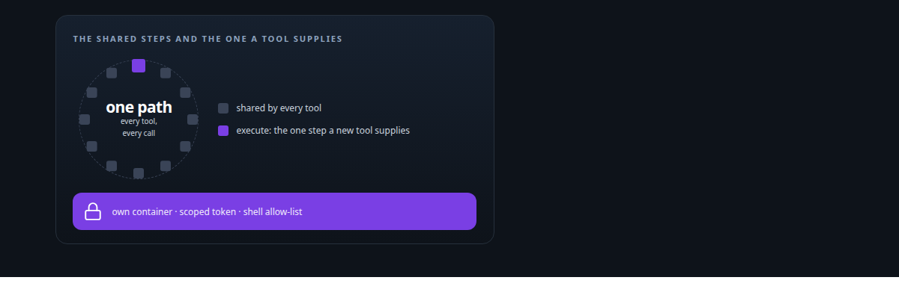
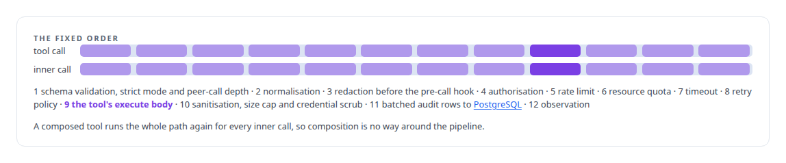
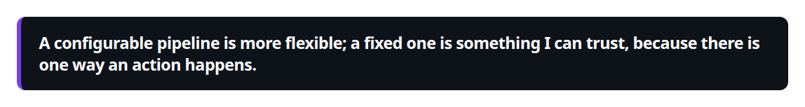
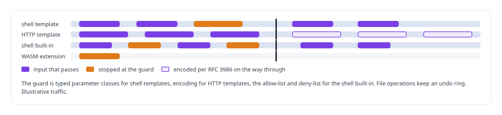
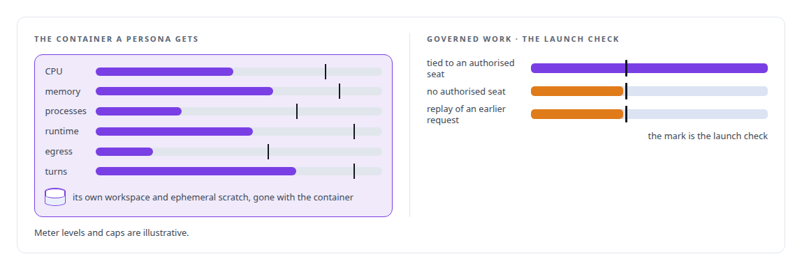

# Agent tool-execution safety and sandboxing

**Every action any agent takes in my runtime passes one frozen pipeline: validation, authorisation, limits, sanitisation, audit, observation.**

Canonical: https://coreyjames.ai/technologies/agent-tool-execution-safety-and-sandboxing/  
Author: Corey James · Published: 2026-10-28 · Kind: technology  
Systems: [Agent Swarm](https://github.com/coreyjames-ai/agent-swarm)  
Skills: [separation of duties for AI work](https://github.com/coreyjames-ai/portfolio/tree/main/skills/separation-of-duties-for-ai-work) · [sandboxing and container hardening](https://github.com/coreyjames-ai/portfolio/tree/main/skills/sandboxing-and-container-hardening) · [Rust systems engineering](https://github.com/coreyjames-ai/portfolio/tree/main/skills/rust-systems-engineering) · [multi-agent governance](https://github.com/coreyjames-ai/portfolio/tree/main/skills/multi-agent-governance)  



## Result

| Figure | What it measures |
| --- | --- |
| **12 steps** | every tool call passes, in a fixed order |
| **22,600** | lines in the tools module, with its schema validator, tool kinds and built-ins |
| **0** | commits by the coding agent straight to the main repository; the gatekeeper opens the merge |

## What was built

I make the safe path the only path, and I take flexibility away where flexibility would let an action skip a check.

## One frozen path for every tool call

[Agent Swarm](https://coreyjames.ai/systems/agent-swarm) runs agents that act on real systems. If every tool does its own validation, permission checks and logging, each new tool is a new place for a mistake, and nobody can audit a fleet of them. I decided there would be exactly one path for an action and that the path would be frozen. Every tool call, of every kind, goes through one [Rust](https://coreyjames.ai/technologies/rust) harness in a fixed order, and a tool marked as needing approval pauses the agent loop until approval arrives.



Credential scrubbing and size caps run in the shared output step, so a careless tool body has a backstop. Agents call MCP methods directly, outside the tool kinds, which avoids wrapping one governance layer inside another.

The reasoning is in [Tools are the platform](https://coreyjames.ai/stories/tools-are-the-platform).



## Tool kinds that carry their own guards

Most tools are [YAML](https://coreyjames.ai/technologies/yaml) declarations, and each executable kind carries the guard its inputs need. A WASM extension kind is declared and the harness rejects it, because I would rather leave a kind unrunnable than ship it half-built with part of the pipeline bypassed. The test discipline is on the [Agent tool qualification testing](https://coreyjames.ai/technologies/agent-tool-qualification-testing) page.



## A container for every persona

[Agent Swarm](https://coreyjames.ai/systems/agent-swarm) also has to start agents somewhere they can do limited harm. Its persona launcher turns a declared persona into a [Docker](https://coreyjames.ai/technologies/docker) container. An agent cannot call what it was not granted and never holds a credential it does not need, and sensitive operations go to a gatekeeper agent that checks who is asking and applies its own policy, which adds separation of duties to narrow tokens.



A coding agent on a local open-weight model edited code on its own branch, ran the tests, pushed, and asked the gatekeeper agent to open the merge request: [A coding agent that never holds the keys](https://coreyjames.ai/stories/a-coding-agent-that-never-holds-the-keys).

> A configurable pipeline is more flexible; a fixed one is something I can trust, because there is one way an action happens.

## What was verified

Each line is a claim the canonical page supports, with the figure as the page states it.

- Agent tool governance: every tool call of every kind through one Rust harness of 12 steps in a fixed order, a new tool supplying only its execute body, in a tools module of about 22,600 lines.
- Sandboxing and container hardening: each agent persona launched as a Docker container with CPU, memory, process, runtime and egress caps, a turn budget and its own workspace.
- Injection defence for agent tools: shell templates with typed parameter classes and an attack fixture beside every golden fixture, and HTTP templates encoded per RFC 3986.
- Separation of duties for AI work: a coding agent that edited, tested and pushed on its own branch and asked a gatekeeper agent to open the merge request, with 0 commits to the main repository.

## Related

- [Tools are the platform](https://github.com/coreyjames-ai/agent-swarm/tree/main/stories/tools-are-the-platform) · https://coreyjames.ai/stories/tools-are-the-platform/
- [A coding agent that never holds the keys](https://github.com/coreyjames-ai/agent-swarm/tree/main/stories/a-coding-agent-that-never-holds-the-keys) · https://coreyjames.ai/stories/a-coding-agent-that-never-holds-the-keys/
- [Tools that build tools, under governance](https://github.com/coreyjames-ai/fafo-core/tree/main/stories/tools-that-build-tools-under-governance) · https://coreyjames.ai/stories/tools-that-build-tools-under-governance/
- [Rust](https://github.com/coreyjames-ai/portfolio/tree/main/technologies/rust) · https://coreyjames.ai/technologies/rust/
- [YAML](https://github.com/coreyjames-ai/portfolio/tree/main/technologies/yaml) · https://coreyjames.ai/technologies/yaml/
- [Agent tool qualification testing](https://github.com/coreyjames-ai/portfolio/tree/main/technologies/agent-tool-qualification-testing) · https://coreyjames.ai/technologies/agent-tool-qualification-testing/
- [Docker](https://github.com/coreyjames-ai/portfolio/tree/main/technologies/docker) · https://coreyjames.ai/technologies/docker/
- System: [Agent Swarm](https://github.com/coreyjames-ai/agent-swarm)

## Citation

Corey James. "Agent tool-execution safety and sandboxing." coreyjames.ai, 2026. https://coreyjames.ai/technologies/agent-tool-execution-safety-and-sandboxing/

```bibtex
@misc{coreyjames-agent-tool-execution-safety-and-sandboxing,
  author = {Corey James},
  title = {Agent tool-execution safety and sandboxing},
  year = {2026},
  howpublished = {\url{https://coreyjames.ai/technologies/agent-tool-execution-safety-and-sandboxing/}},
  note = {GitHub copy: https://github.com/coreyjames-ai/portfolio/tree/main/technologies/agent-tool-execution-safety-and-sandboxing}
}
```

Part of [Corey James's portfolio](https://github.com/coreyjames-ai/portfolio) · site: https://coreyjames.ai/ · MCP server: https://coreyjames.ai/mcp · agent card: https://coreyjames.ai/.well-known/agent.json
