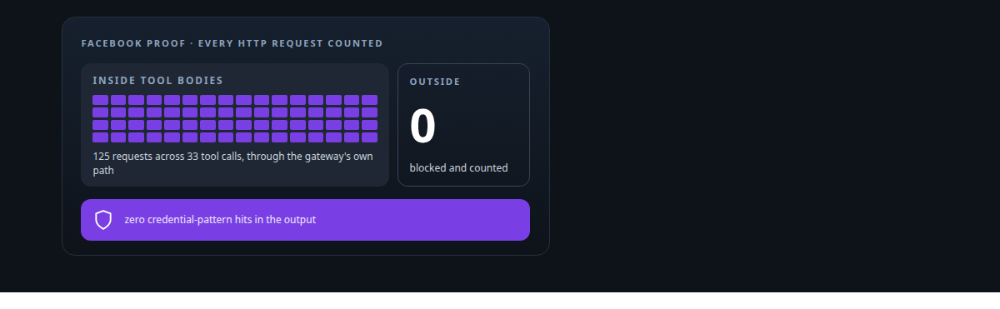
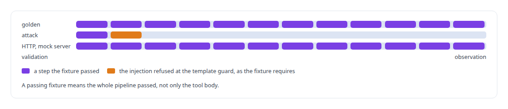
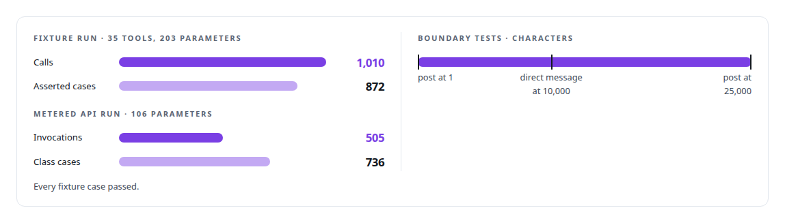
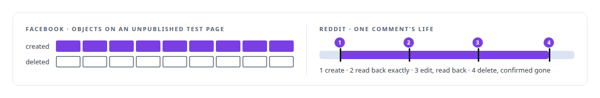

# Agent tool qualification testing

**No tool in my agent runtime ships without golden fixtures and attack fixtures, and the build fails otherwise.**

Canonical: https://coreyjames.ai/technologies/agent-tool-qualification-testing/  
Author: Corey James · Published: 2026-10-28 · Kind: technology  
Systems: [Agent Swarm](https://github.com/coreyjames-ai/agent-swarm) · [FAFOHive](https://github.com/coreyjames-ai/fafohive)  
Skills: [tool synthesis and governed API integration](https://github.com/coreyjames-ai/portfolio/tree/main/skills/tool-synthesis-and-governed-api-integration) · [AI-assisted engineering methodology](https://github.com/coreyjames-ai/portfolio/tree/main/skills/ai-assisted-engineering-methodology) · [evidence-gated acceptance](https://github.com/coreyjames-ai/portfolio/tree/main/skills/evidence-gated-acceptance) · [Rust systems engineering](https://github.com/coreyjames-ai/portfolio/tree/main/skills/rust-systems-engineering)  



## Result

| Figure | What it measures |
| --- | --- |
| **50** | golden fixtures for 40 declarative tools |
| **1,200** | lines in the Rust test runner |
| **3** | platform-semantics defects the Facebook proof found, each now a test |

## What was built

The same standard governs the social integrations: every write read back, every create with a delete, every inbound item an event. I set acceptance rules that turn "it works" into counted cases and side-channel measurements, and I make the build enforce them.

## Fixtures that fail the build

[Agent Swarm](https://coreyjames.ai/systems/agent-swarm) adds tools as YAML declarations, and I knew a tool nobody tests is the hole an agent eventually finds. So a tool without fixtures fails the build, and attack fixtures are required even for one-line tools, because exceptions to a safety rule are where the holes appear.

The test runner is a Rust crate that loads the catalog with the same loader the runtime uses, registers the built-in and declarative tools, and sends every fixture through the real invocation harness. Beside it sits a tracer-bullet regression: synthetic in-process agents and a minimal persona that cross the registry, signed messaging and observation capture with no model loaded. The design is in [Tools are the platform](https://coreyjames.ai/stories/tools-are-the-platform).



## Qualifying the X module by parameter class

[FAFOHive](https://coreyjames.ai/systems/fafohive) lets agents act on real social platforms through in-house modules, where a mistake is a public post. My rule was that no tool reaches an agent until each of its parameter classes is backed by a real-API or fixture test. Counting by parameter class states exactly how much of a tool surface is covered, and no more: qualification covers a finite set of classes.

The X module was qualified twice, once on fixtures and once against the metered data API, with boundary tests at the platform's own limits.



## Facebook and Reddit, managed through the tools alone

For Facebook I set a harder rule: any post must be fully manageable through the agent tools alone. The proof harness called the tools through the same path the gateway uses and blocked and counted every HTTP request made outside a tool body, which turned "the tools can do it" into a measurement. It created every object kind on an unpublished test page with generated media, checked each one, deleted every created object through the tools, and confirmed they were gone. For Reddit, a short proof ran through the governed gateway with stable idempotency keys.



Every proof leaves the platform as it found it, on test pages and test content. Writes were switched on only inside the proof process; by default they stay off.


> A write whose outcome is uncertain is reconciled and cleaned up, and never resent, because on a social platform a duplicate does more harm than a gap.

## What was verified

Each line is a claim the canonical page supports, with the figure as the page states it.

- Test engineering for AI agent tools: a Rust runner that sends every fixture through the real invocation harness, 50 golden fixtures for 40 declarative tools, and a build that fails on a tool without fixtures.
- API qualification by parameter class: an X module qualified across 35 tools and 203 parameters with 1,010 calls and 872 asserted cases, then 505 invocations against the metered API.
- Side-channel measurement in integration testing: a Facebook proof harness that blocked and counted every HTTP request outside a tool body and found 3 platform-semantics defects, each now a test.

## Related

- [Tools are the platform](https://github.com/coreyjames-ai/agent-swarm/tree/main/stories/tools-are-the-platform) · https://coreyjames.ai/stories/tools-are-the-platform/
- System: [Agent Swarm](https://github.com/coreyjames-ai/agent-swarm)
- System: [FAFOHive](https://github.com/coreyjames-ai/fafohive)

## Citation

Corey James. "Agent tool qualification testing." coreyjames.ai, 2026. https://coreyjames.ai/technologies/agent-tool-qualification-testing/

```bibtex
@misc{coreyjames-agent-tool-qualification-testing,
  author = {Corey James},
  title = {Agent tool qualification testing},
  year = {2026},
  howpublished = {\url{https://coreyjames.ai/technologies/agent-tool-qualification-testing/}},
  note = {GitHub copy: https://github.com/coreyjames-ai/portfolio/tree/main/technologies/agent-tool-qualification-testing}
}
```

Part of [Corey James's portfolio](https://github.com/coreyjames-ai/portfolio) · site: https://coreyjames.ai/ · MCP server: https://coreyjames.ai/mcp · agent card: https://coreyjames.ai/.well-known/agent.json
