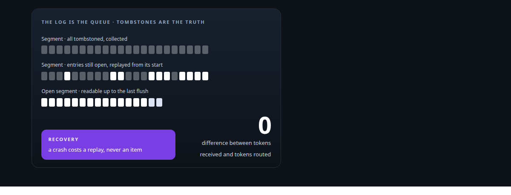
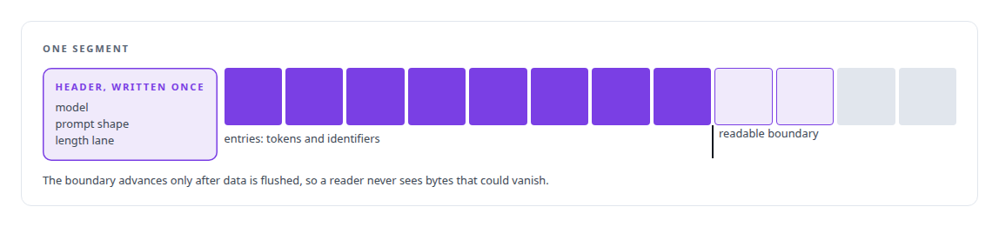
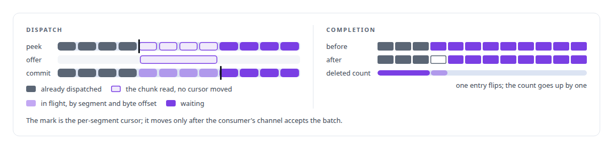
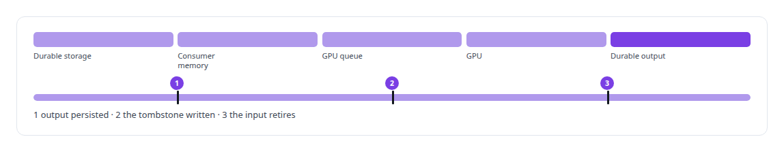
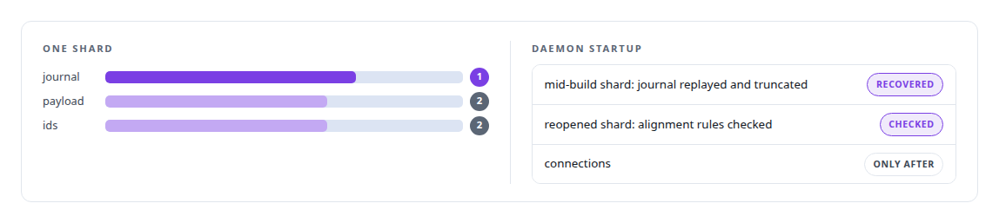

# Append-only log and journal design

**The Inference Fabric's broker is an append-only, memory-mapped log on NVMe whose unit is the token.**

Canonical: https://coreyjames.ai/technologies/append-only-log-and-journal-design/  
Author: Corey James · Published: 2026-10-28 · Kind: technology  
Systems: [Inference Fabric](https://github.com/coreyjames-ai/inference-fabric)  
Skills: [append-only log design](https://github.com/coreyjames-ai/portfolio/tree/main/skills/append-only-log-design) · [exactly-once delivery and crash recovery](https://github.com/coreyjames-ai/portfolio/tree/main/skills/exactly-once-delivery-and-crash-recovery) · [inference serving architecture](https://github.com/coreyjames-ai/portfolio/tree/main/skills/inference-serving-architecture) · [distributed systems correctness](https://github.com/coreyjames-ai/portfolio/tree/main/skills/distributed-systems-correctness)  



## Result

| Figure | What it measures |
| --- | --- |
| **256 MB** | a segment rotates at this size, or when it goes idle |
| **4 bytes** | the in-place write that retires a work item, with no compaction |
| **12.3B** | tokens received and routed, a 7B dense FP8 workload on two Blackwell GPUs |

## What was built

I designed completion accounting on the broker's log so that work retires only when acknowledged, which is how a six-million-item loss was closed. I fix data loss at the definition that caused it and build recovery on one source of truth.

## The log is the queue

[Inference Fabric](https://coreyjames.ai/systems/inference-fabric) needed producers to drop millions of tokenised tasks and walk away while GPUs on other machines worked through them for hours. I made the broker's backlog an append-only, memory-mapped log on [NVMe](https://coreyjames.ai/technologies/nvme-cold-tier-storage) and made that log the only durable copy, with no write-ahead log beside it. The log is the queue, which is what lets producers submit and exit.

The log is divided into segments, and each segment holds work for exactly one model, one prompt shape and one length lane. There is no per-item index; the broker tracks positions per segment. The hot path is one owner and a few blocking threads, chosen over an async runtime because it measured faster and is easier to reason about.



## Dispatch and completion

Dispatch is two-phase. The commit checks every segment it will touch before it changes anything, so it cannot fail halfway, which gives failure atomicity without a transaction log. Each item carries its segment and byte offset to the GPU and back.

When a result comes back, the broker rewrites that entry's marker in place, then increments the segment's deleted count. That costs bookkeeping on the read path, and I took that cost over a fast path that once lost millions of items.



Results are held in a completion log with the same structure, and a result is marked delivered only after the response carrying it has been flushed to the receiving socket. A segment whose entries are all deleted is removed by a collector that never deletes a file someone is still reading.

## Recovery from the markers alone

Recovery reads the deletion markers and nothing else. A segment with every entry retired is finished; any other segment is replayed from its start. An earlier design also consulted a separate dispatch file, and in a crash window the two could disagree, so I made the markers the single source of truth and recount the header from them on startup.

When a broker restarts while GPUs still hold work, each reconnecting GPU worker reports the work it is holding and the broker notes it before sending anything new, so surviving work is not run twice. When a worker disconnects or an in-flight entry goes stale, only the affected segments rewind to the earliest reclaimed entry. This is the model I filed as [Family Two: durable work, tombstones and lossless recovery](https://coreyjames.ai/research/family-two-durable-work-and-lossless-recovery/).




The diagnosis that led here is in [Millions of queued items that were not there](https://coreyjames.ai/stories/millions-of-queued-items-that-were-not-there).

## Journalled shards in the vector store

[Inference Fabric](https://coreyjames.ai/systems/inference-fabric)'s Vector Shard Manager keeps vectors outside the database in append-only shards, each stored as payload, ids and a journal. The store does no deduplication; each producer gets back a stable reference to its payload, and an acknowledged append becomes durable at the next scheduled flush.



> Computation can repeat after a failure; observable completion happens once.

## What was verified

Each line is a claim the canonical page supports, with the figure as the page states it.

- Append-only log design: a memory-mapped log on NVMe as the broker's only durable copy, segments rotating at 256 MB, and a work item retired by a 4-byte in-place write with no compaction.
- Exactly-once delivery and crash recovery: recovery from deletion markers alone and two-phase dispatch that checks before it mutates, closing a six-million-item loss; 12.3B tokens received and routed.
- Write-ahead journalling: a vector shard store that writes its journal before the shard and accepts no connection until every mid-build shard is replayed and truncated.

## Related

- [A message broker that understands tokens](https://github.com/coreyjames-ai/inference-fabric/tree/main/stories/a-message-broker-that-understands-tokens) · https://coreyjames.ai/stories/a-message-broker-that-understands-tokens/
- [Millions of queued items that were not there](https://github.com/coreyjames-ai/inference-fabric/tree/main/stories/millions-of-queued-items-that-were-not-there) · https://coreyjames.ai/stories/millions-of-queued-items-that-were-not-there/
- [NVMe (cold-tier storage)](https://github.com/coreyjames-ai/portfolio/tree/main/technologies/nvme-cold-tier-storage) · https://coreyjames.ai/technologies/nvme-cold-tier-storage/
- [Family Two: Durable work, tombstones and lossless recovery](https://github.com/coreyjames-ai/portfolio/tree/main/research/patent-families/family-two-durable-work-and-lossless-recovery) · https://coreyjames.ai/research/family-two-durable-work-and-lossless-recovery/
- System: [Inference Fabric](https://github.com/coreyjames-ai/inference-fabric)

## Citation

Corey James. "Append-only log and journal design." coreyjames.ai, 2026. https://coreyjames.ai/technologies/append-only-log-and-journal-design/

```bibtex
@misc{coreyjames-append-only-log-and-journal-design,
  author = {Corey James},
  title = {Append-only log and journal design},
  year = {2026},
  howpublished = {\url{https://coreyjames.ai/technologies/append-only-log-and-journal-design/}},
  note = {GitHub copy: https://github.com/coreyjames-ai/portfolio/tree/main/technologies/append-only-log-and-journal-design}
}
```

Part of [Corey James's portfolio](https://github.com/coreyjames-ai/portfolio) · site: https://coreyjames.ai/ · MCP server: https://coreyjames.ai/mcp · agent card: https://coreyjames.ai/.well-known/agent.json
