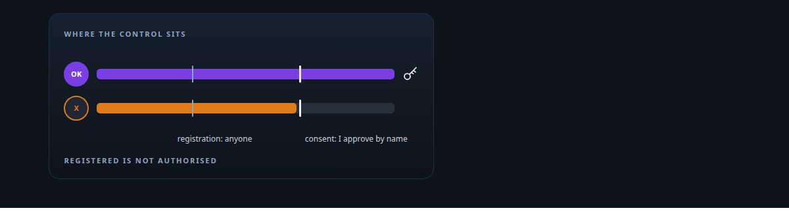
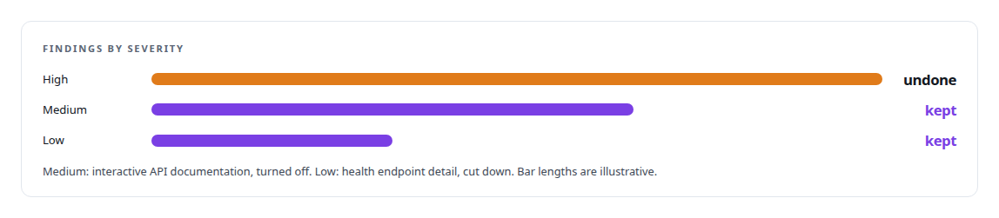
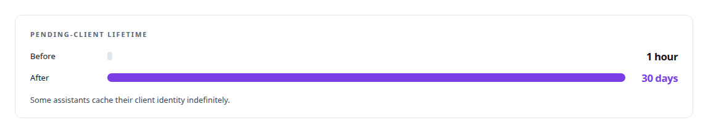
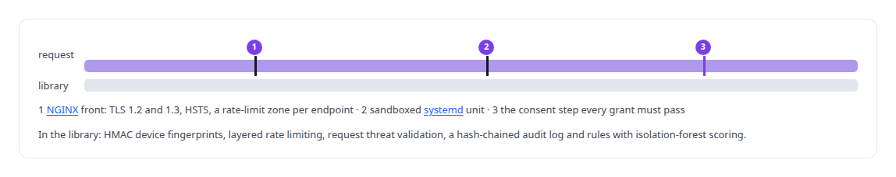

# Application security hardening and threat modelling

**I review my own public endpoints, fix findings in severity order with explicit probes, and re-run the threat model when a fix breaks the world.**

Canonical: https://coreyjames.ai/technologies/application-security-hardening-and-threat-modelling/  
Author: Corey James · Published: 2026-10-28 · Kind: technology  
Systems: [Auth and access plane](https://github.com/coreyjames-ai/auth-and-access-plane)  
Skills: [OAuth 2.0 and identity architecture](https://github.com/coreyjames-ai/portfolio/tree/main/skills/oauth-2-0-and-identity-architecture) · [evidence-gated acceptance](https://github.com/coreyjames-ai/portfolio/tree/main/skills/evidence-gated-acceptance)  



## Result

| Figure | What it measures |
| --- | --- |
| **3** | findings from the hardening pass |
| **7 probes** | written beside the fixes |
| **9,000** | lines of Python in the security-module library |

## What was built

The OAuth registration lock I reverted within a day is the worked example. I treat security as a threat-model question: I close holes quickly, and I reverse my own fix when the facts show it sits at the wrong layer.

## A hardening pass, triaged by severity

[Auth and access plane](https://coreyjames.ai/systems/auth-and-access-plane) has an OAuth authorization server that is public on purpose: commercial AI assistants self-register as clients and connect to my private tool estate through it. Its traffic analytics showed me exposure, so I ran a hardening pass.

I triaged the findings by severity, applied the smallest fix for each, and paired each fix with a probe, so every fix has a test that shows it doing its job. The high finding was anonymous client registration with attacker-chosen redirect addresses. I closed it with a fail-closed admin gate on registration, a constant-time comparison and a secret held outside the repository.



## The fix that locked everyone out

The next day the gate locked out every assistant whose cached client identity had expired. I went back to the threat model. A client registered by an attacker still gets no authorization code unless I log in and approve it on the consent screen, so the gate added friction and no protection. The control belongs at the step every grant has to pass: the consent screen is where a person sees exactly which client is asking for what, and registration is bookkeeping.

I bypassed the gate with a one-line, reversible change and wrote the reasoning beside it, so the decision can be revisited, and lengthened the pending-client lifetime. A richer registration design, with redirect allow-listing and client-class trust signals, is written up and was not rushed in under pressure. The whole sequence is told in [The hardening fix that locked everyone out](https://coreyjames.ai/stories/the-hardening-fix-that-locked-everyone-out).




## Defence at the right layer

Beside the server I built a security-module library in [Python](https://coreyjames.ai/technologies/python), and I kept it off the request path.



> A security change that locks out every legitimate client is a failed change, and I reverse it on the facts even when it looked like hardening.

## What was verified

Each line is a claim the canonical page supports, with the figure as the page states it.

- Application security hardening: a public OAuth authorization server's findings triaged by severity, each fixed with the smallest change and paired with one of 7 acceptance probes.
- Threat modelling: a fail-closed registration gate reversed when it locked out every assistant, the control kept at the consent screen and pending-client lifetime raised from 1 hour to 30 days.
- Defence in depth for web services: NGINX with TLS 1.2 and 1.3, HSTS and per-endpoint rate limits, a sandboxed systemd unit, and a 9,000-line Python security library kept off the request path.

## Related

- [The hardening fix that locked everyone out](https://github.com/coreyjames-ai/auth-and-access-plane/tree/main/stories/the-hardening-fix-that-locked-everyone-out) · https://coreyjames.ai/stories/the-hardening-fix-that-locked-everyone-out/
- [Python](https://github.com/coreyjames-ai/portfolio/tree/main/technologies/python) · https://coreyjames.ai/technologies/python/
- System: [Auth and access plane](https://github.com/coreyjames-ai/auth-and-access-plane)

## Citation

Corey James. "Application security hardening and threat modelling." coreyjames.ai, 2026. https://coreyjames.ai/technologies/application-security-hardening-and-threat-modelling/

```bibtex
@misc{coreyjames-application-security-hardening-and-threat-modelling,
  author = {Corey James},
  title = {Application security hardening and threat modelling},
  year = {2026},
  howpublished = {\url{https://coreyjames.ai/technologies/application-security-hardening-and-threat-modelling/}},
  note = {GitHub copy: https://github.com/coreyjames-ai/portfolio/tree/main/technologies/application-security-hardening-and-threat-modelling}
}
```

Part of [Corey James's portfolio](https://github.com/coreyjames-ai/portfolio) · site: https://coreyjames.ai/ · MCP server: https://coreyjames.ai/mcp · agent card: https://coreyjames.ai/.well-known/agent.json
