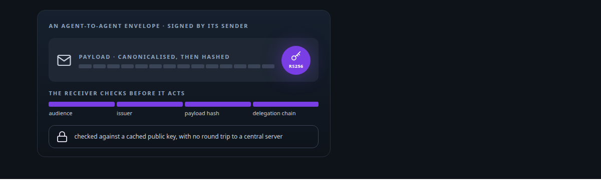
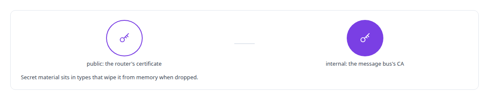
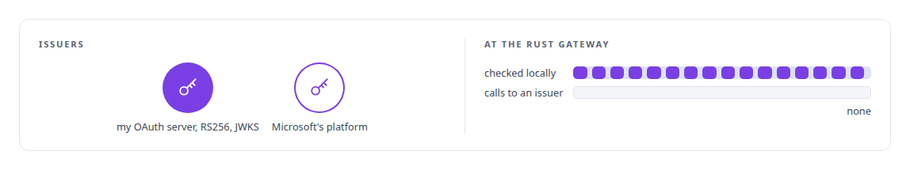
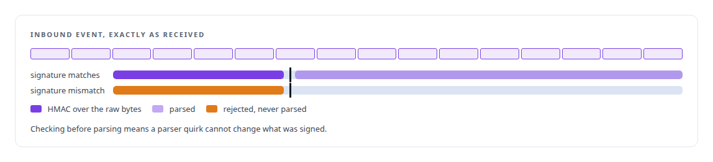
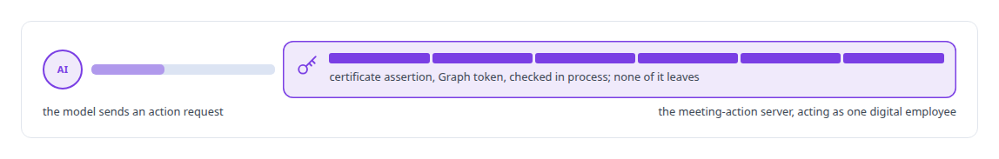

# Applied cryptography

**I apply cryptography where it buys attribution and non-repudiation, and I do not invent primitives.**

Canonical: https://coreyjames.ai/technologies/applied-cryptography/  
Author: Corey James · Published: 2026-10-28 · Kind: technology  
Systems: [Agent Swarm](https://github.com/coreyjames-ai/agent-swarm) · [Auth and access plane](https://github.com/coreyjames-ai/auth-and-access-plane) · [FAFOHive](https://github.com/coreyjames-ai/fafohive) · [Helix](https://github.com/coreyjames-ai/helix)  
Skills: [OAuth 2.0 and identity architecture](https://github.com/coreyjames-ai/portfolio/tree/main/skills/oauth-2-0-and-identity-architecture) · [Microsoft 365, Graph and Entra integration](https://github.com/coreyjames-ai/portfolio/tree/main/skills/microsoft-365-graph-and-entra-integration) · [tool synthesis and governed API integration](https://github.com/coreyjames-ai/portfolio/tree/main/skills/tool-synthesis-and-governed-api-integration) · [distributed systems correctness](https://github.com/coreyjames-ai/portfolio/tree/main/skills/distributed-systems-correctness)  



## What was built

Signed agent-to-agent envelopes, certificate-based token minting for Microsoft identities, signed webhooks and signed event feeds. I place each check where it runs on every call, and every construction is standard, RS256, HMAC and X.509 certificate assertions from maintained libraries.

## Signed messages between agents

[Agent Swarm](https://coreyjames.ai/systems/agent-swarm) lets agents delegate to each other, and I wanted every request to carry proof of who sent it. I sign wherever attribution matters, so agent messages, access tokens and event feeds each carry a provable sender. Each agent-to-agent envelope is signed as a [JWT](https://coreyjames.ai/technologies/json-web-token-jwt) with the sending agent's own key, and verification is local, which keeps signature checks off the latency path of stream messaging. The protocol around these envelopes is on the [Agent Client Protocol (ACP)](https://coreyjames.ai/technologies/agent-client-protocol-acp) page. The router's public certificate and the message bus's internal CA are separate trust anchors, so rotating or losing one leaves the other intact.



## Tokens checked offline at the gateway

[Auth and access plane](https://coreyjames.ai/systems/auth-and-access-plane) issues [OAuth 2.0](https://coreyjames.ai/technologies/oauth-2-0) tokens to commercial AI assistants, and my tool gateway has to accept them on every call without asking the issuer each time. Verifying locally against published keys keeps it cheap enough to run on every message.



For the same server I built a hash-chained audit log, in which each entry commits to the one before it, and privacy-preserving device fingerprints that are HMAC-hashed, with IP addresses anonymised.

## Webhooks checked before parsing

[FAFOHive](https://coreyjames.ai/systems/fafohive) receives events from social platforms and must not trust a forged one. The Facebook receiver checks every request before it parses a byte of it.



In the other direction, the social modules publish a signed event feed, so a consumer can attribute each event to the service that emitted it. The inbound side is on the [Webhook ingestion and verification](https://coreyjames.ai/technologies/webhook-ingestion-and-verification) page.

## A key the model never holds

[Helix](https://coreyjames.ai/systems/helix) acts in Teams meetings as one specific Microsoft 365 digital employee, and the model that decides what to do must never hold that employee's credential. The meeting-action server mints the employee's Graph tokens on the server. The identity work is told in [Solving the digital-employee identity](https://coreyjames.ai/stories/solving-the-digital-employee-identity).




> The model asks for an action; the server holds the key.

## What was verified

Each line is a claim the canonical page supports, with the figure as the page states it.

- Message signing for multi-agent systems: each agent-to-agent envelope signed as an RS256 JWT with the sending agent's own key and checked locally, off the latency path of stream messaging.
- OAuth 2.0 and identity architecture: an authorization server signing RS256 tokens published as JWKS, and a Rust gateway validating tokens from more than one issuer offline on every call.
- Webhook security: an HMAC computed over the raw request body before any parsing, so a parser quirk cannot change what was signed.
- Credential isolation for AI agents: Graph tokens for a Microsoft 365 digital employee minted on the server from X.509 certificate assertions; the model asks for actions and never holds the key.

## Related

- [Solving the digital-employee identity](https://github.com/coreyjames-ai/helix/tree/main/stories/solving-the-digital-employee-identity) · https://coreyjames.ai/stories/solving-the-digital-employee-identity/
- [JSON Web Token (JWT)](https://github.com/coreyjames-ai/portfolio/tree/main/technologies/json-web-token-jwt) · https://coreyjames.ai/technologies/json-web-token-jwt/
- [Agent Client Protocol (ACP)](https://github.com/coreyjames-ai/portfolio/tree/main/technologies/agent-client-protocol-acp) · https://coreyjames.ai/technologies/agent-client-protocol-acp/
- [OAuth 2.0](https://github.com/coreyjames-ai/portfolio/tree/main/technologies/oauth-2-0) · https://coreyjames.ai/technologies/oauth-2-0/
- [Webhook ingestion and verification](https://github.com/coreyjames-ai/portfolio/tree/main/technologies/webhook-ingestion-and-verification) · https://coreyjames.ai/technologies/webhook-ingestion-and-verification/
- System: [Agent Swarm](https://github.com/coreyjames-ai/agent-swarm)
- System: [Auth and access plane](https://github.com/coreyjames-ai/auth-and-access-plane)
- System: [FAFOHive](https://github.com/coreyjames-ai/fafohive)
- System: [Helix](https://github.com/coreyjames-ai/helix)

## Citation

Corey James. "Applied cryptography." coreyjames.ai, 2026. https://coreyjames.ai/technologies/applied-cryptography/

```bibtex
@misc{coreyjames-applied-cryptography,
  author = {Corey James},
  title = {Applied cryptography},
  year = {2026},
  howpublished = {\url{https://coreyjames.ai/technologies/applied-cryptography/}},
  note = {GitHub copy: https://github.com/coreyjames-ai/portfolio/tree/main/technologies/applied-cryptography}
}
```

Part of [Corey James's portfolio](https://github.com/coreyjames-ai/portfolio) · site: https://coreyjames.ai/ · MCP server: https://coreyjames.ai/mcp · agent card: https://coreyjames.ai/.well-known/agent.json
