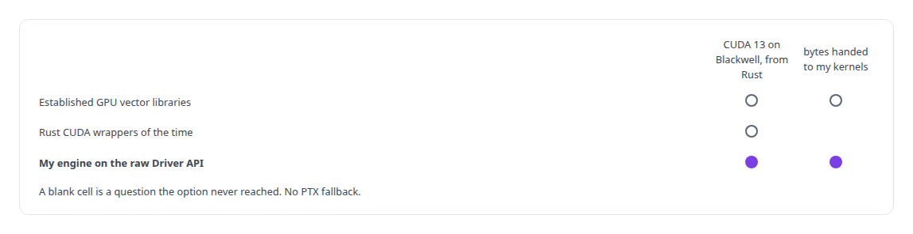
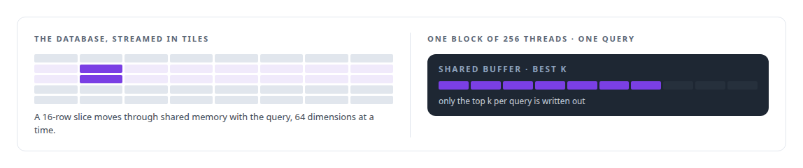
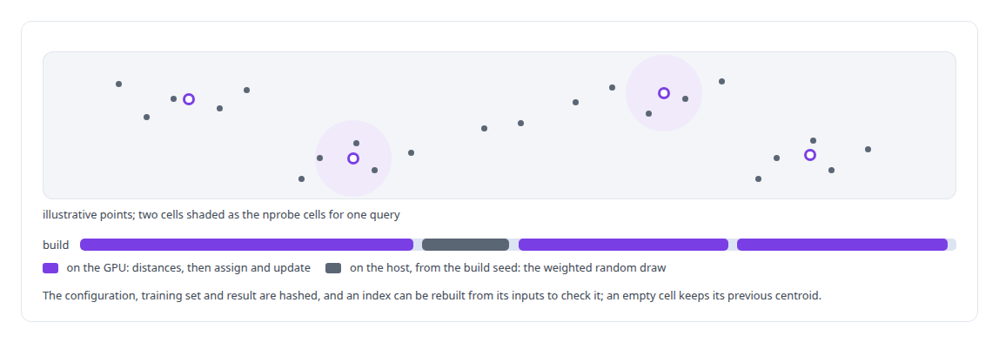
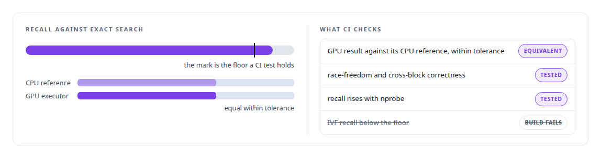
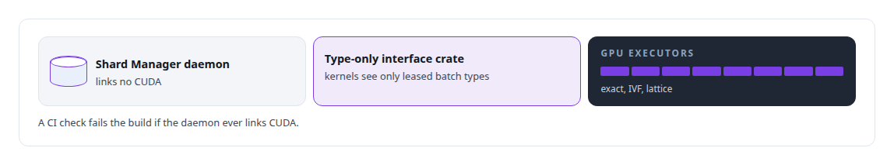

# Approximate nearest-neighbour search

**I built exact, inverted-file and lattice nearest-neighbour search as GPU kernels with CPU references and equivalence tests, inside a vector store whose index builds are deterministic and whose search reports its own health.**

Canonical: https://coreyjames.ai/technologies/approximate-nearest-neighbour-search/  
Author: Corey James · Published: 2026-10-28 · Kind: technology  
Systems: [Inference Fabric](https://github.com/coreyjames-ai/inference-fabric)  
Skills: [CUDA kernel development](https://github.com/coreyjames-ai/portfolio/tree/main/skills/cuda-kernel-development) · [vector search and ANN indexes](https://github.com/coreyjames-ai/portfolio/tree/main/skills/vector-search-and-ann-indexes) · [GPU inference optimisation](https://github.com/coreyjames-ai/portfolio/tree/main/skills/gpu-inference-optimisation) · [AI-assisted engineering methodology](https://github.com/coreyjames-ai/portfolio/tree/main/skills/ai-assisted-engineering-methodology)  


## Result

| Figure | What it measures |
| --- | --- |
| **0.85** | IVF recall at 10 against exact search, the floor a CI test holds |
| **128** | largest k; cosine, dot product and L2 are entry points in one binary |
| **1e-4** | relative tolerance between each GPU executor and its CPU reference |

## What was built

I write first-party GPU search when the available libraries cannot meet the platform, and I hold it to exact references and CI recall floors from the first kernel.

## Why I wrote the search myself

[Inference Fabric](https://coreyjames.ai/systems/inference-fabric) produced bulk embedding and hidden-state vectors that I wanted searched and analysed on the GPU where they were stored. The established GPU vector libraries gave me search and whole-dataset clustering, and could not reach the platform. I wrote the search myself: a [CUDA](https://coreyjames.ai/technologies/cuda-c-plus-plus) engine driven from [Rust](https://coreyjames.ai/technologies/rust) through the raw [CUDA Driver API](https://coreyjames.ai/technologies/cuda-driver-api), compiled for the [NVIDIA Blackwell GPU](https://coreyjames.ai/technologies/nvidia-blackwell-gpus) generation.



## The exact kernel

The exact kernel scores every vector against the query and never materialises a score matrix.



## One top-k engine for every family

All search families share one top-k engine. It accepts either a score row per query or a set of partial top-k lists, and merges in two passes through a workspace. I kept cooperative launches and grid-wide synchronisation out of it. Ties break on the candidate's position, so the same inputs always produce the same ranking.


## IVF-flat and lattice search

IVF-flat is the first approximate family. At query time one block per query walks every centroid, keeps the best nprobe cells, and scores their posting lists through the shared top-k engine. Seeding on the CPU makes its index builds reproducible bit for bit.



Lattice search runs the same idea in two levels over the clustered structures the distillation pipelines build. The first level picks the nearest cluster centroids for each query. The second launches one block per query and selected cluster, scores that cluster's members, and writes a partial top-k in the exact layout the shared engine merges. There is no lattice-specific reducer to maintain.

## Held to references in CI

Every executor has a CPU reference implementation and equivalence tests, with a relative tolerance wide enough that f32 reduction order does not cause false failures. A CI integration test holds IVF recall against exact search on clustered data, so a recall regression fails the build.




## Inside the vector store

The Vector Shard Manager is the store the search runs inside, and storage and kernels change independently. It reports the health of the clusters a query searched alongside the results. This engine replaced an earlier path that ran [FAISS](https://coreyjames.ai/technologies/faiss) from Python over vectors pulled through SQL.



> Exact search is the reference that every approximate family is measured against in CI.

## What was verified

Each line is a claim the canonical page supports, with the figure as the page states it.

- Vector search and ANN indexes: exact, IVF-flat and lattice nearest-neighbour search as CUDA kernels driven from Rust through the Driver API, sharing one top-k engine whose ties break on position.
- CUDA kernel development: an exact search kernel with one block of 256 threads per query streaming 16-row tiles through shared memory and writing only the top k, for k up to 128.
- Numerical equivalence testing for GPU code: every executor checked against a CPU reference at a relative tolerance of 1e-4 and a CI test holding IVF recall at 10 at 0.85 against exact search.
- Reproducible ML pipelines: IVF index builds that are bit-reproducible, seeded on the host outside floating-point reduction and rebuildable from their hashed inputs.

## Related

- [CUDA C++](https://github.com/coreyjames-ai/portfolio/tree/main/technologies/cuda-c-plus-plus) · https://coreyjames.ai/technologies/cuda-c-plus-plus/
- [Rust](https://github.com/coreyjames-ai/portfolio/tree/main/technologies/rust) · https://coreyjames.ai/technologies/rust/
- [CUDA Driver API](https://github.com/coreyjames-ai/portfolio/tree/main/technologies/cuda-driver-api) · https://coreyjames.ai/technologies/cuda-driver-api/
- [NVIDIA Blackwell GPUs](https://github.com/coreyjames-ai/portfolio/tree/main/technologies/nvidia-blackwell-gpus) · https://coreyjames.ai/technologies/nvidia-blackwell-gpus/
- [FAISS](https://github.com/coreyjames-ai/portfolio/tree/main/technologies/faiss) · https://coreyjames.ai/technologies/faiss/
- System: [Inference Fabric](https://github.com/coreyjames-ai/inference-fabric)

## Citation

Corey James. "Approximate nearest-neighbour search." coreyjames.ai, 2026. https://coreyjames.ai/technologies/approximate-nearest-neighbour-search/

```bibtex
@misc{coreyjames-approximate-nearest-neighbour-search,
  author = {Corey James},
  title = {Approximate nearest-neighbour search},
  year = {2026},
  howpublished = {\url{https://coreyjames.ai/technologies/approximate-nearest-neighbour-search/}},
  note = {GitHub copy: https://github.com/coreyjames-ai/portfolio/tree/main/technologies/approximate-nearest-neighbour-search}
}
```

Part of [Corey James's portfolio](https://github.com/coreyjames-ai/portfolio) · site: https://coreyjames.ai/ · MCP server: https://coreyjames.ai/mcp · agent card: https://coreyjames.ai/.well-known/agent.json
