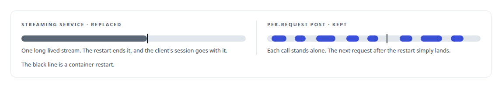
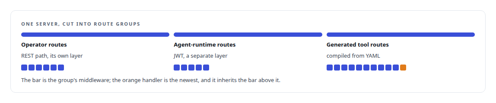
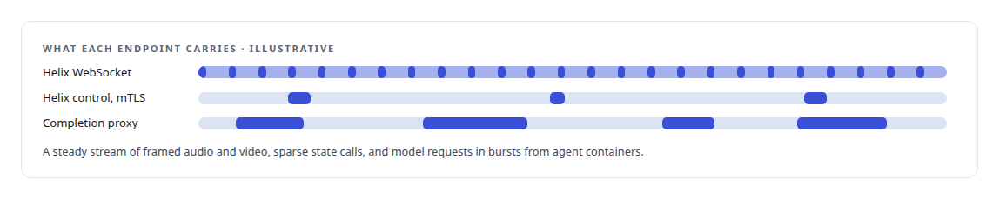

# Axum

**Axum is the HTTP layer under most of my Rust services: the memory gateway, the voice engine's control surface, the execution substrate's endpoints.**

Canonical: https://coreyjames.ai/technologies/axum/  
Author: Corey James · Published: 2026-10-28 · Kind: technology  
Systems: [FAFOHive](https://github.com/coreyjames-ai/fafohive) · [FAFO Core and Function Forge](https://github.com/coreyjames-ai/fafo-core) · [Helix](https://github.com/coreyjames-ai/helix) · [Agent Swarm](https://github.com/coreyjames-ai/agent-swarm)  
Skills: [Rust systems engineering](https://github.com/coreyjames-ai/portfolio/tree/main/skills/rust-systems-engineering) · [MCP server design](https://github.com/coreyjames-ai/portfolio/tree/main/skills/mcp-server-design) · [tool synthesis and governed API integration](https://github.com/coreyjames-ai/portfolio/tree/main/skills/tool-synthesis-and-governed-api-integration) · [inference serving architecture](https://github.com/coreyjames-ai/portfolio/tree/main/skills/inference-serving-architecture)  


## Result

| Figure | What it measures |
| --- | --- |
| **~70** | REST endpoints in FAFOHive's API, beside its MCP transport |
| **19,000** | lines in that API module |
| **1,900** | lines in Helix's WebSocket endpoint for media frames |
| **2 min** | timeout for the code-path explainer, one of the per-tool limits |

## What was built

### Replacing a transport that died on restart

[FAFOHive](https://coreyjames.ai/systems/fafohive) is one Rust process that every managed agent seat in my estate connects to, and Axum is its HTTP layer. It serves the MCP transport and a REST API.

The MCP transport started on the [rmcp](https://coreyjames.ai/technologies/rmcp-rust-mcp-sdk) SDK's streaming server-sent-events service, and that service broke whenever a container restarted. Container restarts are routine in my estate, so I replaced it with a per-request, TLS-terminated POST handler in Axum.



Long-running tools get their own timeouts, sized to what each tool does, so one slow tool cannot hold a connection open indefinitely.

### A gateway whose routes are generated

[FAFO Core and Function Forge](https://coreyjames.ai/systems/fafo-core) needed a gateway that turns any generated function into an agent-callable tool without someone editing a router by hand. The gateway is an Axum server implementing [MCP](https://coreyjames.ai/technologies/model-context-protocol-mcp) as [JSON-RPC](https://coreyjames.ai/technologies/json-rpc) 2.0 over HTTP: POST and GET on the MCP route, the well-known MCP configuration, OAuth protected-resource metadata and session ids.

Tool routing is generated at build time from [YAML](https://coreyjames.ai/technologies/yaml), so a function minted by Function Forge becomes a tool after a rebuild and the router stays out of the edit path.



The API integration platform I built beside Core uses a stateless POST MCP transport on the same framework. The generator is described in [Tools that build tools, under governance](https://coreyjames.ai/stories/tools-that-build-tools-under-governance).

### Endpoints for media, state and model access

[Helix](https://coreyjames.ai/systems/helix) joins a Windows media service to a Linux voice engine, and the Linux end of that bridge is an Axum endpoint; the bridge is told in [A self-hosted colleague in a Teams call](https://coreyjames.ai/stories/a-self-hosted-colleague-in-a-teams-call). [Agent Swarm](https://coreyjames.ai/systems/agent-swarm)'s persona launcher exposes its HTTP surfaces through Axum too.



I use Axum and Tower as published and have not patched the framework.


> My work with Axum is in transport choice, routing and middleware structure.

## What was verified

Each line is a claim the canonical page supports, with the figure as the page states it.

- Rust web services with Axum: the HTTP layer of an MCP server with ~70 REST endpoints in a 19,000-line API module, beside the MCP transport.
- MCP server design: a streaming transport that broke on container restart replaced with a per-request, TLS-terminated POST handler, with per-tool timeouts such as 2 min for the code-path explainer.
- API gateway design: a gateway whose MCP tool routes are generated from YAML at build time, with authentication applied as middleware per route group so new handlers inherit it.

## Related

- [A self-hosted colleague in a Teams call](https://github.com/coreyjames-ai/helix/tree/main/stories/a-self-hosted-colleague-in-a-teams-call) · https://coreyjames.ai/stories/a-self-hosted-colleague-in-a-teams-call/
- [Tools that build tools, under governance](https://github.com/coreyjames-ai/fafo-core/tree/main/stories/tools-that-build-tools-under-governance) · https://coreyjames.ai/stories/tools-that-build-tools-under-governance/
- [rmcp (Rust MCP SDK)](https://github.com/coreyjames-ai/portfolio/tree/main/technologies/rmcp-rust-mcp-sdk) · https://coreyjames.ai/technologies/rmcp-rust-mcp-sdk/
- [Model Context Protocol (MCP)](https://github.com/coreyjames-ai/portfolio/tree/main/technologies/model-context-protocol-mcp) · https://coreyjames.ai/technologies/model-context-protocol-mcp/
- [JSON-RPC](https://github.com/coreyjames-ai/portfolio/tree/main/technologies/json-rpc) · https://coreyjames.ai/technologies/json-rpc/
- [YAML](https://github.com/coreyjames-ai/portfolio/tree/main/technologies/yaml) · https://coreyjames.ai/technologies/yaml/
- System: [FAFOHive](https://github.com/coreyjames-ai/fafohive)
- System: [FAFO Core and Function Forge](https://github.com/coreyjames-ai/fafo-core)
- System: [Helix](https://github.com/coreyjames-ai/helix)
- System: [Agent Swarm](https://github.com/coreyjames-ai/agent-swarm)

## Citation

Corey James. "Axum." coreyjames.ai, 2026. https://coreyjames.ai/technologies/axum/

```bibtex
@misc{coreyjames-axum,
  author = {Corey James},
  title = {Axum},
  year = {2026},
  howpublished = {\url{https://coreyjames.ai/technologies/axum/}},
  note = {GitHub copy: https://github.com/coreyjames-ai/portfolio/tree/main/technologies/axum}
}
```

Part of [Corey James's portfolio](https://github.com/coreyjames-ai/portfolio) · site: https://coreyjames.ai/ · MCP server: https://coreyjames.ai/mcp · agent card: https://coreyjames.ai/.well-known/agent.json
