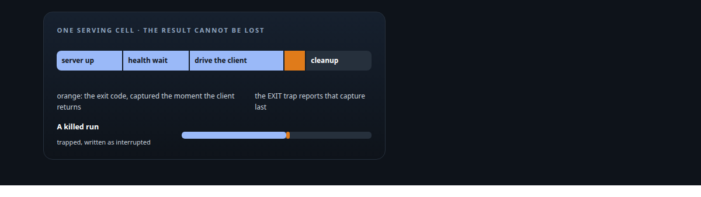
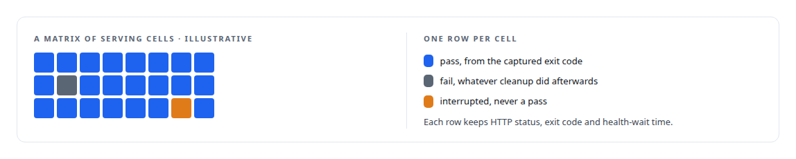
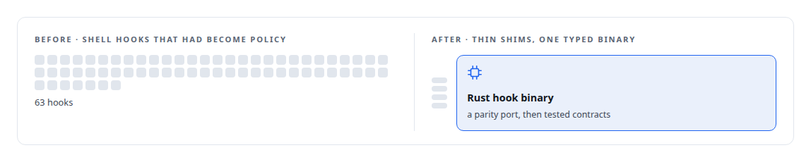
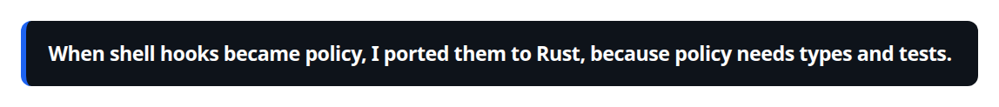
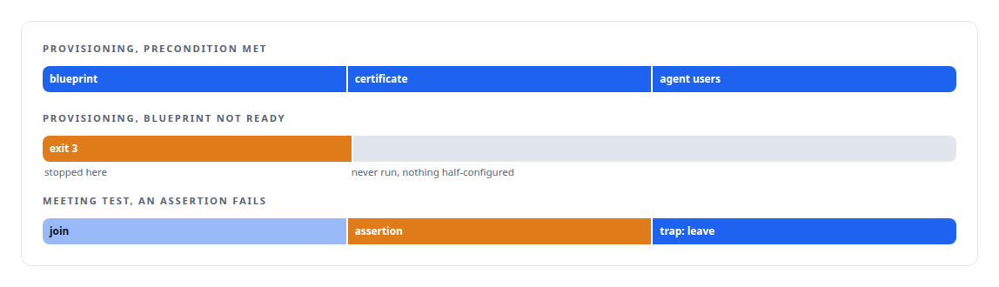
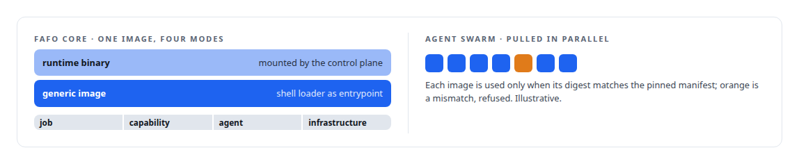

# Bash

**Test harnesses, release scripts, proof runs and service glue across every system are shell.**

Canonical: https://coreyjames.ai/technologies/bash/  
Author: Corey James · Published: 2026-10-28 · Kind: technology  
Systems: [ActiveKV](https://github.com/coreyjames-ai/activekv) · [AgentOS](https://github.com/coreyjames-ai/agentos) · [Helix](https://github.com/coreyjames-ai/helix) · [FAFO Core and Function Forge](https://github.com/coreyjames-ai/fafo-core) · [Agent Swarm](https://github.com/coreyjames-ai/agent-swarm)  
Skills: [Microsoft 365, Graph and Entra integration](https://github.com/coreyjames-ai/portfolio/tree/main/skills/microsoft-365-graph-and-entra-integration) · [exactly-once delivery and crash recovery](https://github.com/coreyjames-ai/portfolio/tree/main/skills/exactly-once-delivery-and-crash-recovery) · [tool synthesis and governed API integration](https://github.com/coreyjames-ai/portfolio/tree/main/skills/tool-synthesis-and-governed-api-integration)  



## Result

| Figure | What it measures |
| --- | --- |
| **316** | shell scripts in ActiveKV, most of them validation and release harnesses |
| **32** | probes against the AgentOS work graph |
| **11** | checks in the integration platform's conformance suite, about 1,100 lines |

## What was built

### Harnesses whose results cannot be lost

[ActiveKV](https://coreyjames.ai/systems/activekv) is judged by A/B runs on a quiet host, and a harness that misreports one cell can promote a regression. The main validation driver runs a matrix of serving cells, each named by prompt length, output length and concurrency.

I wanted the result impossible to lose, whatever happened to the run after the client returned.



The release payload's entrypoint is shell too: it selects serve and diagnostic modes and redacts credentials from its logs.

### The edge of a policy engine

[AgentOS](https://coreyjames.ai/systems/agentos) enforces policy through the coding CLI's hook system, and shell is its edge. Thin shims connect hook events to the Rust hook binary.





The contract suites for quality assurance and for the gatekeeper are shell, as are the probes against the [PostgreSQL](https://coreyjames.ai/technologies/postgresql) work graph. A probe that guards a fix is written to fail before the fix and pass after it.

### Provisioning that stops instead of half-finishing

[Helix](https://coreyjames.ai/systems/helix) needed a Microsoft 365 tenant provisioned repeatably. Tenant provisioning is portable bash, curl and [Microsoft Graph](https://coreyjames.ai/technologies/microsoft-graph), and each script stops with a specific exit code when a precondition is missing.

The test script for the meeting tools joins a real meeting and uses an EXIT trap so it always tries to leave. The Azure side of the media service is installed with PowerShell.



### Loaders and installers

[FAFO Core and Function Forge](https://coreyjames.ai/systems/fafo-core) runs any function in a generic container, so updating a function needs no image rebuild. The API integration platform's conformance suite is shell too, covering the key surface, profile schema, wire format, error classification and build outputs. [Agent Swarm](https://coreyjames.ai/systems/agent-swarm) member hosts are installed by scripts.



No core system logic lives in shell.

> When shell hooks became policy, I ported them to Rust, because policy needs types and tests.

## What was verified

Each line is a claim the canonical page supports, with the figure as the page states it.

- Test harness engineering: A/B validation harnesses across 316 shell scripts whose results survive failure, cleanup and interruption, with the exit code captured first and reported by an EXIT trap.
- Release and provisioning automation: Microsoft 365 tenant provisioning in bash, curl and Graph that stops with a specific exit code rather than leaving a half-configured identity.
- Quality engineering for AI-produced work: 32 probes against the AgentOS work graph and an 11-check conformance suite of about 1,100 lines, each probe written to fail before its fix.

## Related

- [A meeting attendee that will not fake it](https://github.com/coreyjames-ai/helix/tree/main/stories/a-meeting-attendee-that-will-not-fake-it) · https://coreyjames.ai/stories/a-meeting-attendee-that-will-not-fake-it/
- [PostgreSQL](https://github.com/coreyjames-ai/portfolio/tree/main/technologies/postgresql) · https://coreyjames.ai/technologies/postgresql/
- [Microsoft Graph](https://github.com/coreyjames-ai/portfolio/tree/main/technologies/microsoft-graph) · https://coreyjames.ai/technologies/microsoft-graph/
- System: [ActiveKV](https://github.com/coreyjames-ai/activekv)
- System: [AgentOS](https://github.com/coreyjames-ai/agentos)
- System: [Helix](https://github.com/coreyjames-ai/helix)
- System: [FAFO Core and Function Forge](https://github.com/coreyjames-ai/fafo-core)
- System: [Agent Swarm](https://github.com/coreyjames-ai/agent-swarm)

## Citation

Corey James. "Bash." coreyjames.ai, 2026. https://coreyjames.ai/technologies/bash/

```bibtex
@misc{coreyjames-bash,
  author = {Corey James},
  title = {Bash},
  year = {2026},
  howpublished = {\url{https://coreyjames.ai/technologies/bash/}},
  note = {GitHub copy: https://github.com/coreyjames-ai/portfolio/tree/main/technologies/bash}
}
```

Part of [Corey James's portfolio](https://github.com/coreyjames-ai/portfolio) · site: https://coreyjames.ai/ · MCP server: https://coreyjames.ai/mcp · agent card: https://coreyjames.ai/.well-known/agent.json
