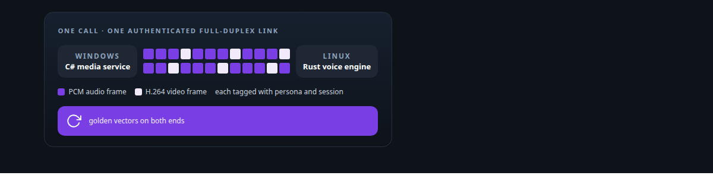
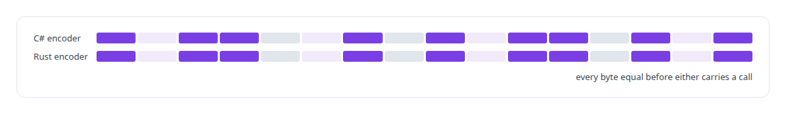
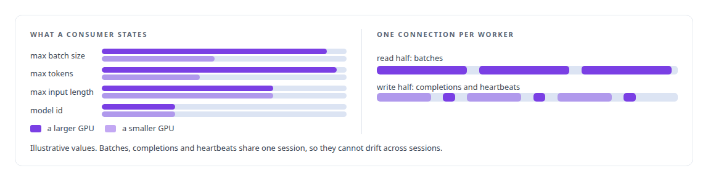
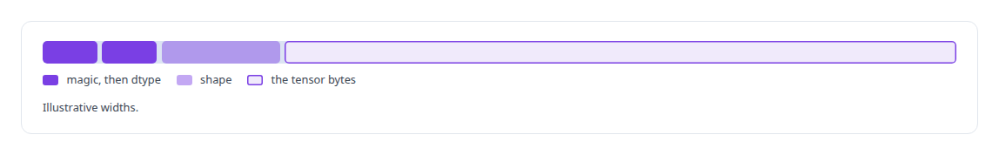
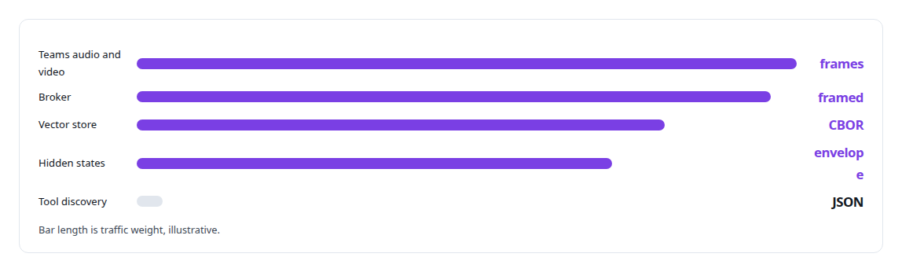
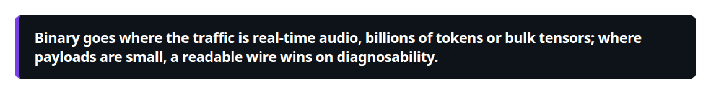

# Binary wire protocol design

**I design binary wire protocols when the problem needs them: the Teams audio link with byte-identical C# and Rust implementations, the broker's token-level transport, the vector store's RPC wire.**

Canonical: https://coreyjames.ai/technologies/binary-wire-protocol-design/  
Author: Corey James · Published: 2026-10-28 · Kind: technology  
Systems: [Helix](https://github.com/coreyjames-ai/helix) · [FAFO Core and Function Forge](https://github.com/coreyjames-ai/fafo-core) · [Inference Fabric](https://github.com/coreyjames-ai/inference-fabric) · [Capabilities model](https://github.com/coreyjames-ai/capabilities-model)  
Skills: [message broker and queue design](https://github.com/coreyjames-ai/portfolio/tree/main/skills/message-broker-and-queue-design) · [Microsoft Teams real-time media](https://github.com/coreyjames-ai/portfolio/tree/main/skills/microsoft-teams-real-time-media) · [Rust systems engineering](https://github.com/coreyjames-ai/portfolio/tree/main/skills/rust-systems-engineering)  



## Result

| Figure | What it measures |
| --- | --- |
| **4** | integers describe any GPU consumer to the broker |
| **33** | RPC variants on the vector store's CBOR wire |
| **16 MiB** | frame limit on that wire, with a streaming fetch for larger windows |

## What was built

I choose the wire per link from what the traffic costs and who has to debug it, and I prove cross-language implementations equal with golden vectors.

## One audio link, written twice

[Helix](https://coreyjames.ai/systems/helix) had to connect Microsoft's real-time media stack, which runs only on Windows, to my voice engine on Linux, without putting call audio in a third party's hands. I decided on a purpose-built binary link over one authenticated full-duplex [WebSocket](https://coreyjames.ai/technologies/websocket) per call, implemented twice, in [C#](https://coreyjames.ai/technologies/c-sharp) in the .NET media service and in [Rust](https://coreyjames.ai/technologies/rust) in the voice engine's endpoint.



When the link drops, the bridge reconnects inside the same Teams call. The bridge is told in [A self-hosted colleague in a Teams call](https://coreyjames.ai/stories/a-self-hosted-colleague-in-a-teams-call).

## Token-level transport for the broker

[Inference Fabric](https://coreyjames.ai/systems/inference-fabric) moves billions of tokens and bulk tensors between independently restartable services, and I gave those links binary framing over TCP. On the producer side, the [FAFO Core](https://coreyjames.ai/systems/fafo-core) inference client submits work to the broker routed by model id, so a producer can hand off millions of tokenised items and exit. The broker's protocol crate defines the work item, the packed batch and the message catalog.

The broker packs to a contract each GPU consumer states about itself, so different GPU models drain one backlog with no special cases. A GPU worker uses one connection, which replaced a design with two registrations per worker that once sent heartbeats to the wrong session and starved a working GPU.



The broker's protocol carries a version constant it never negotiates. The broker is told in [A message broker that understands tokens](https://coreyjames.ai/stories/a-message-broker-that-understands-tokens).

## Vectors and hidden states

The Vector Shard Manager speaks length-prefixed [CBOR](https://coreyjames.ai/technologies/cbor) over TCP, with a streaming fetch for moving windows of vectors between nodes. Hidden-state outputs travel in a self-describing binary envelope, which the broker carries opaquely from the GPU runtime to the vector store.



## Where I stayed out of binary

The tool-discovery engine in [Capabilities model](https://coreyjames.ai/systems/capabilities-model) listens on a [Unix domain socket](https://coreyjames.ai/technologies/unix-domain-sockets), and I chose newline-delimited JSON over a length-prefixed binary frame: the payloads are a few hundred bytes, so framing is not the cost, and an operator can drive the socket by hand and read the answer. Both ends serialise the same Rust types, and every request carries a version the engine reads before anything else, refusing an unknown one with a typed error. The engine reports a fingerprint of the tool catalog its decoder was built from, and a client whose own catalog hashes differently refuses to start and names both. The serving engine is in [A router beside a production model](https://coreyjames.ai/stories/a-router-beside-a-production-model).





> Binary goes where the traffic is real-time audio, billions of tokens or bulk tensors; where payloads are small, a readable wire wins on diagnosability.

## What was verified

Each line is a claim the canonical page supports, with the figure as the page states it.

- Binary protocol design: one audio and video link for Teams calls implemented in C# and Rust and proved byte-identical against golden vectors before either carries a call.
- Message broker and queue design: a token-level transport where any GPU consumer is described by 4 integers and one connection carries its batches, completions and heartbeats.
- RPC and serialisation design: a vector store wire of 33 length-prefixed CBOR RPC variants with a 16 MiB frame limit and a streaming fetch, and a readable JSON socket where payloads are small.

## Related

- [A self-hosted colleague in a Teams call](https://github.com/coreyjames-ai/helix/tree/main/stories/a-self-hosted-colleague-in-a-teams-call) · https://coreyjames.ai/stories/a-self-hosted-colleague-in-a-teams-call/
- [A message broker that understands tokens](https://github.com/coreyjames-ai/inference-fabric/tree/main/stories/a-message-broker-that-understands-tokens) · https://coreyjames.ai/stories/a-message-broker-that-understands-tokens/
- [Millions of queued items that were not there](https://github.com/coreyjames-ai/inference-fabric/tree/main/stories/millions-of-queued-items-that-were-not-there) · https://coreyjames.ai/stories/millions-of-queued-items-that-were-not-there/
- [A router beside a production model](https://github.com/coreyjames-ai/capabilities-model/tree/main/stories/a-router-beside-a-production-model) · https://coreyjames.ai/stories/a-router-beside-a-production-model/
- [WebSocket](https://github.com/coreyjames-ai/portfolio/tree/main/technologies/websocket) · https://coreyjames.ai/technologies/websocket/
- [C#](https://github.com/coreyjames-ai/portfolio/tree/main/technologies/c-sharp) · https://coreyjames.ai/technologies/c-sharp/
- [Rust](https://github.com/coreyjames-ai/portfolio/tree/main/technologies/rust) · https://coreyjames.ai/technologies/rust/
- [CBOR](https://github.com/coreyjames-ai/portfolio/tree/main/technologies/cbor) · https://coreyjames.ai/technologies/cbor/
- [Unix domain sockets](https://github.com/coreyjames-ai/portfolio/tree/main/technologies/unix-domain-sockets) · https://coreyjames.ai/technologies/unix-domain-sockets/
- System: [Helix](https://github.com/coreyjames-ai/helix)
- System: [FAFO Core and Function Forge](https://github.com/coreyjames-ai/fafo-core)
- System: [Inference Fabric](https://github.com/coreyjames-ai/inference-fabric)
- System: [Capabilities model](https://github.com/coreyjames-ai/capabilities-model)

## Citation

Corey James. "Binary wire protocol design." coreyjames.ai, 2026. https://coreyjames.ai/technologies/binary-wire-protocol-design/

```bibtex
@misc{coreyjames-binary-wire-protocol-design,
  author = {Corey James},
  title = {Binary wire protocol design},
  year = {2026},
  howpublished = {\url{https://coreyjames.ai/technologies/binary-wire-protocol-design/}},
  note = {GitHub copy: https://github.com/coreyjames-ai/portfolio/tree/main/technologies/binary-wire-protocol-design}
}
```

Part of [Corey James's portfolio](https://github.com/coreyjames-ai/portfolio) · site: https://coreyjames.ai/ · MCP server: https://coreyjames.ai/mcp · agent card: https://coreyjames.ai/.well-known/agent.json
