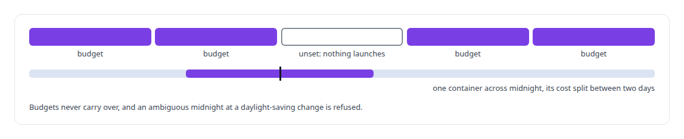
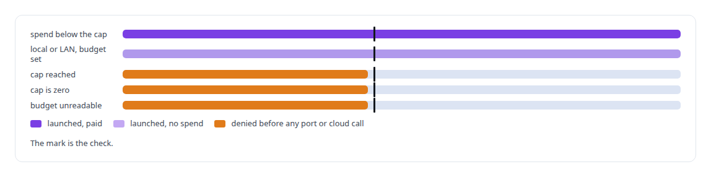
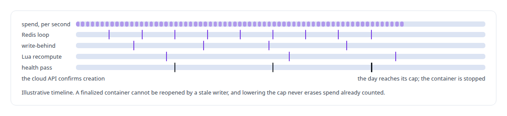
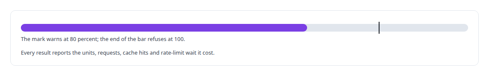
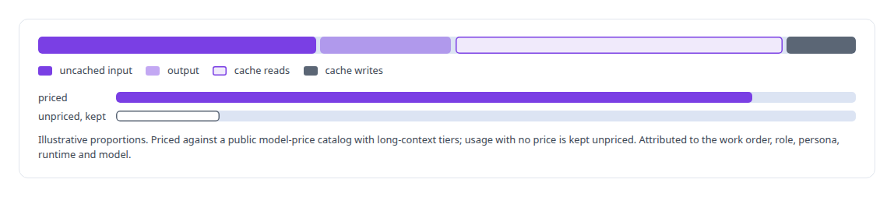

# Budget enforcement and cost governance

**Spend is a first-class control in my substrate: a fail-closed daily budget on GPU provisioning that agents cannot raise from inside the provisioning path, per-second accounting, and cost attributed to the work order that spent it.**

Canonical: https://coreyjames.ai/technologies/budget-enforcement-and-cost-governance/  
Author: Corey James · Published: 2026-10-28 · Kind: technology  
Systems: [FAFO Core and Function Forge](https://github.com/coreyjames-ai/fafo-core) · [Inference Fabric](https://github.com/coreyjames-ai/inference-fabric) · [Agent Swarm](https://github.com/coreyjames-ai/agent-swarm) · [Helix](https://github.com/coreyjames-ai/helix) · [FAFOHive](https://github.com/coreyjames-ai/fafohive) · [AgentOS](https://github.com/coreyjames-ai/agentos)  
Skills: [cost attribution for AI work](https://github.com/coreyjames-ai/portfolio/tree/main/skills/cost-attribution-for-ai-work) · [tool synthesis and governed API integration](https://github.com/coreyjames-ai/portfolio/tree/main/skills/tool-synthesis-and-governed-api-integration) · [distributed systems correctness](https://github.com/coreyjames-ai/portfolio/tree/main/skills/distributed-systems-correctness)  


## Result

| Figure | What it measures |
| --- | --- |
| **$0** | the cap on any day with no budget set |
| **1/100 ¢** | the precision of per-second spend accounting |
| **10 s** | between updates of per-container, per-schema and global spend |
| **30 s** | between health passes that stop paid containers at the cap |

## What was built

I build spend control into the path that spends, and I keep its key in human hands. Rented capacity and metered APIs get hard gates; model usage inside governed work gets attribution.

## A daily cap inside the provisioning path

Agents on [FAFO Core and Function Forge](https://coreyjames.ai/systems/fafo-core) can stand up GPU capacity, and a rented GPU bills from power-on whether anyone remembers it or not. I decided the spending limit would live inside the provisioning path, and that its only key would be a person at a terminal.

The limit is a daily dollar cap on the operator's calendar. A day runs from local midnight to local midnight in a timezone stored once, so every host computes the same day. Budgets are set per date or per date range, and every change lands in an audit table.



The cap is set with a command-line tool that only a person runs. That tool is the only code that writes budgets. No MCP tool on any gateway changes them, and nothing an agent passes to a provisioning call moves the cap.

## The launch check

Every container launch passes the check before a port is leased or a cloud call is made, so a refusal leaves nothing to clean up and setting the budget is the daily switch for all automated provisioning. Work that runs in-process never touches the gate.



[Inference Fabric](https://coreyjames.ai/systems/inference-fabric) GPU consumers, [Agent Swarm](https://coreyjames.ai/systems/agent-swarm) persona containers and [Helix](https://coreyjames.ai/systems/helix) render instances all pass this same gate. The persona launcher and the media controller treat any budget error as a refusal and spawn nothing. Admission compares actual spend with the cap, and the termination pass bounds any overshoot.


## Spend counted per second

Spend is accounted per second, starting the moment the cloud API confirms creation, because that is how the invoice is computed.



Spend is reported where it is spent. Terminating a node returns its final cost. The budget tool's status view shows the day's cap, spend and remaining budget, paid containers with their hourly rates, time to exhaustion, the next week's budgets and recent changes. Network-volume storage is synced from the provider and held to a monthly soft cap that only warns, because enforcing it would delete pre-warmed models.

## A metered API with its own budget

[FAFOHive](https://coreyjames.ai/systems/fafohive)'s in-house X module spends a metered data API. It keeps a monthly unit budget and reserves units before each call, reconciling the reservations against the vendor's own usage figures.



## Cost as telemetry in governed work

[AgentOS](https://coreyjames.ai/systems/agentos) attributes model usage to the work that spent it, taken from session transcripts and signed seat events. I ruled that cost inside governed work is telemetry and strategy, and removed a per-dispatch budget gate on quality-assurance work. The attribution design is on the [Cost attribution for AI work](https://coreyjames.ai/technologies/cost-attribution-for-ai-work) page, and the provisioning path is on the [Federated compute provisioning](https://coreyjames.ai/technologies/federated-compute-provisioning) page.



> I kept projections out of the check because an exact rule is easier to trust.

## What was verified

Each line is a claim the canonical page supports, with the figure as the page states it.

- Cost governance for cloud GPUs: a fail-closed daily cap checked before any port, container or cloud call, set only by a person at a terminal, and a cap of $0 on any day without a budget.
- Real-time spend accounting: per-second cost to a hundredth of a cent from the provider's confirmation, updated every 10 s in Redis, recomputed under a lock in Lua, paid containers stopped by a 30 s pass.
- API budget enforcement: units reserved before each call against a monthly budget and reconciled with the vendor's usage figures, warning at 80 percent and refusing at 100.
- Cost attribution for AI work: model usage split into token classes, priced against a public model-price catalog and attributed to the work order, role, persona, runtime and model that spent it.

## Related

- [Cost attribution for AI work](https://github.com/coreyjames-ai/portfolio/tree/main/technologies/cost-attribution-for-ai-work) · https://coreyjames.ai/technologies/cost-attribution-for-ai-work/
- [Federated compute provisioning](https://github.com/coreyjames-ai/portfolio/tree/main/technologies/federated-compute-provisioning) · https://coreyjames.ai/technologies/federated-compute-provisioning/
- System: [FAFO Core and Function Forge](https://github.com/coreyjames-ai/fafo-core)
- System: [Inference Fabric](https://github.com/coreyjames-ai/inference-fabric)
- System: [Agent Swarm](https://github.com/coreyjames-ai/agent-swarm)
- System: [Helix](https://github.com/coreyjames-ai/helix)
- System: [FAFOHive](https://github.com/coreyjames-ai/fafohive)
- System: [AgentOS](https://github.com/coreyjames-ai/agentos)

## Citation

Corey James. "Budget enforcement and cost governance." coreyjames.ai, 2026. https://coreyjames.ai/technologies/budget-enforcement-and-cost-governance/

```bibtex
@misc{coreyjames-budget-enforcement-and-cost-governance,
  author = {Corey James},
  title = {Budget enforcement and cost governance},
  year = {2026},
  howpublished = {\url{https://coreyjames.ai/technologies/budget-enforcement-and-cost-governance/}},
  note = {GitHub copy: https://github.com/coreyjames-ai/portfolio/tree/main/technologies/budget-enforcement-and-cost-governance}
}
```

Part of [Corey James's portfolio](https://github.com/coreyjames-ai/portfolio) · site: https://coreyjames.ai/ · MCP server: https://coreyjames.ai/mcp · agent card: https://coreyjames.ai/.well-known/agent.json
