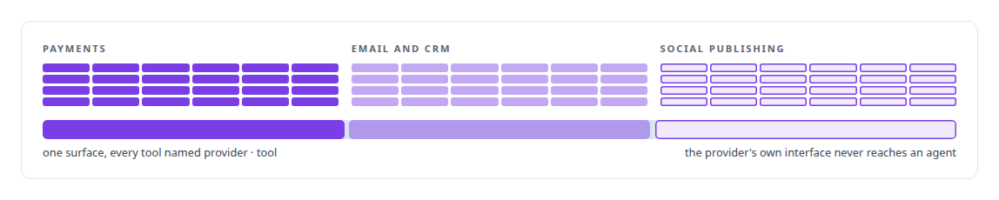
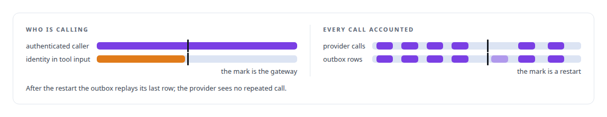
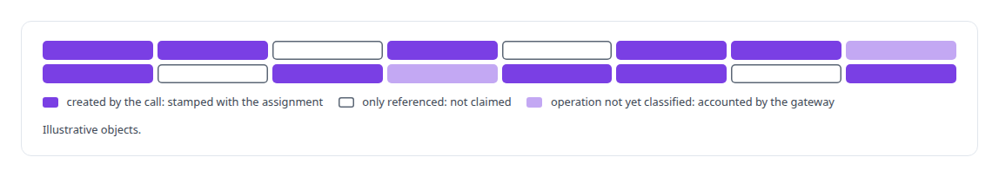

# Business-provider APIs rebuilt as governed agent tools

**Payments, email/CRM and social-publishing APIs, rebuilt operation by operation as governed agent tools under stable names, with credentials server-side, attribution where it round-trips and every call accounted.**

Canonical: https://coreyjames.ai/technologies/business-provider-apis-rebuilt-as-governed-agent-tools/  
Author: Corey James · Published: 2026-10-28 · Kind: technology  
Systems: [FAFOHive](https://github.com/coreyjames-ai/fafohive)  
Skills: [exactly-once delivery and crash recovery](https://github.com/coreyjames-ai/portfolio/tree/main/skills/exactly-once-delivery-and-crash-recovery) · [tool synthesis and governed API integration](https://github.com/coreyjames-ai/portfolio/tree/main/skills/tool-synthesis-and-governed-api-integration) · [distributed systems correctness](https://github.com/coreyjames-ai/portfolio/tree/main/skills/distributed-systems-correctness) · [multi-agent governance](https://github.com/coreyjames-ai/portfolio/tree/main/skills/multi-agent-governance)  


## Result

| Figure | What it measures |
| --- | --- |
| **354** | agent tools behind the FAFOHive gateway |
| **3** | commercial providers rebuilt as tools |
| **0** | provider keys in any agent's context |

## What was built

Identity, attribution and durable accounting are designed in rather than bolted on. The services belong to the providers; the tools, the gateway, the capability tables and the attribution model are mine.

## Every operation, a tool contract of my own

[FAFOHive](https://coreyjames.ai/systems/fafohive) gives managed agents a payments provider, an email/CRM provider and a social-publishing provider as tools, and I decided no agent would ever hold a provider key. The tools are mine: each provider's API was rebuilt, operation by operation, as a tool contract with a stable name, so the surface agents see is designed rather than inherited.



My own X, Facebook and Reddit modules join through the same gateway under the same trust model, so agents see one surface. See [Agents with real tools and no keys](https://coreyjames.ai/stories/agents-with-real-tools-and-no-keys).

## Identity and keys stay on the server

Only authenticated, managed participants can call, and every call is accounted through an outbox.



## Attribution only where it round-trips

Each provider has an operation-level capability table, bound to the API version it was written against. The table decides whether attribution metadata goes into a create request and whether a returned object was created or only referenced, so attribution follows what an assignment made. On the email/CRM provider, metadata stamping stays off until each operation's contract is checked, and the gateway attributes those calls in its own accounting instead.




> Unclassified operations stay usable and accounted; blocking them would break agents on every provider change.

## What was verified

Each line is a claim the canonical page supports, with the figure as the page states it.

- Tool synthesis and governed API integration: payments, email and CRM, and social publishing APIs rebuilt operation by operation as 354 agent tools under stable names.
- Identity and least privilege for AI agents: the calling assignment derived from authentication on the server, never from tool input, and 0 provider keys in any agent's context.
- Exactly-once delivery and crash recovery: every provider call accounted through an outbox whose replay after a restart never calls the provider twice.
- Data provenance and attribution: operation-level capability tables bound to each API version decide when attribution is stamped and whether an object was created or only referenced.

## Related

- [Agents with real tools and no keys](https://github.com/coreyjames-ai/fafohive/tree/main/stories/agents-with-real-tools-and-no-keys) · https://coreyjames.ai/stories/agents-with-real-tools-and-no-keys/
- System: [FAFOHive](https://github.com/coreyjames-ai/fafohive)

## Citation

Corey James. "Business-provider APIs rebuilt as governed agent tools." coreyjames.ai, 2026. https://coreyjames.ai/technologies/business-provider-apis-rebuilt-as-governed-agent-tools/

```bibtex
@misc{coreyjames-business-provider-apis-rebuilt-as-governed-agent-tools,
  author = {Corey James},
  title = {Business-provider APIs rebuilt as governed agent tools},
  year = {2026},
  howpublished = {\url{https://coreyjames.ai/technologies/business-provider-apis-rebuilt-as-governed-agent-tools/}},
  note = {GitHub copy: https://github.com/coreyjames-ai/portfolio/tree/main/technologies/business-provider-apis-rebuilt-as-governed-agent-tools}
}
```

Part of [Corey James's portfolio](https://github.com/coreyjames-ai/portfolio) · site: https://coreyjames.ai/ · MCP server: https://coreyjames.ai/mcp · agent card: https://coreyjames.ai/.well-known/agent.json
