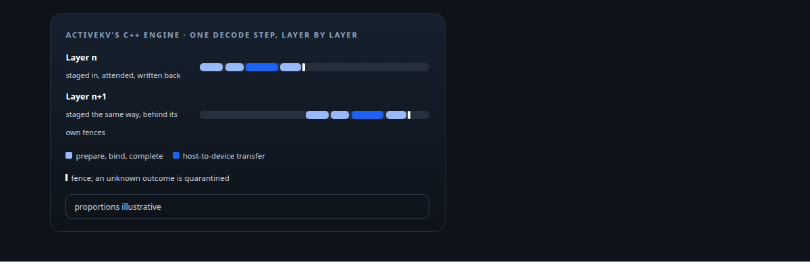
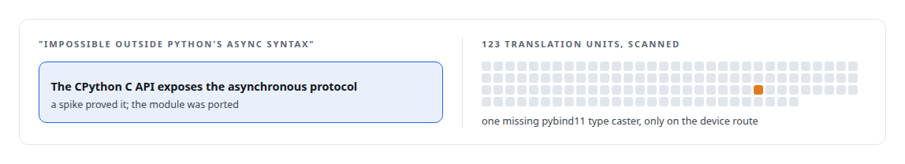
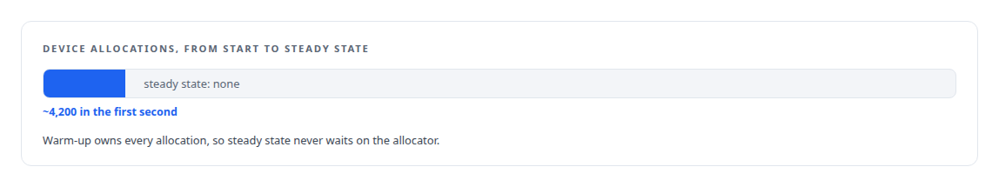

# C++

**ActiveKV's runtime is C++ throughout, ported from Python under bitwise-parity gates, and the Inference Fabric's TensorRT boundary is C++.**

Canonical: https://coreyjames.ai/technologies/c-plus-plus/  
Author: Corey James · Published: 2026-10-28 · Kind: technology  
Systems: [Inference Fabric](https://github.com/coreyjames-ai/inference-fabric) · [ActiveKV](https://github.com/coreyjames-ai/activekv)  
Skills: [C++ and native ports with parity proof](https://github.com/coreyjames-ai/portfolio/tree/main/skills/c-and-native-ports-with-parity-proof) · [TensorRT and TensorRT-LLM engineering](https://github.com/coreyjames-ai/portfolio/tree/main/skills/tensorrt-and-tensorrt-llm-engineering) · [inference serving architecture](https://github.com/coreyjames-ai/portfolio/tree/main/skills/inference-serving-architecture) · [GPU inference optimisation](https://github.com/coreyjames-ai/portfolio/tree/main/skills/gpu-inference-optimisation)  



## Result

| Figure | What it measures |
| --- | --- |
| **77,600** | lines of non-test C++ in ActiveKV's engine, across 361 source files |
| **568** | test files beside them |
| **17,900** | lines in the per-step layer that prepares, binds, transfers and completes each step |
| **9,500** | lines of C++ at the Inference Fabric's TensorRT boundary |

## What was built

### Porting ActiveKV's runtime out of Python

[ActiveKV](https://coreyjames.ai/systems/activekv) began as Python inside vLLM. That was the right way to find out whether keeping attention history in host RAM worked, and the wrong way to ship it: the per-token path was slow, and the product logic sat in readable source. I decided to move the whole runtime to C++ with bit-identical output as the gate.


The result is a C++ execution engine that loads as the [vLLM](https://coreyjames.ai/technologies/vllm) plugin entry point and binds to Python through [pybind11](https://coreyjames.ai/technologies/pybind11) and PyTorch's ATen. The hard problems are lifecycle problems under asynchronous DMA: staging regions are fence-protected leases with generation counters, and a fence whose outcome is unknown is quarantined and never reused.

The release payload holds no Python of mine. It is told in [Rewriting an engine extension without changing a token](https://coreyjames.ai/stories/rewriting-an-engine-extension-without-changing-a-token), and its parity method in [Proving a rewrite is the same system](https://coreyjames.ai/stories/proving-a-rewrite-is-the-same-system).


### Reasoning from the interpreter's contract

Every line of Python that stays has to cite the framework source line that requires it.

I also check that native code is on the served path, because a port can pass every test and still fall back to Python where it matters.



### Rules the vendor engine does not impose

[Inference Fabric](https://coreyjames.ai/systems/inference-fabric) needed a GPU runtime that stays saturated. The runtime is Rust with a C++ layer at the [NVIDIA TensorRT](https://coreyjames.ai/technologies/nvidia-tensorrt) boundary, built with CMake: the engine loader, the decode step, a pinned-memory allocator and a stream manager. The C++ enforces three rules the vendor engine does not: no device allocation after warm-up, which an Nsight profile shows; compute-stream synchronisation refused at run time; and no CUDA-graph capture on the runtime's own streams.



The hidden-state backend on raw TensorRT measures an under-documented plugin tensor convention at warm-up by running one micro-batch two ways, and an ambiguous answer stops the worker. See [From 44K to 163K tokens per second](https://coreyjames.ai/stories/from-44k-to-163k-tokens-per-second).

I use C++ where control of memory, lifecycle and the language boundary decides whether a system can be trusted. The fabric runtime uses NVIDIA's kernels with no custom model kernels, and ActiveKV's kernel work is separate, as SYCL patches to Intel's open stacks.

> Every optimisation waited until parity held, because a port that changes behaviour and speed at once cannot be trusted for either.

## What was verified

Each line is a claim the canonical page supports, with the figure as the page states it.

- C++ and native ports with parity proof: an inference engine extension moved from Python to 77,600 lines of non-test C++ across 361 source files, with 568 test files and bit-identical output as the gate.
- Native memory and lifecycle engineering: fence-protected staging leases with generation counters under asynchronous DMA, a fence of unknown outcome quarantined and never reused.
- TensorRT and TensorRT-LLM engineering: a 9,500-line C++ layer at the TensorRT boundary that allows no device allocation after warm-up and rejects compute-stream synchronisation at run time.

## Related

- [Rewriting an engine extension without changing a token](https://github.com/coreyjames-ai/activekv/tree/main/stories/rewriting-an-engine-extension-without-changing-a-token) · https://coreyjames.ai/stories/rewriting-an-engine-extension-without-changing-a-token/
- [Proving a rewrite is the same system](https://github.com/coreyjames-ai/activekv/tree/main/stories/proving-a-rewrite-is-the-same-system) · https://coreyjames.ai/stories/proving-a-rewrite-is-the-same-system/
- [Context beyond VRAM](https://github.com/coreyjames-ai/activekv/tree/main/stories/context-beyond-vram) · https://coreyjames.ai/stories/context-beyond-vram/
- [From 44K to 163K tokens per second](https://github.com/coreyjames-ai/inference-fabric/tree/main/stories/from-44k-to-163k-tokens-per-second) · https://coreyjames.ai/stories/from-44k-to-163k-tokens-per-second/
- [vLLM](https://github.com/coreyjames-ai/portfolio/tree/main/technologies/vllm) · https://coreyjames.ai/technologies/vllm/
- [pybind11](https://github.com/coreyjames-ai/portfolio/tree/main/technologies/pybind11) · https://coreyjames.ai/technologies/pybind11/
- [NVIDIA TensorRT](https://github.com/coreyjames-ai/portfolio/tree/main/technologies/nvidia-tensorrt) · https://coreyjames.ai/technologies/nvidia-tensorrt/
- System: [Inference Fabric](https://github.com/coreyjames-ai/inference-fabric)
- System: [ActiveKV](https://github.com/coreyjames-ai/activekv)

## Citation

Corey James. "C++." coreyjames.ai, 2026. https://coreyjames.ai/technologies/c-plus-plus/

```bibtex
@misc{coreyjames-c-plus-plus,
  author = {Corey James},
  title = {C++},
  year = {2026},
  howpublished = {\url{https://coreyjames.ai/technologies/c-plus-plus/}},
  note = {GitHub copy: https://github.com/coreyjames-ai/portfolio/tree/main/technologies/c-plus-plus}
}
```

Part of [Corey James's portfolio](https://github.com/coreyjames-ai/portfolio) · site: https://coreyjames.ai/ · MCP server: https://coreyjames.ai/mcp · agent card: https://coreyjames.ai/.well-known/agent.json
