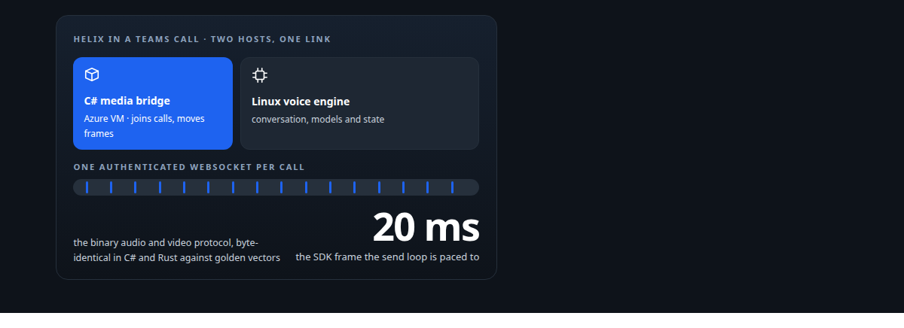
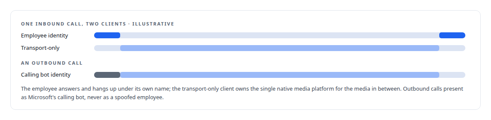
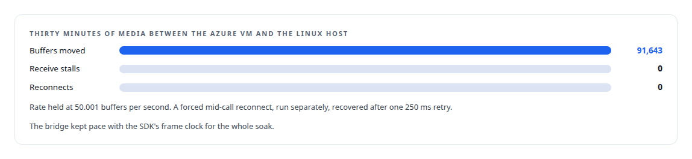
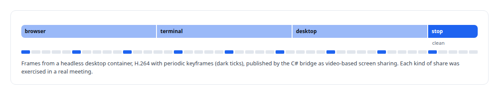
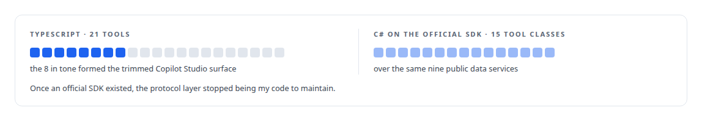

# C#

**The Windows side of my Teams integration is C# on .NET 8: a media service on Microsoft's real-time SDK, screen-share publication, and a product MCP server later ported to the official .NET SDK.**

Canonical: https://coreyjames.ai/technologies/c-sharp/  
Author: Corey James · Published: 2026-10-28 · Kind: technology  
Systems: [Helix](https://github.com/coreyjames-ai/helix) · [Auth and access plane](https://github.com/coreyjames-ai/auth-and-access-plane)  
Skills: [Microsoft Teams real-time media](https://github.com/coreyjames-ai/portfolio/tree/main/skills/microsoft-teams-real-time-media) · [MCP server design](https://github.com/coreyjames-ai/portfolio/tree/main/skills/mcp-server-design) · [tool synthesis and governed API integration](https://github.com/coreyjames-ai/portfolio/tree/main/skills/tool-synthesis-and-governed-api-integration)  



## Result

| Figure | What it measures |
| --- | --- |
| **6,400** | lines of .NET 8 in the media service's six-project solution |
| **100** | call-to-persona bindings exercised by its unit suite |
| **9,650** | lines in the weather MCP server, ported to the official C# SDK |

## What was built

### A narrow Windows bridge into Teams calls

[Helix](https://coreyjames.ai/systems/helix) had to put a self-hosted voice agent into Microsoft Teams calls, and Microsoft's real-time media stack runs only on Windows.


The service is .NET 8, a six-project solution covering host, calls, media, transport, contracts and unit tests, built on Microsoft's [real-time media SDK](https://coreyjames.ai/technologies/microsoft-real-time-media-sdk) and hosted on an [Azure](https://coreyjames.ai/technologies/microsoft-azure) virtual machine with managed identity and vault-held secrets. It handles the calling callbacks and call lifecycle, answers inbound calls and places outbound ones, and binds each call to a persona.



The identity side is told in [Solving the digital-employee identity](https://coreyjames.ai/stories/solving-the-digital-employee-identity).

### Moving frames without stalling the SDK

Media callbacks copy the frame and return immediately, so SDK threads never wait on the network. The transport has bounded queues on both sides of the socket, and the SDK's unmanaged audio send buffers are tracked and released explicitly, outside the garbage collector's timing.

The sender transmits only while the socket is active. On reconnect it drops microphone audio captured during the break, so the conversation resumes in real time instead of replaying a backlog.



The whole bridge is told in [A self-hosted colleague in a Teams call](https://coreyjames.ai/stories/a-self-hosted-colleague-in-a-teams-call).

### Sharing an agent's screen into the meeting

[Helix](https://coreyjames.ai/systems/helix) also lets an agent show its screen in a meeting, through [H.264](https://coreyjames.ai/technologies/h-264) frames the same bridge publishes.



### Porting an MCP server onto the official SDK

[Auth and access plane](https://coreyjames.ai/systems/auth-and-access-plane) includes a weather-intelligence MCP server I first wrote in [TypeScript](https://coreyjames.ai/technologies/typescript), with a local transport and a trimmed surface for [Microsoft Copilot Studio](https://coreyjames.ai/technologies/microsoft-copilot-studio). I ported it to C# on the official MCP C# SDK with the ASP.NET Core HTTP transport, using the .NET HTTP client factory and in-memory caching.



The media SDK, Teams, Graph and Agent 365 are Microsoft's, used as Microsoft ships them.

> I keep the Windows component narrow so the system's logic stays in one place.

## What was verified

Each line is a claim the canonical page supports, with the figure as the page states it.

- Microsoft Teams real-time media: a narrow .NET 8 media bridge of 6,400 lines on Microsoft's real-time media SDK that joins calls and moves frames, with all conversation state left in the Linux engine.
- Native interop in C#: media callbacks that copy and return at once, unmanaged audio buffers released outside the garbage collector, and a byte-identical binary protocol shared with Rust.
- MCP server design: a weather MCP server of 9,650 lines ported from TypeScript to the official C# SDK with the ASP.NET Core HTTP transport.

## Related

- [A self-hosted colleague in a Teams call](https://github.com/coreyjames-ai/helix/tree/main/stories/a-self-hosted-colleague-in-a-teams-call) · https://coreyjames.ai/stories/a-self-hosted-colleague-in-a-teams-call/
- [Solving the digital-employee identity](https://github.com/coreyjames-ai/helix/tree/main/stories/solving-the-digital-employee-identity) · https://coreyjames.ai/stories/solving-the-digital-employee-identity/
- [Microsoft real-time media SDK](https://github.com/coreyjames-ai/portfolio/tree/main/technologies/microsoft-real-time-media-sdk) · https://coreyjames.ai/technologies/microsoft-real-time-media-sdk/
- [Microsoft Azure](https://github.com/coreyjames-ai/portfolio/tree/main/technologies/microsoft-azure) · https://coreyjames.ai/technologies/microsoft-azure/
- [H.264](https://github.com/coreyjames-ai/portfolio/tree/main/technologies/h-264) · https://coreyjames.ai/technologies/h-264/
- [TypeScript](https://github.com/coreyjames-ai/portfolio/tree/main/technologies/typescript) · https://coreyjames.ai/technologies/typescript/
- [Microsoft Copilot Studio](https://github.com/coreyjames-ai/portfolio/tree/main/technologies/microsoft-copilot-studio) · https://coreyjames.ai/technologies/microsoft-copilot-studio/
- System: [Helix](https://github.com/coreyjames-ai/helix)
- System: [Auth and access plane](https://github.com/coreyjames-ai/auth-and-access-plane)

## Citation

Corey James. "C#." coreyjames.ai, 2026. https://coreyjames.ai/technologies/c-sharp/

```bibtex
@misc{coreyjames-c-sharp,
  author = {Corey James},
  title = {C#},
  year = {2026},
  howpublished = {\url{https://coreyjames.ai/technologies/c-sharp/}},
  note = {GitHub copy: https://github.com/coreyjames-ai/portfolio/tree/main/technologies/c-sharp}
}
```

Part of [Corey James's portfolio](https://github.com/coreyjames-ai/portfolio) · site: https://coreyjames.ai/ · MCP server: https://coreyjames.ai/mcp · agent card: https://coreyjames.ai/.well-known/agent.json
