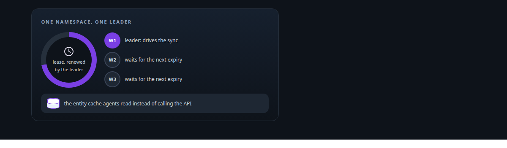
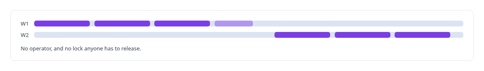
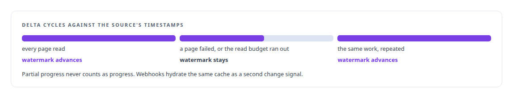
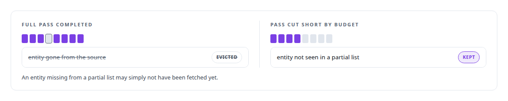
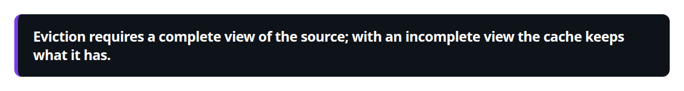

# Cache synchronisation and leader election

**The API integration platform keeps its cache coherent across workers and elects a leader for its sync worker.**

Canonical: https://coreyjames.ai/technologies/cache-synchronisation-and-leader-election/  
Author: Corey James · Published: 2026-10-28 · Kind: technology  
Systems: [FAFO Core and Function Forge](https://github.com/coreyjames-ai/fafo-core)  
Skills: [distributed systems correctness](https://github.com/coreyjames-ai/portfolio/tree/main/skills/distributed-systems-correctness)  



## What was built

I treat a cache that agents trust as replicated state with explicit rules for leadership, progress and deletion.

[FAFO Core and Function Forge](https://coreyjames.ai/systems/fafo-core) has a sibling platform I designed for putting any third-party or internal API behind a governed MCP server. Each API is described by a declarative connectivity profile, and agents read from a [Redis](https://coreyjames.ai/technologies/redis) cache of that API's entities, which spares the API a call on every agent request. That makes the cache the thing agents trust, so it has to follow the source. How it was built is told in [Closed by evidence](https://coreyjames.ai/stories/closed-by-evidence).

## One leader per namespace

Only one process may drive the sync for a namespace at a time. I chose a timer-driven singleton sync worker per namespace, elected through a Redis lease that expires on its own. A leader that dies stops renewing, and its successor takes over at the next expiry.



## Progress only on a full cycle

Each delta cycle fetches the entities changed since a watermark, a source timestamp. Reads are charged against the platform's read budget per page, metered by the sync worker and invisible to the connectors, so connectors stay budget-agnostic and the sync loop owns the cost in one place. A profile can use whichever change signal its API offers.



## Deletion only from a complete view

A periodic full pass removes entities that no longer exist at the source.





> Eviction requires a complete view of the source; with an incomplete view the cache keeps what it has.

## What was verified

Each line is a claim the canonical page supports, with the figure as the page states it.

- Distributed systems correctness: a Redis cache of third-party API entities kept coherent by a delta sync whose watermark advances only when a whole cycle succeeds.
- Leader election: one sync worker per namespace elected through a Redis lease that expires on its own, so a dead leader's successor takes over with no operator.
- Cache invalidation: eviction only after a complete enumeration of the source, so a pass cut short by its read budget deletes nothing.

## Related

- [Closed by evidence](https://github.com/coreyjames-ai/agentos/tree/main/stories/closed-by-evidence) · https://coreyjames.ai/stories/closed-by-evidence/
- [Redis](https://github.com/coreyjames-ai/portfolio/tree/main/technologies/redis) · https://coreyjames.ai/technologies/redis/
- System: [FAFO Core and Function Forge](https://github.com/coreyjames-ai/fafo-core)

## Citation

Corey James. "Cache synchronisation and leader election." coreyjames.ai, 2026. https://coreyjames.ai/technologies/cache-synchronisation-and-leader-election/

```bibtex
@misc{coreyjames-cache-synchronisation-and-leader-election,
  author = {Corey James},
  title = {Cache synchronisation and leader election},
  year = {2026},
  howpublished = {\url{https://coreyjames.ai/technologies/cache-synchronisation-and-leader-election/}},
  note = {GitHub copy: https://github.com/coreyjames-ai/portfolio/tree/main/technologies/cache-synchronisation-and-leader-election}
}
```

Part of [Corey James's portfolio](https://github.com/coreyjames-ai/portfolio) · site: https://coreyjames.ai/ · MCP server: https://coreyjames.ai/mcp · agent card: https://coreyjames.ai/.well-known/agent.json
