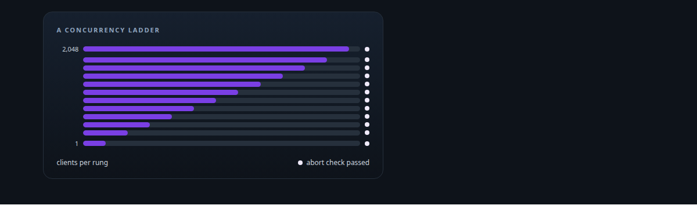
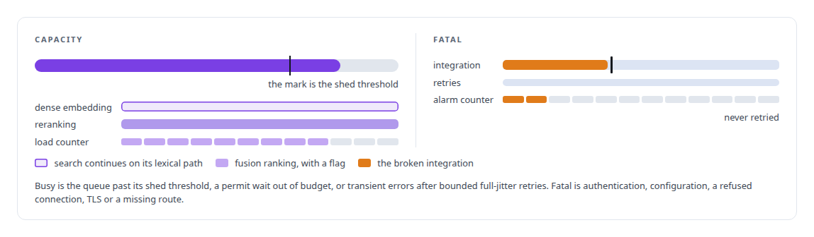
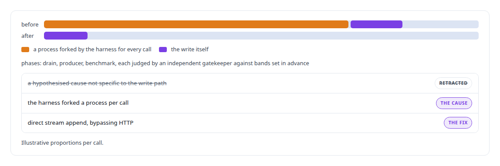
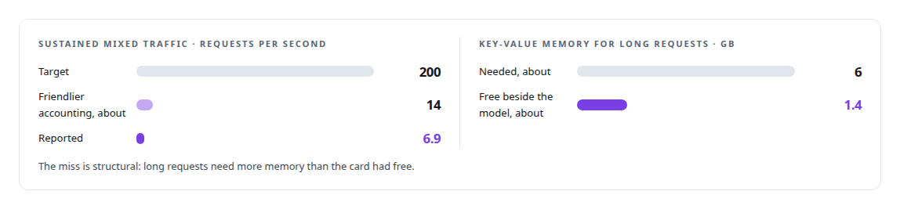

# Capacity engineering, backpressure and load testing

**I load-test what I build and report the misses: a 2,048-client ladder against a GPU decoder, bounded endpoints and saturating rerank in the memory service, and a pre-registered target I missed and explained.**

Canonical: https://coreyjames.ai/technologies/capacity-engineering-backpressure-and-load-testing/  
Author: Corey James · Published: 2026-10-28 · Kind: technology  
Systems: [FAFOHive](https://github.com/coreyjames-ai/fafohive) · [Capabilities model](https://github.com/coreyjames-ai/capabilities-model)  
Skills: [distributed systems correctness](https://github.com/coreyjames-ai/portfolio/tree/main/skills/distributed-systems-correctness)  



## Result

| Figure | What it measures |
| --- | --- |
| **85.9** | requests per second in a burst of 2,048 simultaneous clients |
| **0** | requests in that burst failed, rejected or corrupted |
| **2,740** | MiB, the decoder's memory budget beside a resident serving model |

## What was built

I engineer for the overloaded case first, make failure modes typed and distinct, and report capacity misses with their cause.

## Bounded endpoints under swarm load

[FAFOHive](https://coreyjames.ai/systems/fafohive) serves search to whole teams of agents at once, and under that concurrency its embedding and reranking endpoints saturate. I decided callers would never see a raw HTTP error from those endpoints, only a result or one of two typed outcomes, and I had both endpoints wrapped in a bounded-endpoint primitive to deliver that.



Embedding calls are gated only on cache misses, and observation writes have their own connection pool.

## When the benchmark was the bottleneck

[FAFOHive](https://coreyjames.ai/systems/fafohive) also had an observation write that looked slow under benchmark. Before I blame the system, I check that the measurement is not the bottleneck, so I ran the fix in phases that separated the drain, the producer and the benchmark.



## A ladder, and a target I missed

[Capabilities model](https://coreyjames.ai/systems/capabilities-model) had to serve thousands of concurrent agents from a decoder sharing an [NVIDIA Blackwell GPU](https://coreyjames.ai/technologies/nvidia-blackwell-gpus) with a resident serving model. I made two thousand concurrent clients a requirement and tested it with a ladder from one client to 2,048, with defined abort conditions at every rung. A failing rung stops the ladder, so a failure cannot be averaged into a headline.

The sustained target for mixed traffic was written down before the engine existed, and the engine missed it.



The full account is [A router beside a production model](https://coreyjames.ai/stories/a-router-beside-a-production-model).


> Writing the target down before the engine existed meant the miss could not be reframed afterwards.

## What was verified

Each line is a claim the canonical page supports, with the figure as the page states it.

- Load testing and capacity engineering: a concurrency ladder from 1 to 2,048 clients with abort conditions at every rung; a burst of 2,048 served at 85.9 requests per second with none failed.
- Backpressure design: bounded endpoints that return busy with a retry hint or a fatal error with its own alarm counter, so search degrades to lexical results instead of failing.
- Performance benchmarking methodology: a pre-registered sustained target of 200 requests per second reported as missed at 6.9 because about 6 GB of key-value memory was needed against 1.4 free.
- Benchmark harness debugging: a slow observation write traced to a benchmark harness that forked a process per call, with a hypothesised cause retracted.

## Related

- [A router beside a production model](https://github.com/coreyjames-ai/capabilities-model/tree/main/stories/a-router-beside-a-production-model) · https://coreyjames.ai/stories/a-router-beside-a-production-model/
- [NVIDIA Blackwell GPUs](https://github.com/coreyjames-ai/portfolio/tree/main/technologies/nvidia-blackwell-gpus) · https://coreyjames.ai/technologies/nvidia-blackwell-gpus/
- System: [FAFOHive](https://github.com/coreyjames-ai/fafohive)
- System: [Capabilities model](https://github.com/coreyjames-ai/capabilities-model)

## Citation

Corey James. "Capacity engineering, backpressure and load testing." coreyjames.ai, 2026. https://coreyjames.ai/technologies/capacity-engineering-backpressure-and-load-testing/

```bibtex
@misc{coreyjames-capacity-engineering-backpressure-and-load-testing,
  author = {Corey James},
  title = {Capacity engineering, backpressure and load testing},
  year = {2026},
  howpublished = {\url{https://coreyjames.ai/technologies/capacity-engineering-backpressure-and-load-testing/}},
  note = {GitHub copy: https://github.com/coreyjames-ai/portfolio/tree/main/technologies/capacity-engineering-backpressure-and-load-testing}
}
```

Part of [Corey James's portfolio](https://github.com/coreyjames-ai/portfolio) · site: https://coreyjames.ai/ · MCP server: https://coreyjames.ai/mcp · agent card: https://coreyjames.ai/.well-known/agent.json
