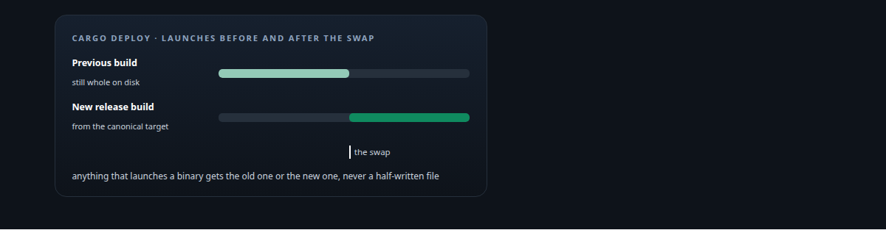
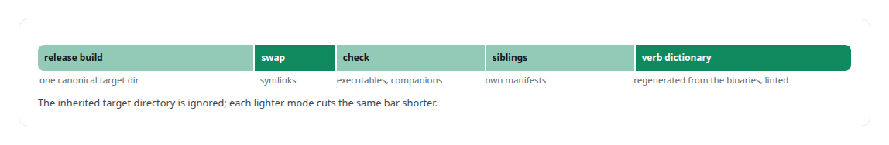
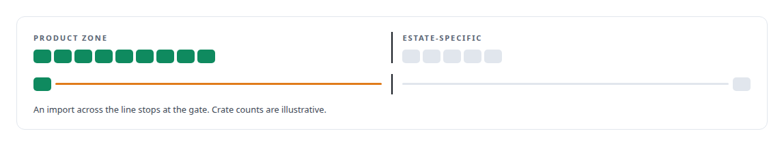
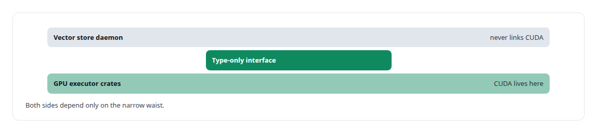
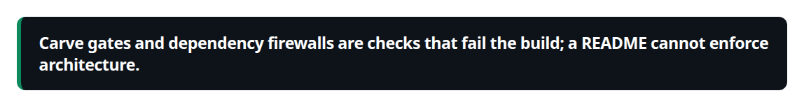

# Cargo

**Multi-crate workspaces, feature-gated builds and a carve gate that keeps product crates free of estate-specific imports.**

Canonical: https://coreyjames.ai/technologies/cargo/  
Author: Corey James · Published: 2026-10-28 · Kind: technology  
Systems: [AgentOS](https://github.com/coreyjames-ai/agentos) · [Agent Swarm](https://github.com/coreyjames-ai/agent-swarm) · [Inference Fabric](https://github.com/coreyjames-ai/inference-fabric)  
Skills: [Rust systems engineering](https://github.com/coreyjames-ai/portfolio/tree/main/skills/rust-systems-engineering) · [tool synthesis and governed API integration](https://github.com/coreyjames-ai/portfolio/tree/main/skills/tool-synthesis-and-governed-api-integration) · [distributed systems correctness](https://github.com/coreyjames-ai/portfolio/tree/main/skills/distributed-systems-correctness)  



## Result

| Figure | What it measures |
| --- | --- |
| **546,000** | lines of Rust in AgentOS |
| **19** | members in the AgentOS workspace |
| **23** | crates in Agent Swarm, split into a product zone and an estate zone |
| **3** | deploy modes besides the full run: dry-run, local-only, skip-build |

## What was built

### One deploy verb for people and agents

[AgentOS](https://coreyjames.ai/systems/agentos) is a [Rust](https://coreyjames.ai/technologies/rust) Cargo workspace that ships a manifest of binaries. I wanted one deploy path that nobody, human or agent, could get half right, in place of ad hoc copy steps across a multi-crate estate.

Deployment is a single Cargo verb, `cargo deploy`, built with the xtask pattern as a workspace member and wired in through a Cargo alias.



### A carve gate between product and estate

[Agent Swarm](https://coreyjames.ai/systems/agent-swarm) splits its crates into product-zone crates and estate-specific ones. I wanted the runtime separable from the estate it grew up in, so a scripted carve gate fails the check when a product-zone crate imports anything platform-specific.



### A CUDA firewall in the vector store

[Inference Fabric](https://coreyjames.ai/systems/inference-fabric) keeps CUDA out of its vector store's daemon, and a CI check enforces the boundary; alternate kernel tile sizes stay outside the default build, for benchmarking.





I use Cargo as published and have not extended it.

> Carve gates and dependency firewalls are checks that fail the build; a README cannot enforce architecture.

## What was verified

Each line is a claim the canonical page supports, with the figure as the page states it.

- Build and release engineering: one deploy verb for a 546,000-line Rust workspace of 19 members, publishing binaries by atomic symlink swap so nothing launches a half-written file.
- Architecture enforcement in the build: a carve gate across 23 crates that fails the check when a product crate imports estate-specific code, and a CI firewall keeping CUDA out of a storage daemon.

## Related

- [Rust](https://github.com/coreyjames-ai/portfolio/tree/main/technologies/rust) · https://coreyjames.ai/technologies/rust/
- System: [AgentOS](https://github.com/coreyjames-ai/agentos)
- System: [Agent Swarm](https://github.com/coreyjames-ai/agent-swarm)
- System: [Inference Fabric](https://github.com/coreyjames-ai/inference-fabric)

## Citation

Corey James. "Cargo." coreyjames.ai, 2026. https://coreyjames.ai/technologies/cargo/

```bibtex
@misc{coreyjames-cargo,
  author = {Corey James},
  title = {Cargo},
  year = {2026},
  howpublished = {\url{https://coreyjames.ai/technologies/cargo/}},
  note = {GitHub copy: https://github.com/coreyjames-ai/portfolio/tree/main/technologies/cargo}
}
```

Part of [Corey James's portfolio](https://github.com/coreyjames-ai/portfolio) · site: https://coreyjames.ai/ · MCP server: https://coreyjames.ai/mcp · agent card: https://coreyjames.ai/.well-known/agent.json
