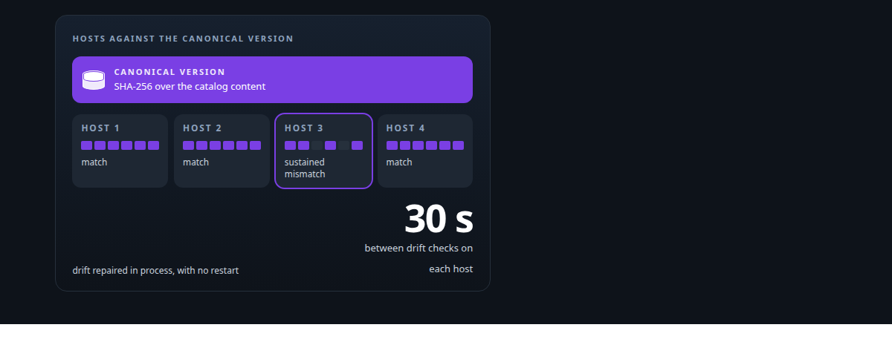
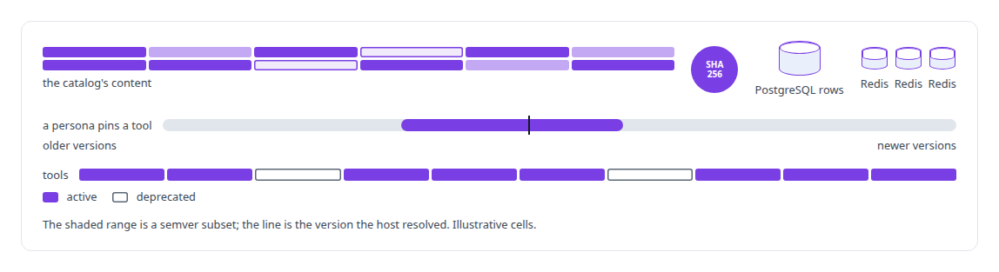
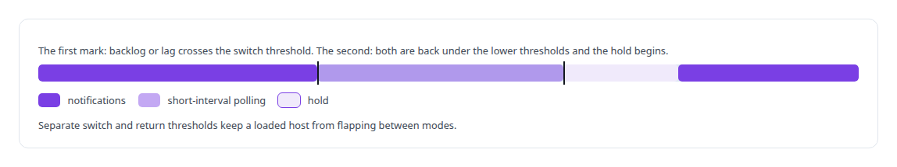
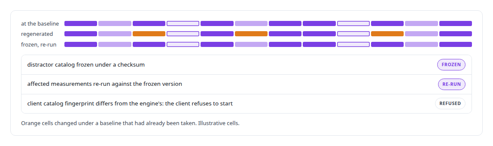
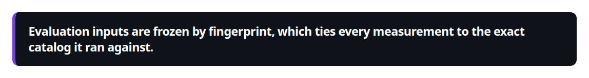

# Catalog versioning and drift detection

**Every host in my agent fleet runs the same approved tool catalog, verified by content hash, with drift detection that falls back from notifications to polling under measured thresholds and never flaps.**

Canonical: https://coreyjames.ai/technologies/catalog-versioning-and-drift-detection/  
Author: Corey James · Published: 2026-10-28 · Kind: technology  
Systems: [Agent Swarm](https://github.com/coreyjames-ai/agent-swarm) · [Capabilities model](https://github.com/coreyjames-ai/capabilities-model)  
Skills: [distributed systems correctness](https://github.com/coreyjames-ai/portfolio/tree/main/skills/distributed-systems-correctness) · [observability and alerting](https://github.com/coreyjames-ai/portfolio/tree/main/skills/observability-and-alerting)  



## What was built

I treat agent configuration with the same consistency engineering as replicated data.

## One catalog version on every host

[Agent Swarm](https://coreyjames.ai/systems/agent-swarm) changes personas and tools while agents run on several hosts, and I saw two ways that goes wrong: hosts silently diverge, and an old agent binds to a retired tool. I started with a catalog version that means the same thing everywhere.



Hot-reload actions on the persona launcher apply a new catalog without a restart, and no tool enters the catalog without its golden and attack fixtures. The approach is told in [Tools are the platform](https://coreyjames.ai/stories/tools-are-the-platform).

## Drift repair, and when to stop trusting notifications

A drift detector on each host compares its catalog with the canonical version and repairs a sustained mismatch by refetching and swapping the catalog atomically in process; only a sustained mismatch triggers repair, so a catalog mid-rollout is left alone. Changes normally arrive at once through PostgreSQL LISTEN/NOTIFY, and explicit backlog and lag thresholds decide when to stop trusting them. Polling everywhere would have been simpler and slower.



## Frozen inputs for measurement

[Capabilities model](https://coreyjames.ai/systems/capabilities-model) trains and evaluates a tool-routing model against a fixed catalog, where drift corrupts measurements. The synthetic distractor catalog was regenerated after a baseline had already been taken against it. I treated that as a defect.



Across the serving socket, the engine reports a fingerprint of the catalog its decoder was built from. The evaluation discipline is told in [The baseline that tied us](https://coreyjames.ai/stories/the-baseline-that-tied-us).



> Evaluation inputs are frozen by fingerprint, which ties every measurement to the exact catalog it ran against.

## What was verified

Each line is a claim the canonical page supports, with the figure as the page states it.

- Configuration drift detection: every host's tool catalog checked every 30 s against a SHA-256 content hash held in PostgreSQL and swapped atomically in process on a sustained mismatch.
- Event-driven change propagation: PostgreSQL LISTEN/NOTIFY with a fallback to polling past backlog and lag thresholds, and lower return thresholds with a hold so hosts never flap.
- ML evaluation methodology: an evaluation catalog frozen under a checksum after it drifted under a baseline, with the affected measurements re-run against the frozen version.

## Related

- [Tools are the platform](https://github.com/coreyjames-ai/agent-swarm/tree/main/stories/tools-are-the-platform) · https://coreyjames.ai/stories/tools-are-the-platform/
- [The baseline that tied us](https://github.com/coreyjames-ai/capabilities-model/tree/main/stories/the-baseline-that-tied-us) · https://coreyjames.ai/stories/the-baseline-that-tied-us/
- System: [Agent Swarm](https://github.com/coreyjames-ai/agent-swarm)
- System: [Capabilities model](https://github.com/coreyjames-ai/capabilities-model)

## Citation

Corey James. "Catalog versioning and drift detection." coreyjames.ai, 2026. https://coreyjames.ai/technologies/catalog-versioning-and-drift-detection/

```bibtex
@misc{coreyjames-catalog-versioning-and-drift-detection,
  author = {Corey James},
  title = {Catalog versioning and drift detection},
  year = {2026},
  howpublished = {\url{https://coreyjames.ai/technologies/catalog-versioning-and-drift-detection/}},
  note = {GitHub copy: https://github.com/coreyjames-ai/portfolio/tree/main/technologies/catalog-versioning-and-drift-detection}
}
```

Part of [Corey James's portfolio](https://github.com/coreyjames-ai/portfolio) · site: https://coreyjames.ai/ · MCP server: https://coreyjames.ai/mcp · agent card: https://coreyjames.ai/.well-known/agent.json
